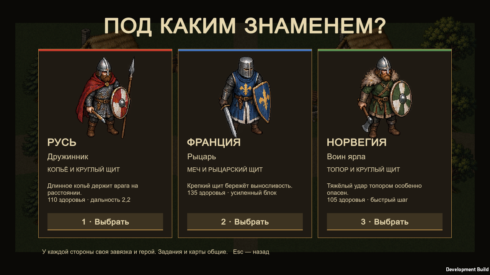
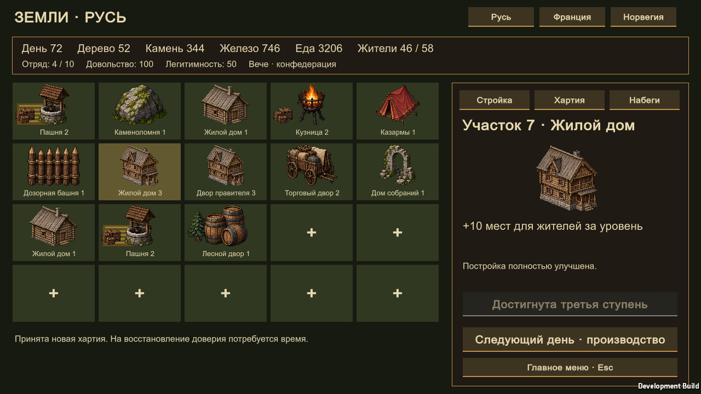
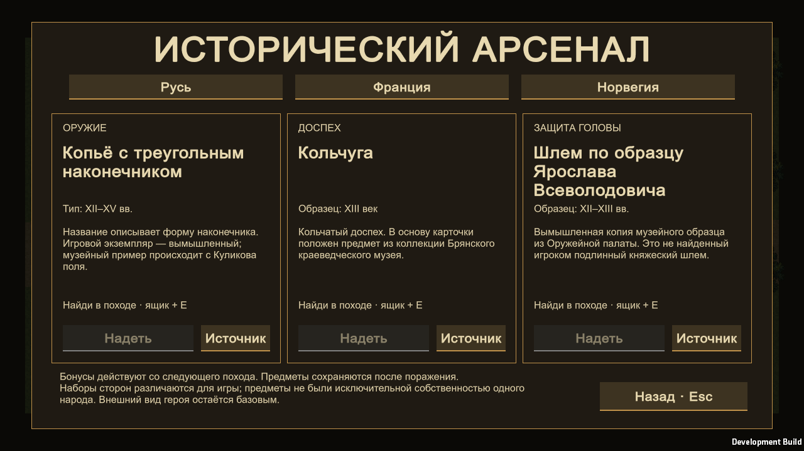

<div align="center">

# ASKICH · Клятва на границе

**Три знамени. Одна осаждённая земля.**

Средневековая 2D-арена: ближний бой, сюжетный поход и немного мистики.

Unity 6000.3.4f1 · C# · Windows x64 · Русский интерфейс

[Скачать Windows-версию](https://github.com/Asker323/askich/releases/latest) · [Проверки](docs/VALIDATION.md) · [Происхождение графики](docs/ART.md)

</div>



## Под каким знаменем?

- **Русь — дружинник.** Копьё, круглый щит и красный плащ. Большая дальность удара. Проведи княжеский обоз через Бережки и узнай, кому служит комендант крепости.
- **Франция — рыцарь.** Меч, синий сюрко и крепкий щит. Больше здоровья и экономный блок. Верни Сен-Рош под защиту короны, не забывая о людях за стенами.
- **Норвегия — воин ярла.** Топор, мех и зелёная одежда. Быстрый шаг и сильный тяжёлый удар. Доставь зимние запасы и раскрой предательство у фьорда.

У сторон разные герои, характеристики, прологи, названия заданий и эпилоги. Пять заданий и две карты используются совместно. Это вымышленное приключение по мотивам Средневековья, а не историческая реконструкция.

## Поход

1. Очисти поселение от разбойников.
2. Проведи обоз: он движется только рядом с героем и может быть уничтожен.
3. Проникни в крепость, освободи трёх пленных и разбей стражу.
4. Удержи ворота во время нападения.
5. Победи хранителя часовни и его людей.

После освобождения пленных брат Матье предлагает союз. Тамплиер присоединится к бою, если принять помощь ордена. Независимый путь даёт дополнительный урон и серебро. Выбор меняет заключительный диалог. Мистика связана с одной реликвией: основная борьба идёт с людьми.


## Бой и развитие

Лёгкий и тяжёлый удары, направленный блок, перекат с краткой неуязвимостью и выносливость. Враги показывают замах перед атакой; лучники стреляют стрелами, тяжёлые бойцы опасны вблизи. Здания и крупные предметы препятствуют движению.

Между заданиями походная кузница предлагает усилить оружие, доспех или запас сил. Серебро выпадает из врагов, выдаётся за спасение пленных и завершение заданий. Две цветовые отделки доспеха открываются за 180 и 520 серебра. Это косметические варианты окраски существующих спрайтов.

Кошелёк, открытая отделка, выбранная сторона, рекорд и отметки завершённых походов сохраняются. Текущий поход между запусками не сохраняется. Профиль версии 1.0 переносит валюту, покупки и рекорд.

## Поселения и исторический арсенал · 2.1

Полностью одиночный режим, без сервера и аренды. Для каждой стороны сохраняется своё поселение: 20 участков, 10 типов зданий, три ступени улучшений, дерево, камень, железо, еда, население и отряд. Жилые дома меняют спрайты по ступеням и культуре. Игровой день продвигается кнопкой; ресурсы и стройка не требуют ожидания в реальном времени.

Через развитие открываются реформы устройства и власти: единое управление или конфедерация; совет старейшин, единоличная власть или вече. Набеги на три поселения ИИ расходуют припасы и воинов, приносят добычу и учитывают выбранную тактику. Это расчётные бои с короткой анимацией, без прямого управления отрядами и без сетевой игры.



В походе выпадают девять исторически обоснованных предметов, по три на сторону. Подойди к ящику и нажми **E**. В арсенале выбери оружие, доспех и защиту головы; бонусы действуют со следующего похода. Есть датировки и ссылки на музейные источники. Экипировка пока не меняет части спрайта героя.



[Как развивать поселение](docs/SETTLEMENT.md) · [Исторические источники и условности](docs/HISTORY.md) · [Графика зданий](docs/SETTLEMENT-ART.md)

## Управление

- **WASD / стрелки:** движение; **мышь:** направление удара и щита.
- **ЛКМ:** лёгкий удар; **Q:** тяжёлый удар.
- **ПКМ:** держать щит; **пробел:** перекат.
- **E:** освободить пленного или подобрать предмет поблизости.
- **Esc:** пауза; **M:** звук.
- **Enter:** начать / продолжить диалог; **1–3:** герой или улучшение.

Скачай `Askich-Windows.zip` из Releases, распакуй целиком и запусти `Askich.exe`. Файл EXE должен оставаться рядом с папкой `Askich_Data` и DLL.

## Живость и Android

Воины имеют кадры ходьбы и удара, небольшую пластику движения и реакцию цветом на попадания. Деревья и палатки колышутся, огонь мерцает, по картам летят листья и пыль. У сторон разные оттенки окружения.

Добавлены сенсорный джойстик, кнопки боя и адаптация к безопасной области экрана. **Android пока подготовлен в исходниках: APK не собран, на телефоне не проверен.** В установленной Unity отсутствуют Android Build Support, SDK/NDK и OpenJDK. [Статус и сборка Android](docs/ANDROID.md).

## Сборка

Открой корень репозитория в **Unity 6000.3.4f1** с модулем Windows Build Support. Выбери **Askich → Build Windows**. По умолчанию результат попадёт в соседнюю папку `Askich-Windows`.

Для автоматической сборки:

```powershell
& 'C:\Program Files\Unity\Hub\Editor\6000.3.4f1\Editor\Unity.exe' `
  -batchmode -force-d3d11 -quit -projectPath $PWD `
  -buildTarget Win64 -executeMethod Askich.Editor.BuildGame.Windows `
  -logFile build.log
```

`ASKICH_BUILD_DIR` задаёт другую папку результата. `ASKICH_DEVELOPMENT=1` включает диагностическую сборку с интеграционными проверками; обычный релиз их не содержит. [Инструкция проверок](docs/TESTING.md).

Служебный `Hidden/Internal-Colored` исключён из Always Included Shaders: его сериализация вызывала сбой Unity. Сборщик проверяет это условие перед экспортом.

## Исходники

- `ArenaGame.cs` — симуляция, бой, противники, задания и сцены.
- `ArenaGame.UI.cs` — меню, выбор стороны, HUD и диалоги.
- `ArenaGame.Progression.cs` — решения, кузница и покупки.
- `CampaignData.cs` — сценарий и описания героев.
- `MedievalArt.cs` — атласы, кадры и окружение.
- `AskichProfile.cs` — сохранение и перенос старого профиля.
- `Assets/Editor/BuildGame.cs` — воспроизводимая Windows-сборка.

Сборка распространяется через Releases; кэш Unity и локальные данные не включены в репозиторий. Старый космический вариант остаётся в [релизе 1.0.0](https://github.com/Asker323/askich/releases/tag/v1.0.0).

Автор проекта: **Asker323**. Код, сценарий и графика подготовлены с помощью AI-инструментов. Происхождение изображений и точные запросы описаны в `docs/ART.md`.
