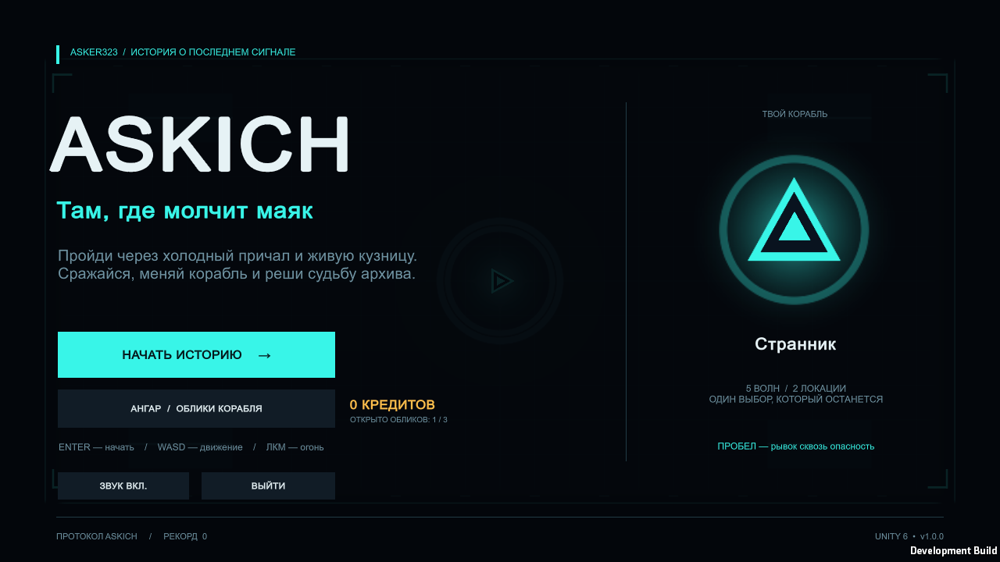
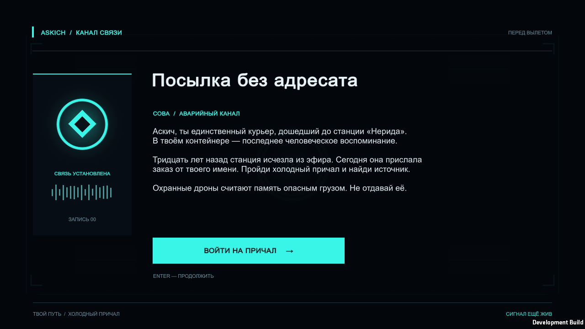
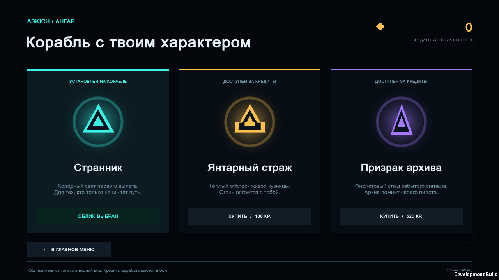
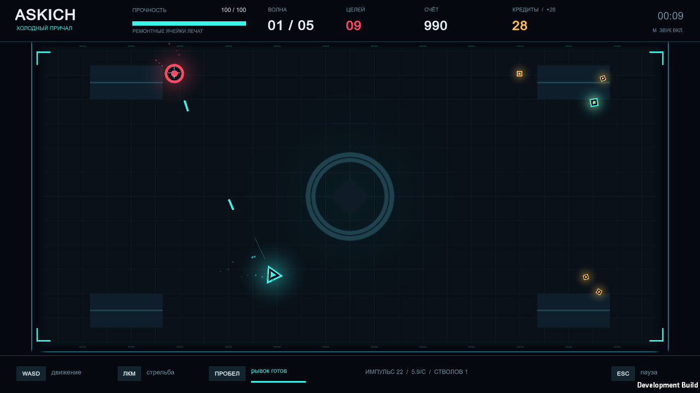
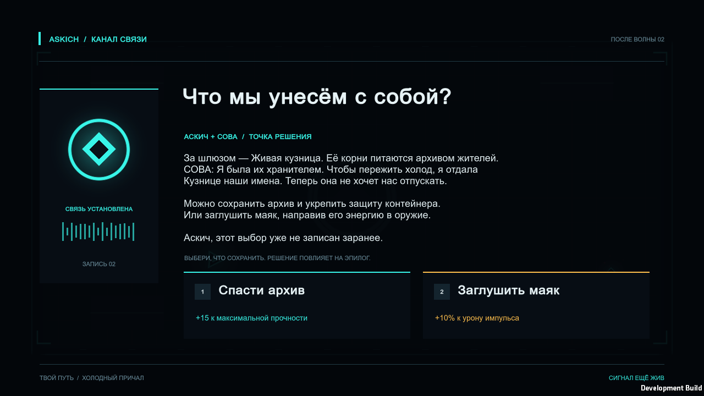
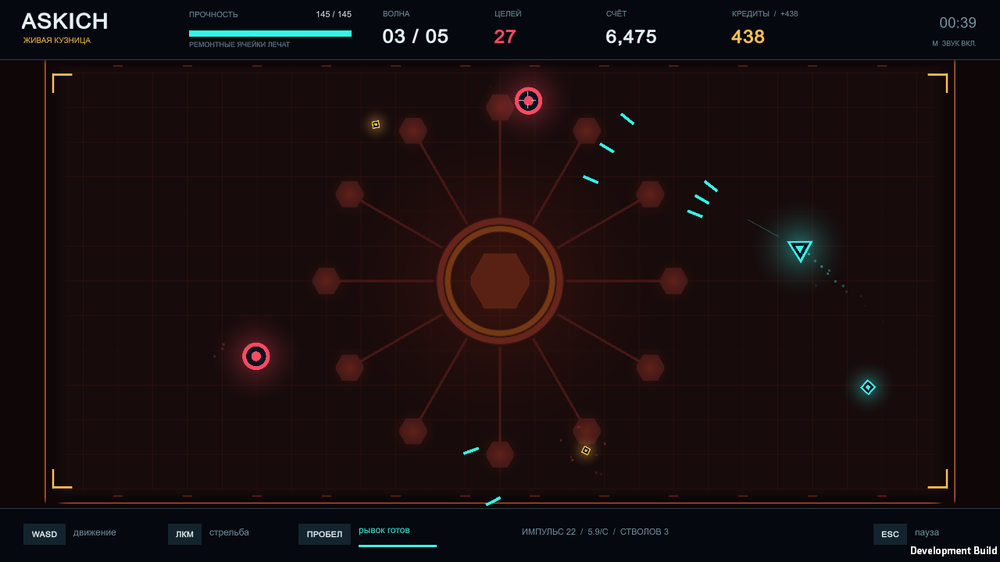

<div align="center">

# ASKICH

**Станция помнит. Выбирай, что останется после тебя.**

Сюжетная 2D-арена на Unity: пять волн, две локации и выбор, который меняет финал.

**Unity 6000.3.4f1 · C# · Windows x64 · Русский интерфейс**

[Скачать игру](https://github.com/Asker323/askich/releases/latest) · [Проверка версии](docs/VALIDATION.md) · [Сборка из исходников](#сборка)

</div>



<details>
<summary>Посмотреть сюжет, ангар и обе локации</summary>

Кадры реального автоматизированного игрового прогона диагностической сборки. В архиве релиза находится обычная Windows-сборка без диагностического кода.







</details>

## Сюжет

Курьер Аскич прибывает на потерянную станцию **«Нерида»**. Искусственный интеллект **СОВА** проводит его к охраняемому архиву памяти, пока защитные дроны пытаются остановить вторжение.

Путь начинается на ледяном промышленном **«Холодном причале»**, а после второй волны продолжается в биологической **«Живой кузнице»**. Между боями история раскрывает, что произошло со станцией. Сохранить архив или заглушить маяк — решение повлияет на способности героя и концовку.

## Что внутри

- Пять волн с тремя типами противников: преследователи, стрелки и тяжёлые дроны.
- Стрельба мышью, рывок с краткой защитой и ремонтные ячейки.
- Шесть типов боевых улучшений; после волны предлагаются три варианта на выбор.
- Две локации с разным цветом и окружением: причал на волнах 1–2, кузница на волнах 3–5.
- Сюжетные сцены, выбор после второй волны и зависящий от него финал.
- Постоянный кошелёк кредитов и ангар со скинами.
- Сохранение прогресса, рекорд, пауза, повторный запуск и скриншоты по F12.
- Процедурная геометрическая графика и синтезированный звук.

## Кредиты и ангар

Подбирай осколки, выпадающие из противников, чтобы заработать кредиты. Кошелёк сохраняется сразу: поражение не отнимает уже собранную валюту. После победы в волне оставшиеся осколки собираются автоматически, а также начисляется бонус `25 × номер волны`.

В ангаре доступны три облика:

- **Странник** — исходный бирюзовый облик, доступен бесплатно.
- **Янтарный страж** — золотой облик за **180 кредитов**.
- **Призрак архива** — фиолетовый облик за **520 кредитов**.

Два покупаемых скина меняют силуэт, цвет, выстрелы и след героя. Урон, здоровье и скорость от них не зависят. Покупки используют только заработанные в игре кредиты; платежей реальными деньгами нет.

## Запуск

### Готовая игра для Windows

1. Открой [последний релиз](https://github.com/Asker323/askich/releases/latest).
2. Скачай `Askich-Windows.zip` и распакуй весь архив.
3. Запусти **`Askich.exe`**.

Сохрани рядом с приложением `UnityPlayer.dll` и папку `Askich_Data`. Для игры Unity Editor не требуется. Контрольная сумма архива находится в `SHA256SUMS.txt` среди файлов релиза.

### В редакторе Unity

1. Установи **Unity 6000.3.4f1** через Unity Hub и активируй подходящую лицензию.
2. Склонируй репозиторий или распакуй архив исходников GitHub.
3. Добавь корневую папку проекта в Unity Hub и дождись импорта пакетов.
4. Открой `Assets/Scenes/Arena.unity`. Если сцены ещё нет, выбери **Askich → Prepare Project**.
5. Нажми **Play**.

Репозиторий содержит исходники, ресурсы, `.meta`, зависимости и настройки Unity. Готовая Windows-сборка публикуется отдельно в Releases.

## Управление

- **WASD / стрелки** — движение.
- **Мышь** — прицеливание; **левая кнопка мыши** — огонь с возможностью удержания.
- **Пробел / Shift** — рывок.
- **Esc / P** — пауза и продолжение боя.
- **M** — включить или выключить звук.
- **Enter** — начать игру или продолжить обычный диалог; **1 / 2** — сюжетный выбор.
- **1 / 2 / 3** — выбор предложенного улучшения.
- **R** — повторить забег после завершения.
- **F12** — сохранить скриншот.

Меню, сюжетные сцены и ангар управляются кнопками на экране. Следуй подсказкам интерфейса для перехода к следующему эпизоду.

## Сохранения

Профиль хранится локально в `profile.json` в каталоге данных игры Unity: `%USERPROFILE%\AppData\LocalLow\Asker323\Askich`. Там сохраняются кредиты, купленные скины и выбранный облик. Скриншоты находятся в подпапке `Screenshots`.

Сохранения не входят в репозиторий и архив игры. Перенеси `profile.json` отдельно, если хочешь сохранить прогресс на другом компьютере.

## Сборка

В Unity выбери **Askich → Build Windows**. Скрипт проверит правила боя и стартовую сцену, затем создаст рядом с проектом папку `Askich-Windows` с приложением `Askich.exe`.

Сборка из PowerShell, запущенного в папке проекта:

```powershell
& 'C:\Program Files\Unity\Hub\Editor\6000.3.4f1\Editor\Unity.exe' `
  -batchmode -quit -force-d3d11 `
  -projectPath $PWD.Path `
  -buildTarget StandaloneWindows64 `
  -executeMethod Askich.Editor.BuildGame.Windows `
  -logFile "$PWD\build.log"
```

Используется Mono для Windows x64. Переменная `ASKICH_BUILD_DIR` задаёт другой каталог сборки. Для диагностического player установи `ASKICH_DEVELOPMENT=1`; без неё создаётся release-сборка.

## Проверка и устройство проекта

Фактические результаты сборки и тестов находятся в [VALIDATION.md](docs/VALIDATION.md), а воспроизводимый сценарий проверки — в [TESTING.md](docs/TESTING.md).

```text
Assets/
  Editor/         подготовка сцены, проверки и сборка
  Scenes/         стартовая сцена Arena
  Scripts/        бой, сюжет, прогресс, интерфейс и эффекты
Packages/         версии зависимостей
ProjectSettings/  настройки Unity
docs/             проверка и иллюстрации
```

## Авторство и права

Проект **Asker323**, разработан при помощи Codex. Графика и звук генерируются кодом; платные сторонние ассеты не используются. Unity и его пакеты распространяются по собственным лицензиям.

© 2026 Asker323. Все права сохранены. Открытая лицензия на повторное использование кода и ресурсов проекта пока не предоставлена.

## English

**Askich** is a story-driven single-player arena shooter. A courier explores the lost station Nerida with guidance from the AI SOVA. Survive five waves across two locations, choose combat upgrades, earn persistent credits and unlock two cosmetic skins. A choice after the second wave affects your abilities and the ending.

The game uses **Unity 6000.3.4f1**, targets **Windows x64**, and has a Russian interface. Download the complete Windows archive from [Releases](https://github.com/Asker323/askich/releases/latest), or open the source project in Unity. Actual build and test results are documented in `docs/VALIDATION.md`.
