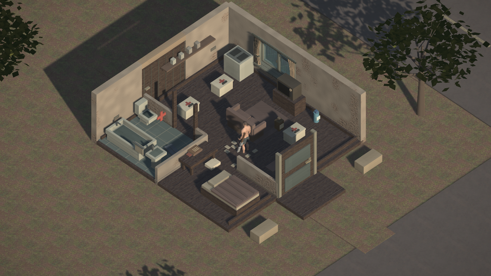
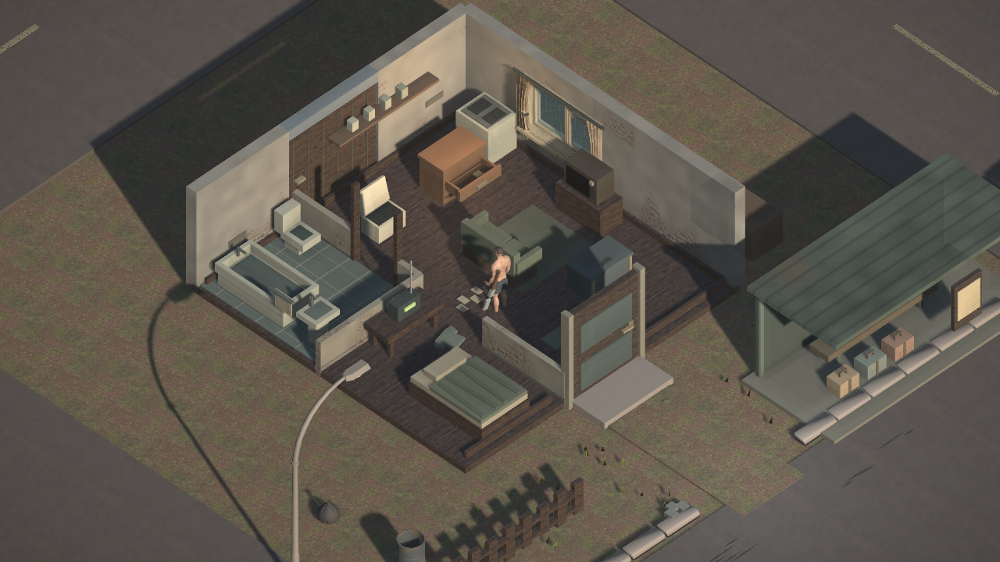

# Zonbee

**Одиночное офлайн-выживание в заброшенном районе.** Начни без оружия, исследуй дома, ищи припасы и снаряжение, лечи раны и старайся не привлечь заражённых. Днём изучай окрестности, ночью выбирай между темнотой и заметным светом фонаря.

Игра находится на ранней стадии разработки. Это рабочий прототип для Windows, а не законченный открытый мир. Сервер, регистрация и подключение к интернету для игры не нужны.

**[Скачать Windows-версию](https://github.com/Asker323/askich/releases/download/zonbee-preview-2026.11.20-district/Zonbee-Windows.zip)** · [Описание выпуска и исходники](https://github.com/Asker323/askich/releases/tag/zonbee-preview-2026.11.20-district) · [Сообщить об ошибке](https://github.com/Asker323/askich/issues)

## Что уже работает

- Непрерывный район с тремя обустроенными зданиями в разных местах карты: дом связиста, дом фельдшера и АЗС.
- Обыск с шумом и возможностью прерывания, ближний бой и заражённые, реагирующие на игрока.
- Инвентарь с ячейками, найденные рюкзаки и одежда, еда и вода, кровотечение и лечение.
- Время суток, фонарь, радио, навыки и ремесло.
- Двери, отдельные открываемые и разбиваемые окна, перелезание и баррикады.
- Сохранение прогресса; совместимость с прежними форматами сохранений v1–10.

Последний этап: три интерьера со спальнями, санузлами, гостиными и включаемыми телевизорами. Шесть заражённых вместо 39; они быстрее и сильнее. Старые вещи возвращаются без потери прогресса. [Подробности и проверка](docs/CURATED_DISTRICT.md).

Находка при обыске по-прежнему появляется в руке до переноса в инвентарь. [Предыдущий этап](docs/LOOT_PRESENTATION.md).

Стены, двери и стекло ослабляют шум для заражённых; шаги имеют разную слышимость. [Шум и укрытия](docs/HEARING.md).

Заражённые также проверяют соседние доступные точки после потери героя: [поиск потерянного следа](docs/SEARCH_BEHAVIOR.md).

Предыдущий этап улучшил материалы улицы, освещение, крыши и два стартовых дома. Четыре новых фасадных окна имеют стекло и шторы, но пока неподвижны; интерактивные боковые окна работают отдельно.

Снимки сделаны в Windows Player. Позиция героя, время и камера выставлены для проверки, заражённые отключены; дополнительного постановочного света нет. [Телевизор вечером](docs/images/curated-television.png).

## Как запустить

1. Скачай `Zonbee-Windows.zip` из указанного выше выпуска.
2. Распакуй **весь архив**, сохранив папку `Zonbee_Data` рядом с программой.
3. Запусти `Zonbee.exe` из распакованной папки.

Платформа этого выпуска — **Windows x64**. Android отложен; APK этой версии нет. Минимальные системные требования ещё не определены: текущая графика проверена на RTX 4060 Laptop GPU.

**Управление:** WASD — движение; Shift — бег; Ctrl — тихий шаг; ЛКМ — удар/обыск; ПКМ — направление удара; Пробел — толчок; E — действие; F — фонарь; G — камень. I — вещи; J — навыки и ремесло; M — карта; F1 — справка; F11 — режим окна; Esc — пауза. У действующего окна C — перелезть, у задней двери V — баррикада.

## Проверка и ограничения

Текущая Windows-сборка прошла **384 локальные проверки** планировки, телевизоров, обыска, слуха заражённых, боя, окон, баррикад, навыков, интерфейса и переноса сохранений. Сборка завершена без ошибок и предупреждений. [Отчёт и ограничения этапа](docs/CURATED_DISTRICT.md).

Модели мебели, транспорта, растительность и часть окон ещё упрощены. Некоторые анимации требуют дальнейшей работы. Мир пока ограничен созданным районом, мультиплеера нет. Проверки не заменяют длительный игровой тест и не гарантируют работу на всех компьютерах.

Следующий приоритет — игровой процесс: интерес исследования, поведение заражённых, баланс риска и находок. Графика будет дорабатываться поэтапно.

## Открыть исходники в Unity

Нужны **Unity 6000.3.4f1** и Windows Build Support. Открой корень репозитория как существующий проект; основная сцена — `Assets/Scenes/District.unity`. Папки `Library`, `Temp`, `Logs` и готовые сборки в git не включены. Windows-архив размещён в Releases.

Для пары диагностической и обычной сборок задай `ASKICH_BUILD_DIR` и `GOIDA_SURVIVAL_RELEASE` — два разных каталога — и вызови `Askich.Editor.BuildDistrict.Pair` через Unity batchmode. Для повторного импорта новых материалов с последующей сборкой используй `Askich.Editor.WorldSurfaceAuthor.Build`.

Прежние технические имена Askich/GOIDA сохранены в части инструментов ради совместимости. Репозиторий вырос из ранней арены и средневековой GOIDA: старые коммиты и общие компоненты сохранены, текущая игра называется **Zonbee**.

[Источники и лицензии моделей, материалов и звуков](THIRD_PARTY.md) · [История этапов Zonbee](docs/DEVELOPMENT_HISTORY.md).
