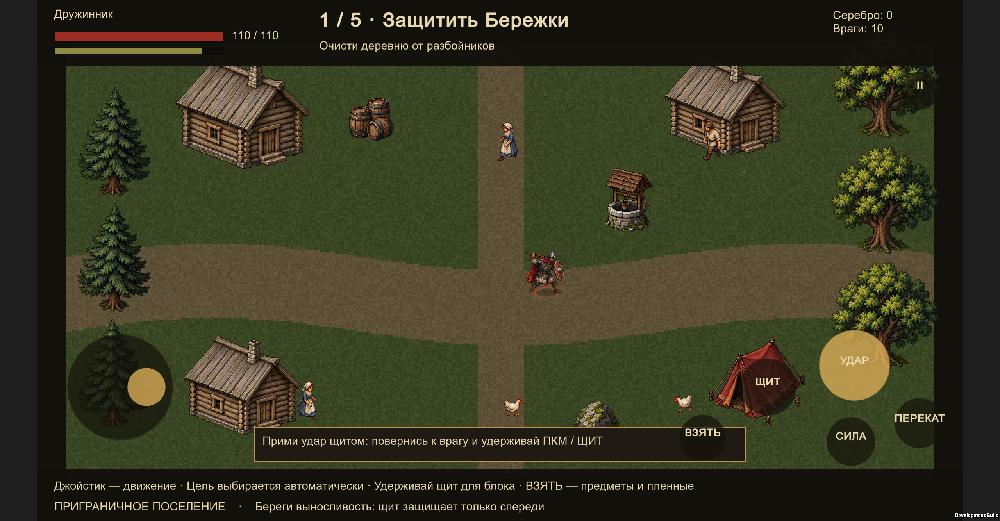

# Android · 2.4

**APK пока не выпущен. На физическом телефоне игра не проверена.**

Установлены официальные Android Build Support для Unity 6000.3.4f1, OpenJDK 17.0.9, NDK r27c и SDK / build-tools 36.0.0. Компиляция IL2CPP проходит; упаковку Gradle прерывают ошибки загрузки библиотек Google Maven и Gradle Plugin Portal: DNS, Connection reset, Read timed out.

Меню, ползунки громкости и участки деревни используют Input System Enhanced Touch. Поддерживаются одновременные движение и атака, щит, тяжёлый удар, перекат, взаимодействие и пауза. Интерфейс и камера учитывают безопасную область экрана. При уходе в фон игра ставится на паузу, управление сбрасывается, профиль сохраняется. Текущий поход после выгрузки процесса не восстанавливается.

Полная графика задаёт предел 60 кадров/с, экономная — 30. Реальная производительность, нагрев и расход батареи не измерены. 50 интеграционных проверок и 16 сценариев виртуальных касаний прошли в Windows-player; это не заменяет проверку на телефоне. [Отчёт](touch-playtest.json).



## Сборка

Установите Android Build Support с SDK/NDK и OpenJDK для Unity 6000.3.4f1. Android-инструменты отклоняют кириллицу в пути проекта, поэтому скопируйте Assets, Packages и ProjectSettings в отдельную папку с ASCII-путём. Library копировать не нужно.

Сборщик Askich → Build Android APK использует ARM64, IL2CPP, OpenGLES 3, минимум Android 8.0/API 26, установленный целевой SDK (здесь 36), горизонтальные ориентации, пакет com.asker323.askich, версию 2.4.0 / код 240. Development Build выключен. Для тестового APK используется локальный debug-ключ; постоянный ключ распространения и публикация в магазине ещё не подготовлены. Приватные ключи не входят в репозиторий.

Пример PowerShell для ASCII-копии и отдельно установленных инструментов:

```powershell
$env:ASKICH_BUILD_DIR='C:/Users/Public/GOIDA-Android-2.4'
$env:GOIDA_ANDROID_TOOLS='C:/Users/Public/GOIDA-AndroidTools-6000.3.4f1'
$null=New-Item -ItemType Directory -Force 'C:/Users/Public/GOIDA-JavaTemp'
$env:TEMP='C:/Users/Public/GOIDA-JavaTemp'
$env:TMP=$env:TEMP
& 'C:/Program Files/Unity/Hub/Editor/6000.3.4f1/Editor/Unity.exe' `
  -batchmode -quit -buildTarget Android `
  -projectPath 'C:/Users/Public/GOIDA-Build-2.4' `
  -executeMethod Askich.Editor.BuildGame.Android -logFile android-build.log
```

GOIDA_ANDROID_TOOLS необязателен: при его отсутствии используются настройки Unity. Под ним ожидаются папки OpenJDK, SDK, NDK. Отдельный TEMP устраняет ошибку Java loopback/Unix-domain socket с путём пользователя на кириллице. Переменные действуют в текущем процессе и его дочерних процессах; системные настройки не меняются.

Результат успешного экспорта — GOIDA.apk и build-report.txt. Перед распространением необходимы проверка подписи, содержимого и установка на телефон. Одиночная игра не требует аренды сервера.

Для просмотра раскладки на компьютере используйте -askich-touch: мышь имитирует один палец. Диагностический Development Build поддерживает -askich-mobile-preview -askich-preview-output <directory> с отдельным временным профилем. Этот сценарий исключён из обычного release.
