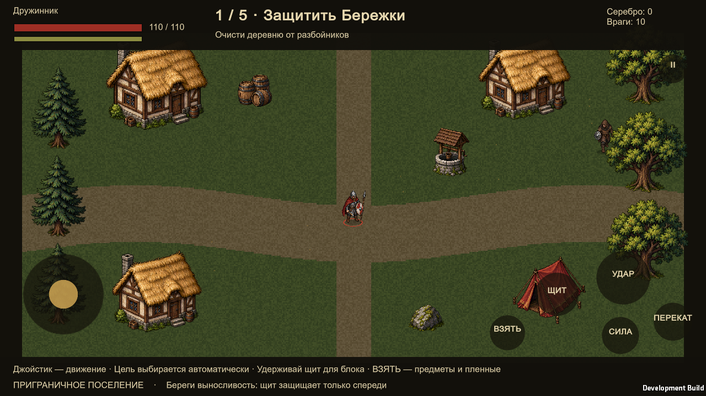

# Android: подготовка и текущий статус

В проект добавлены сенсорный джойстик, одновременное движение и атака, кнопки щита, тяжёлого удара, переката, взаимодействия и паузы. На мобильном устройстве включается автоматический выбор ближайшего противника в пределах досягаемости наведения. Интерфейс и камера вписываются в горизонтальную область 16:9 с учётом `Screen.safeArea`.

**APK не собран и работа на физическом Android-устройстве не подтверждена.** В установленной Unity 6000.3.4f1 доступен только Windows Standalone Support. Проверены логика нескольких касаний и отображение экранных элементов в диагностическом Windows-player.

## Сборка после установки модулей

В Unity Hub для редактора 6000.3.4f1 установите Android Build Support вместе с Android SDK & NDK Tools и OpenJDK. Затем откройте проект и выберите **Askich → Build Android APK**.

Сборщик настроен на ARM64, IL2CPP, минимальную Android API 26, горизонтальные ориентации и пакет `com.asker323.askich`. Используется установленная целевая версия SDK. Это локальная сборка; подготовка ключа подписи и публикация в магазине отдельно не выполнялись.

Командный вариант:

```powershell
& 'C:\Program Files\Unity\Hub\Editor\6000.3.4f1\Editor\Unity.exe' `
  -batchmode -quit -projectPath $PWD -buildTarget Android `
  -executeMethod Askich.Editor.BuildGame.Android -logFile android-build.log
```

Результат по умолчанию — соседняя папка `Askich-Android/Askich.apk`. Переменная `ASKICH_BUILD_DIR` меняет папку результата.

Для просмотра мобильной раскладки на компьютере можно запустить player с `-askich-touch`. Этот флаг включает сенсорную схему: обычное управление мышью и WASD в бою заменяется касаниями. Для тестирования без сенсорного экрана нужен диагностический сценарий или эмуляция Touchscreen в Input System.

Перед Android-релизом остаются: фактический экспорт APK, тест кнопок меню и мультитача на телефоне, проверка читаемости интерфейса поселения на небольших экранах, производительности, сворачивания приложения и сохранений. Бесплатный локальный режим не требует игрового сервера.


