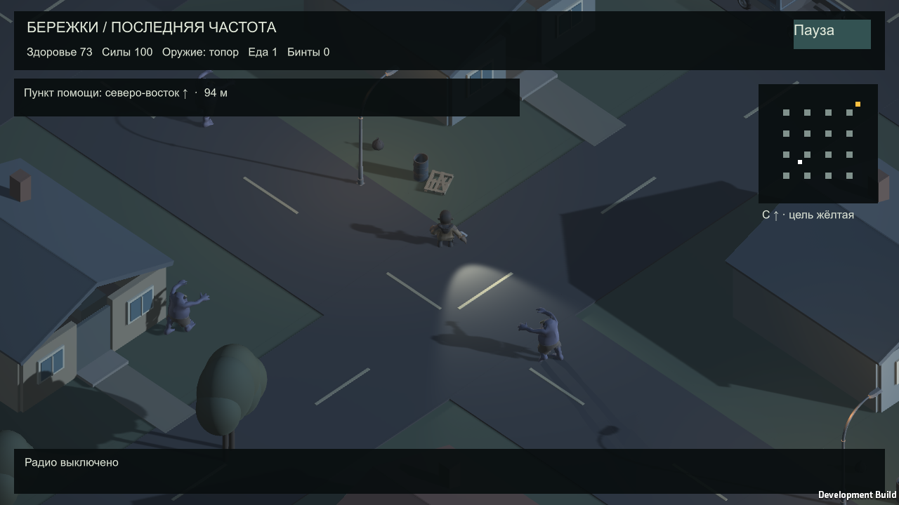
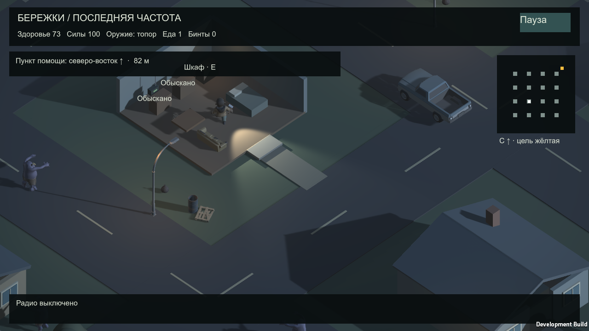
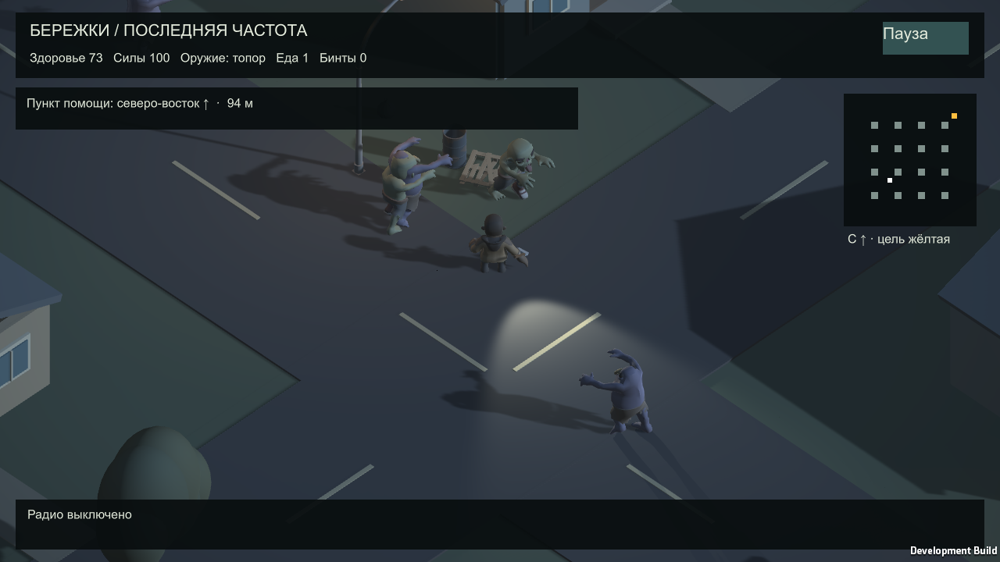

# Бережки — первый этап атмосферы и анимации

> Текущее состояние персонажей на 8 ноября: [первый авторский проход, реальные кадры и видео](CHARACTER_ART.md). Текст ниже описывает первоначальный этап; модели Matt уже заменены производными анатомической CC0-основы.

Этап 3–4 ноября 2026. Локальная Windows-версия; GitHub не обновлялся по просьбе автора.

## Изменения

* Выживший Matt и три модели заражённых из Quaternius Zombie Apocalypse Kit заменили простые фигуры. Скелетные клипы: ожидание, ходьба/бег, атаки, получение урона и смерть; переходы смешиваются. Ползущий вариант использует Crawl; у него нет отдельного клипа HitReact, атака пока использует тот же клип движения. Это стилизованный 3D, не реалистичные персонажи и не финальное художественное качество.
* Топор и копьё отображаются у руки. Для кулака, топора и копья выбираются Punch, Slash и Stab. Проверяется движение кости во время атаки, а не только наличие файла.
* Обычный заражённый: 65 здоровья / скорость 1,9; крупный: 90 / 1,3; ползущий: 40 / 1,1. Встречи и длительный баланс ещё предстоит настроить.
* Сумеречный свет, туман, тени, уличные и домашние лампы, фонарь с управлением F. Отдельный слой BerezkiPlayer исключает тень собственного тела из фонаря, сохраняя тень от общего света.
* Материал Weathered приглушает цвета атласа; Dusk добавляет мягкую виньетку. Есть экономный режим без полноэкранного эффекта и теней фонаря. Эти шейдеры включены в билд как ресурсы, стандартный материал остаётся запасным вариантом.
* Модели машин, башни, уличных фонарей, диванов, бочек, поддонов и мусора; деревья имеют объёмную крону и лёгкое покачивание. Дома всё ещё состоят из простой геометрии и требуют дальнейшей детализации.
* 24 записи голосовых эффектов заражённых: пространственное затухание, интервалы, небольшое изменение высоты голоса. Стены приглушают звук и срезают высокие частоты. Это не новая актёрская озвучка диалогов.
* Исправлен AudioListener: раньше он находился на удалённой камере, теперь следует за героем. Радио проходит частотную обработку. Существующая русская передача остаётся временной синтезированной записью Microsoft Irina.
* Пауза останавливает анимации и звук. Клики по HUD не начинают удар. Для района выделены отдельные сенсорные зоны: движение, удар, действие, фонарь, бинт; движение и удар могут обрабатываться одновременно.

## Совместимость

Формат district-v1.json сохранён. Новые настройки внешнего вида не меняют инвентарь, двери или добычу. Старые GOIDA-профили не используются. Состояния заражённых по-прежнему не сохраняются: это известное ограничение прототипа. Новая сборка лежит отдельно от предыдущей.

## Проверка

Unity 6000.3.4f1, Windows x64, обычная и диагностическая сборки. Результаты последнего запуска — atmosphere-checks.txt; отчёт обычного билда — atmosphere-build-report.txt. Диагностический сценарий использует отдельное временное сохранение.

Скриншоты сняты в настоящем Windows-player. Позиции, инвентарь и группа заражённых подготовлены диагностическим сценарием для осмотра; это не запись полного ручного прохождения. Дополнительно через обычное меню диагностической версии проверены старт попытки, пауза кнопкой, переключение графики и выход. 4 ноября повторно осмотрен сенсорный интерфейс в Windows с флагом -askich-touch: кнопки и подсказки отображаются; это не проверка на Android.

Клавиатурное движение проверено через Input System; короткие синтетические нажатия инструмента управления окном не дали надёжного подтверждения F/Esc. Полное прохождение и субъективная оценка микса звука остаются отдельной проверкой.

Android APK этого этапа не собирался, на физическом Android-устройстве ничего не проверено. Есть облегчённая графика и отдельная сенсорная схема, но нужны проверка интерфейса на телефоне и замеры производительности.

## Сборка

`Askich.Editor.DistrictArtImport.Prepare` повторно создаёт префабы и материал из исходных FBX. `PrepareAndBuild` затем вызывает `BuildDistrict.Pair`. Для пары сборок задать ASKICH_BUILD_DIR (диагностический каталог) и GOIDA_SURVIVAL_RELEASE (обычный каталог). `BuildDistrict.Pair` не перегенерирует префабы.

Запуск диагностического Windows-player: `-district-check` и GOIDA_DISTRICT_CHECK (каталог результатов). Режим `-district-manual-check` оставляет обычное меню и управление, но использует временное сохранение; оба режима доступны только в Development Build. `-askich-touch` включает эмуляцию сенсорной схемы мышью; это не заменяет устройство.

Лицензии и исходные ссылки: [THIRD_PARTY.md](../THIRD_PARTY.md).

