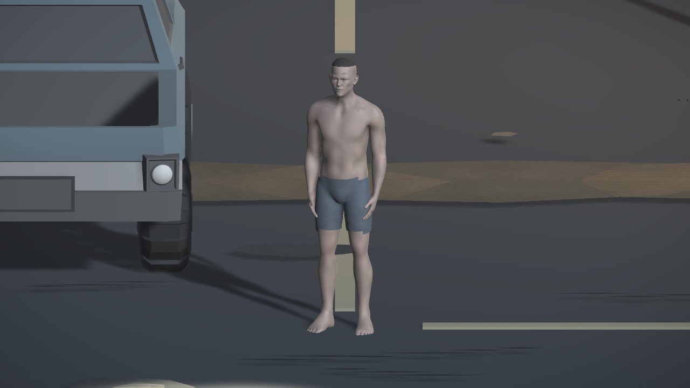
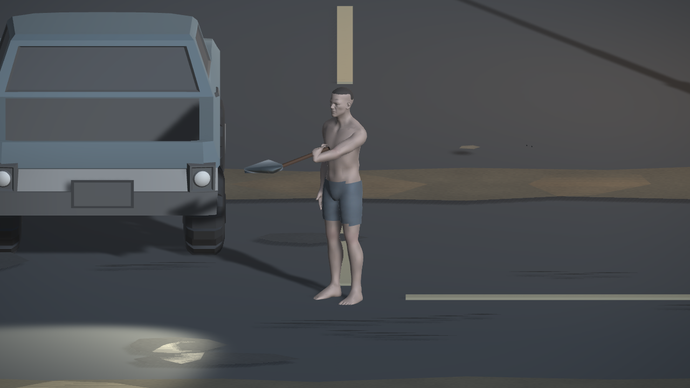
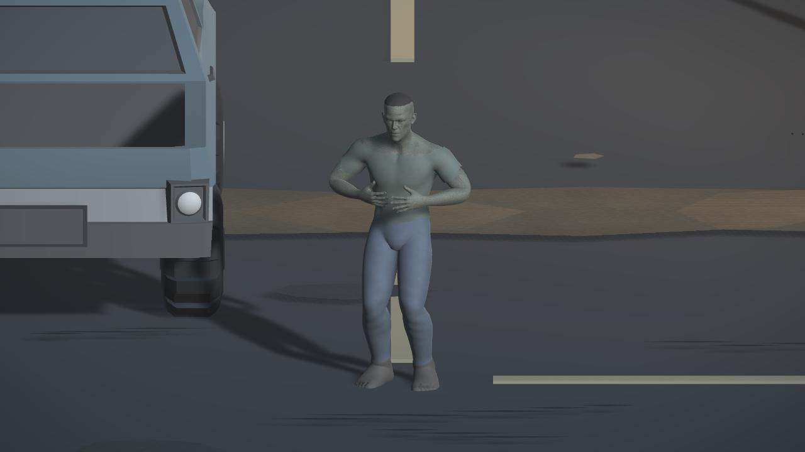

# Персонажи: первый авторский проход

Этап 8 ноября 2026, Windows, Unity 6000.3.4f1. Это первая итерация внешности и движений, а не окончательное качество персонажей.

Для изменения внешности используется существующая анатомическая CC0-основа Julien Kaspar. Геометрия лица слегка доработана, для тела и одежды подготовлены новые развёртки и запечённые цвет и затенение. Источник сохранён отдельно в `Assets/CharacterSources/AdultBase.fbx`, рабочий файл со встроенными текстурами — `tools/CharacterArt/AdultStudio.blend`. Мы не выдаём стороннюю анатомическую основу за самостоятельно созданную модель.

## Что изменено

- Для героя непосредственно на итоговом скелете созданы ожидание, ходьба, бег, удар топором, выпад копьём, удар руками и реакция на урон.
- Для худого стоящего заражённого созданы отдельные ожидание, походка, атака и реакция на урон.
- Перемещение опорной стопы рассчитано под скорость движения; при переходе между ходьбой и бегом сохраняется фаза цикла.
- Траектории рук привязаны к существующим моментам нанесения урона. Игровые характеристики оружия не менялись.
- Топор и копьё заменены собственной простой геометрией с отдельными материалами дерева и металла. Хват смещён из запястья к ладони, для вооружённой руки добавлена форма сгибания пальцев.
- Ослаблен синий оттенок общего освещения: материалы сохраняют больше собственного цвета; сумеречный туман и тени сохранены.
- Сохранены старт в шортах, находимая одежда, инвентарь и прежний формат сохранений.

## Как воспроизвести

1. Запустить Blender 4.5 с `--background --python tools/CharacterArt/author_surface.py` из этого проекта. Скрипт берёт неизменённый AdultBase, экспортирует Adult.fbx, текстуры и рабочий blend; изменения не накапливаются при повторном запуске.
2. В Unity вызвать `Askich.Editor.CharacterMotionAuthor.BakeAndBuild`, задав `ASKICH_BUILD_DIR` для диагностической версии и `GOIDA_SURVIVAL_RELEASE` для обычной Windows-версии.
3. Для проверки персонажей запустить диагностический Player с `-district-character-art-check`, задав папку `BEREZKI_CHARACTER_ART_CHECK`. Используется временное сохранение.

## Проверка и кадры

Численные проверки подтверждают исправность отдельных механизмов, но не оценивают художественное качество движения. Крупные кадры и видео циклов — подготовленные диагностические состояния в настоящем Windows Player: камера приближена, враги отключены, фазы клипов задаются проверкой. Это не запись обычной вылазки.

## Ограничения

Тяжёлый и ползущий заражённые пока используют прежние производные анимации. Смерть, обыск, еда, питьё и отдых также пока не переделаны целиком. Нет захвата движений, лицевой анимации и симуляции ткани. Волосы и одежда требуют дальнейшей художественной работы; руки и контакт оружия нужно продолжать улучшать. Скольжение уменьшено на рассчитанной прямой ходьбе; развороты и движение по сложной поверхности ещё требуют работы.

Android на этом этапе не собирался и на устройстве не проверялся. Публикация на GitHub отложена по просьбе пользователя. Проверки локальные; полная вылазка не запускалась. Пользовательское сохранение не используется диагностическими сценариями.

Результаты: **291 проверка пройдена** (11 персонажей, 230 общих, 30 боя на ПК, 20 одежды). Обычная Windows-сборка: **0 ошибок, 0 предупреждений**; запуск меню проверен отдельно. Движение опорной стопы на измеренном отрезке — 2,533 м/с при целевых 2,6 м/с.

[Видео циклов ходьбы, бега и удара](images/character-motion.mp4) — около девяти секунд, без звука; каждый цикл повторяется четыре раза на месте. Между тремя блоками стоят монтажные склейки. Переход ходьба/бег проверяется отдельно в отчёте, это видео его не показывает.
