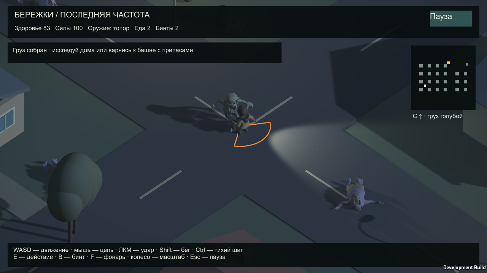
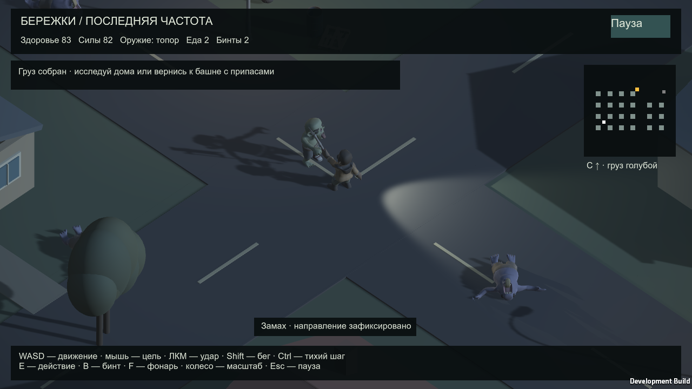

# Движение и один бой

4 ноября 2026. Этап после 00a5093. Основной объект настройки — обычный заражённый и три существующих способа атаки героя. Мир не расширялся. Публикация отложена.

## Причины и исправления

Раньше шаги и скорость анимации героя зависели от намерения двигаться, даже если стена полностью блокировала путь. Теперь используется фактическое перемещение; разгон и остановка плавные, бег имеет отдельную базовую скорость воспроизведения. Во время замаха и возврата оружия герой стоит на месте. Это уменьшает скольжение при атаке и у стен; полноценного IK стоп и перенастройки всего набора походок нет.

Измерение существующих клипов выявило, что Punch использует правую руку, а Slash и Stab — левую. Прежние самодельные меши оружия были на правой руке и не следовали рабочему движению. Герой теперь показывает оригинальные Axe/Spear из того же CC0-набора, с авторской привязкой к скелету и общим материалом. Файлы уже были в проекте; новых сторонних загрузок нет. Резервная геометрия сохранена на случай отсутствия этих мешей.

Контакт настроен по фазе движения руки: кулак — 47%, топор — 36%, копьё — 40% клипа. Фазы измерены редакторским DistrictCombatProbe; протокол — combat-clip-samples.txt. Это выбор момента урона по анимации, а не физическая симуляция столкновения лезвия с телом.

## Правила боя

- Кулак: цикл 0,55 с, дальность 1,35 м, 10 урона, 8 сил; одна ближайшая цель.
- Топор: цикл 0,85 с, дальность 1,85 м, 45 урона, 18 сил; до двух целей в широком секторе.
- Копьё: цикл 0,8 с, дальность 2,7 м, 30 урона, 14 сил; одна цель в узком секторе.

Направление фиксируется в начале атаки. Вращение мыши во время замаха не переносит урон на другую сторону. Попадание требует прямой видимости: двери и стены блокируют его. Силы во время атаки не восстанавливаются. Получение урона прерывает незавершённый удар героя; загрузка мира отменяет старую отложенную атаку.

Заражённый разворачивается перед ударом, фиксирует направление и показывает сектор подготовки. Контакт обычного Punch происходит примерно через 0,56 с; затем есть восстановление. Выход из дальности или заход за спину позволяет избежать удара. Попадание героя отменяет вражеский замах, ненадолго останавливает заражённого, немного отталкивает с проверкой препятствий и даёт короткую цветовую реакцию. Сектор не показывается сквозь стены. Его простой шейдер включён в ресурсы сборки.

## Проверки и ограничения

Автоматизированный сценарий в настоящем Windows-player проверяет отсутствие раннего урона, паузу, фиксированное направление, момент контакта, восстановление между ударами, оглушение, дальность и сектор копья, обход атаки сзади, нехватку сил, препятствие между бойцами и остановку анимации у закрытой двери. Прежние проверки мира, загрузки и интерьеров также выполняются. Тестовые сохранения изолированы от пользовательских.

Скриншоты combat-warning.png и combat-swing.png — реальные кадры диагностического player с подготовленным положением и состоянием персонажей. Они не являются полным ручным прохождением. Ощущение управления и баланс ещё требуют ручного игрового сеанса.

Сохранения остаются v3; форматы v1/v2 поддерживаются. Замах, оглушение и восстановление не сохраняются и сбрасываются при загрузке. Android APK этого этапа не собран, физическое устройство не проверено. Шейдер простой, но это не подтверждение производительности телефона.

Модели остаются стилизованными. У ползуна пока нет отдельной авторской атаки: используется прежний Crawl. Поведение «проверить шум — искать потерянную цель», отвлекаемые предметы, звуки поверхностей и полный ручной маршрут относятся к следующим этапам.

## Повторение проверки

Unity 6000.3.4f1. Для измерения клипов: Askich.Editor.DistrictCombatProbe.Run и переменная GOIDA_COMBAT_PROBE с путём отчёта. Для пары сборок: Askich.Editor.BuildDistrict.Pair, ASKICH_BUILD_DIR (диагностический каталог), GOIDA_SURVIVAL_RELEASE (обычный выпуск). Для запуска проверок: Berezki.exe -district-check, GOIDA_DISTRICT_CHECK с каталогом результатов.

Итог: 72 проверок пройдено в Windows Development Player. Обычная сборка: 0 ошибок, 0 предупреждений.

