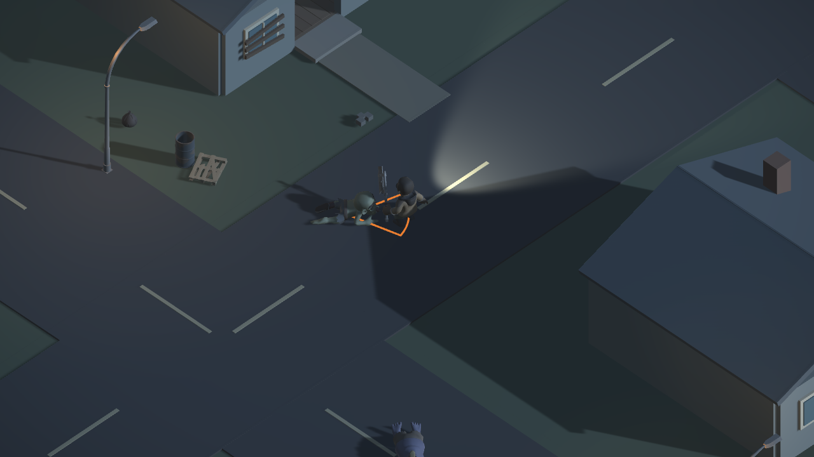

# Бережки — бросок ползуна

Ползун распластывается у ног выжившего, упирается руками, фиксирует направление и делает короткий рывок. Сектор на земле показывает его досягаемость. Уход вбок до контакта оставляет время для ответа топором. Дверь может остановить бросок, если успеть закрыть её.

## Дистанция и время

Ползун начинает атаку с расстояния до 1,85 м. Первые 0,54 с он готовится на месте, затем за 0,22 с скользит вперёд максимум на 0,8 м. На близкой дистанции ход корпуса сокращается с учётом досягаемости кисти. Контакт проверяется один раз, на отметке 0,76 с. Для попадания нужны цель в исходном секторе, досягаемость от фактической позиции и прямая видимость. Попадание снимает 20 здоровья и вызывает рану. Восстановление длится 0,92 с.

Старая модель Zombie_Ribcage не имеет костей рук. Для ползуна использована имеющая руки модель Zombie_Basic из того же пакета Quaternius, с её циклом ползания и отдельным скелетным клипом CrawlerLunge. Новый клип запекается в редакторе; в игровом запуске для замаха и контакта используется время боевой симуляции. Исходный пакет и лицензия указаны в THIRD_PARTY.md.

## Сенсорная раскладка

Отклонение стика теперь задаёт скорость шага; в центре есть мёртвая зона в восемь единиц раскладки. При нажатии удара ближайший живой заражённый в пределах оружия и прямой видимости задаёт направление замаха. Если такой цели нет, герой бьёт по направлению взгляда. Направление фиксируется при начале удара.

## Проверка

В Windows Development Player пройдены 125 проверок. В постановочной встрече ИИ самостоятельно начал атаку. Проверены неподвижная цель, уход в сторону клавишей, ответный удар, сохранение положения кисти на паузе и столкновение с закрытой дверью. Урон пришёлся на кадр выпрямления руки; в этой встрече её вынос от центра ползуна вырос с 0,57 до 1,06 м. Два виртуальных пальца через Unity Enhanced Touch удержали стик и попали топором по восстанавливающемуся ползуну.

На этой же версии автоматический маршрут от безоружного старта до убежища занял 98,5 с. Герой добыл топор, включил радио, обработал рану в медпункте и обустроил лагерь с собранными припасами. Релиз отдельно запущен до начальной сцены.

[Журнал проверок](crawler-checks.txt) · [Отчёт релизной сборки Windows](crawler-build-report.txt) · [Журнал автоматического маршрута](crawler-route.txt)

В отдельном оконном запуске вручную начата новая попытка. Передача коротких WASD-нажатий не позволила надёжно удерживать движение, затем окно потеряло фокус. Ручной сеанс на 10–15 минут и испытание на физическом телефоне остаются открытыми. Изменения проверялись с отдельными тестовыми сохранениями.

Кадры сняты игровой камерой в Windows Player. Герой и ползун заранее поставлены на дороге, у героя есть топор. После начала встречи действуют игровые таймеры, коллизии, урон и ранения.

