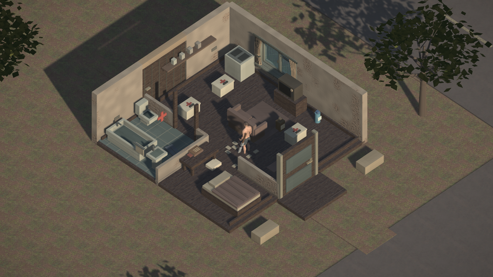
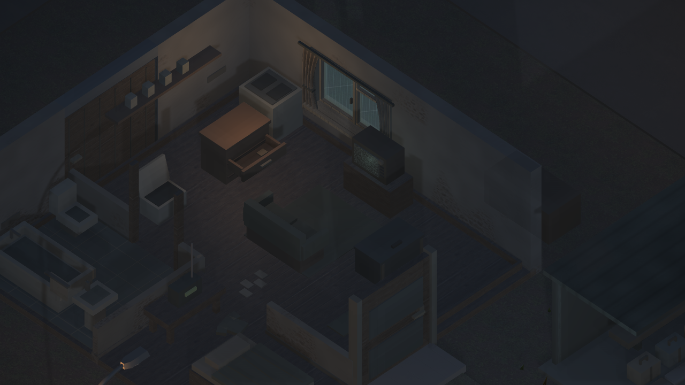

# Район из трёх зданий

20 ноября 2026. Windows Preview.

В непрерывном районе теперь построены три здания: дом связиста на юго-западе, дом фельдшера на северо-западе и АЗС на востоке. Остальные 19 домов больше не создают геометрию, двери, контейнеры или препятствия. Размер карты, башня-убежище, огород, остановка, дорожный груз и автомобильная сигнализация сохранены.

В каждом здании есть спальня, санузел с ванной, раковиной и туалетом, гостиная с диваном и телевизором, кухонный уголок. Перегородки закрывают обзор и ослабляют звук. Крупная мебель останавливает движение. В домах связиста и фельдшера сохранены открываемые задние двери, баррикады, боковые окна со стеклом и перелезанием. Аптечки, продукты и инструменты используют существующие правила обыска и сохранения добычи.

Телевизор включается и выключается клавишей E рядом с экраном. Он показывает помехи, тихо шумит в пространстве и привлекает заражённых. Переключатель сохраняется. Близкое окно или контейнер сохраняют приоритет взаимодействия. Это пока неисправный телевизор: озвученных передач, видеопрограмм и отдельного обучения через ТВ нет. Учебная радиопередача и книги продолжают работать.

## Заражённые и нагрузка

- В новом мире шесть заражённых вместо 39. Никакого появления противника перед камерой или автоматического восстановления убитых не добавлено.
- Обычный заражённый: скорость 3,35 м/с, 140 здоровья, удар на 34. Тяжёлый: 2,55 м/с, 195 здоровья, удар на 44. Ползущий: 2,1 м/с, 90 здоровья, удар на 28.
- Подготовка удара, направленный выпад ползущего, возможность прервать замах толчком, потеря следа и влияние преград на слух сохранены. Бежать от обычного заражённого можно, пока хватает выносливости.
- Неподвижные предметы новых интерьеров объединяются средствами статической пакетной отрисовки Unity. Телевизоры, крышки, окна и двери остаются самостоятельными движущимися объектами.

Это сокращение количества зданий и работающих персонажей, а не обещание определённого прироста FPS. Сравнение частоты кадров на слабом ПК и длительный тест производительности ещё нужны. Размер загружаемого архива существенно не уменьшался: общие модели и текстуры сохранены.

## Старые сохранения

Новый формат — v10. Старые номера 22 домов остаются только как лёгкие записи совместимости; на карте построены именно три здания. Вещи из контейнеров убранных домов переносятся в раздел инвентаря «Возвращённые вещи». Новая добыча из необследованных домов не выдаётся. Содержимое контейнеров трёх оставшихся зданий, одежда, навыки, часы, ранения и припасы сохраняются.

Состояния двух задних выходов, окон и баррикад перенесены в два оставшихся жилых дома. Положение героя внутри прежнего медпункта переводится в новый дом фельдшера. У оставшихся заражённых сохраняются смерть и доля оставшегося здоровья; убранные противники не создаются.

Перед первым переносом создаётся отдельная копия `district-v1.json.before-district-v9.json` (номер соответствует исходному формату). Она не участвует в ротации автосохранений. Старые сборки не читают v10; для возврата к ним потребуется эта копия. Обычный запуск новой версии использует уже перенесённый мир.

## Проверка

384 локальные проверки пройдены. Windows Development и обычная сборка завершены без ошибок и предупреждений; обычная версия отдельно запущена и штатно закрыта.

Локальные сценарии запускаются в настоящем Windows Player с отдельными временными сохранениями. Проверяются все девять точек обыска, проходы между комнатами, препятствия, телевизоры и шум, перенос реального старого сохранения, защита от повторной выдачи, бой, окна, баррикады, навыки и интерфейс. Отчёты этого этапа — `curated-*-checks.txt`; состав мира — `curated-world-budget.txt`.

Реальные кадры Windows Player. Позиции, время суток и камера выставлены диагностическим сценарием; заражённые отключены. Это постановочные проверочные кадры, не полная ручная вылазка.

Мебель пока выполнена упрощённой авторской геометрией; у трёх интерьеров общая основа планировки. Следующие художественные шаги — индивидуальные планы помещений, округлые формы мебели, более выразительные материалы и следы жизни. Новых внешних моделей, записей голоса и платных материалов в этом этапе нет. Помехи телевизора созданы программно; существующие источники материалов перечислены в `THIRD_PARTY.md`.

Android в этом этапе не собирался и на устройстве не проверялся. Полная вылазка и длительный тест не проводились.

Повторение проверки: `Askich.Editor.BuildDistrict.Pair`; Development Player с `-zonbee-curated-check`, каталог результатов в `ZONBEE_CURATED_CHECK`, исходный старый тестовый профиль — `ZONBEE_LEGACY_FIXTURE`.
