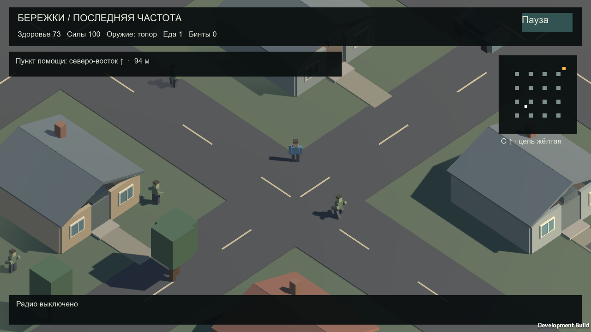
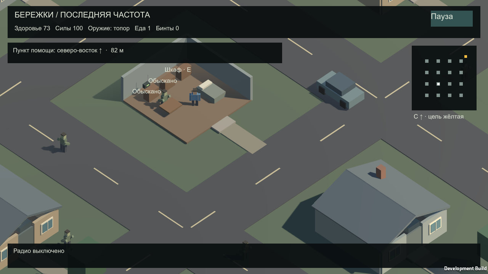

# Бережки · Последняя частота

Локальный этап, 3 ноября 2026. Ветка survival-modern-district, сцена Assets/Scenes/District.unity. Публикация отложена по просьбе пользователя.

## Реализовано

Современный район 120 × 120 игровых метров, 16 домов, дороги, деревья, машины и водонапорная башня. Ортографическая камера под углом следует за героем; колесо меняет масштаб. Мини-карта показывает героя, дома и цель. Это конечная карта, которая целиком создаётся при старте: потоковой подгрузки районов ещё нет.

В дома можно входить прямо с улицы. Крыша и ближние стены скрываются внутри. Закрытая дверь блокирует движение и обзор; открытая позволяет заражённым найти путь внутрь. Стены учитываются при обнаружении и ударах. Заражённые не ломают двери. Внутренняя мебель пока служит декорацией и не блокирует движение.

Игрок начинает без оружия. Шкафы содержат фиксированную добычу или пусты. Обыск занимает 1,8 секунды, движение, атака и получение урона прерывают его. Есть топор, копьё, еда, бинты, выносливость, бег и тихий шаг. Руки и ноги персонажей анимируются процедурно; полноценной графики и анимаций персонажей ещё нет.

В доме к северу от старта находится радио с русской синтезированной аварийной передачей и пространственным звуком. Приёмник можно выключить. Пока он работает, шум регулярно привлекает заражённых. Подсказка цели открывается при включении радио; ожидание полного прослушивания не требуется. Цель — дойти до северо-восточной башни с едой и бинтом.

## Управление

WASD — перемещение относительно камеры; мышь — направление удара; ЛКМ — удар; Shift — бег; Ctrl — тихий шаг; E — дверь, шкаф или радио; B — перевязка; колесо — масштаб; Esc — пауза. На карте север сверху, жёлтая метка — текущая цель. Для первого оружия обыщите дом с радио, ближайший к северу от старта.

## Сохранение

Отдельный district-v1.json в пользовательской папке продукта Berezki Last Frequency. Старые профили GOIDA и Askich не читаются и не меняются. Сохраняются положение, здоровье, выносливость, оружие, припасы, обысканные шкафы, двери и факт включения радио. Автосохранение каждые 15 активных секунд, после добычи, при уходе в фон и выходе. Предыдущая версия копируется в .bak; восстановление повреждённого основного файла из .bak пока ручное.

Положение и гибель заражённых, включённость радио и завершение маршрута пока не сохраняются: при загрузке заражённые создаются заново. После смерти доступна последняя сохранённая попытка. Начальная кнопка «Новая попытка» запускает свежий район, «Загрузить попытку» восстанавливает профиль.

## Проверка

Windows release: 0 ошибок, 0 предупреждений, Development=False. [Отчёт сборки](district-build-report.txt).

[12 диагностических проверок](district-checks.txt) прошли в настоящем Windows-player: безоружное начало, число домов, закрытая и открытая дверь, путь заражённого через неё, получение оружия, защита от повторного лута, наличие звуковой записи и открытие цели радио, привлечение заражённых, выключение радио, сохранение и загрузка из отдельного временного профиля, движение через событие клавиатуры Input System.

Остальные проверки вызывают игровые операции напрямую, а не имитируют полное пользовательское прохождение. Обычная release-сборка открыта и визуально проверена; пользователь начал самостоятельную игру, поэтому дальнейший ввод помощника прекращён. Полное прохождение до башни вручную и длительная оценка баланса ещё нужны. Скриншоты ниже — диагностический Windows-player; инвентарь и положение подготовлены сценарием.

Android этого этапа не собран и на устройстве не проверен. Сенсорная основа перенесена, но расположение кнопок, камера и производительность на телефоне требуют отдельной проверки.

## Звук и графика

Все новые трёхмерные объекты создаются кодом проекта. Материалы и анимации пока простые; эта версия проверяет ракурс, доступные дома и исследование района. Ресурсы Project Zomboid не используются.

Радиопередача синтезирована локально установленным Microsoft Irina Desktop через Windows System.Speech. Текст написан для игры. Это временная синтезированная озвучка, не актёрская запись. Перед внешним распространением записи требуется проверить условия использования голоса или заменить её на запись с явно разрешённым распространением. Шум радио синтезирован кодом. Ветер, шаги и удары используют прежний SynthAudio; полноценные звуки поверхностей, заражённых и музыкальное сопровождение ещё нужны.

## Следующее

Доработать внешний вид и анимации героев, разнообразить интерьеры, добавить столкновения мебели и разбивание дверей, проверить баланс преследования, сохранять заражённых, улучшить озвучку и звук поверхностей. Затем закончить ручной маршрут и подготовить мобильную версию.

