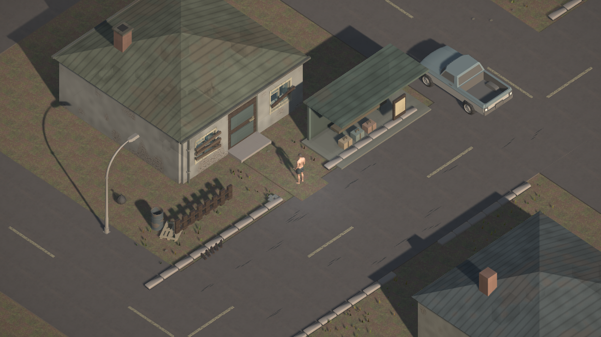
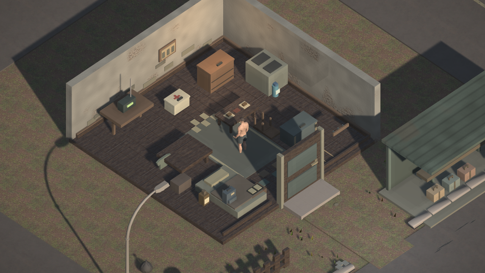
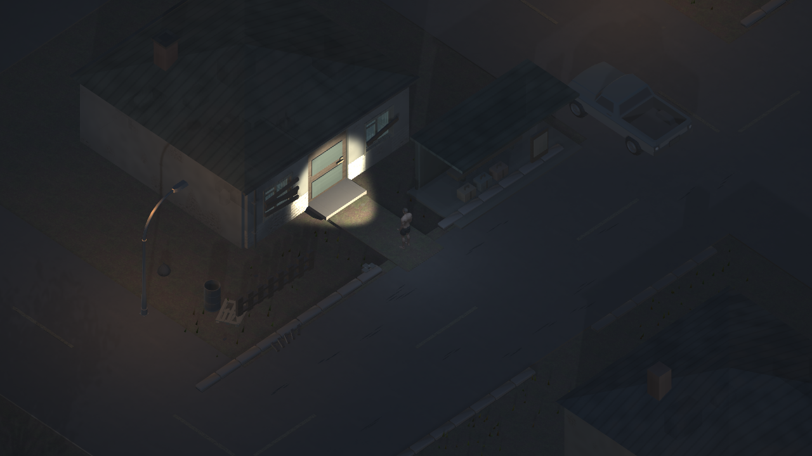

# Zonbee — материалы, свет и окружение

15 ноября 2026. Локальный этап графики для Windows. Основная ручная доработка — стартовая улица, дом связиста и дом фельдшера; общие материалы применяются и к другим зданиям района.

## Что изменилось

- Асфальт, дерево, грунт и каменная основа штукатурки используют пять наборов текстур Poly Haven CC0: цвет, нормали и шероховатость. Поверх камня смешивается состаренная штукатурка с неровными утратами и затемнением у земли. Дерево приглушено по цвету. Источники и контрольные суммы сохранены вместе с ресурсами и в `THIRD_PARTY.md`.
- Разметка стала потёртой. Убраны большие плоские многоугольники старых дорожных пятен и сплошные полосы обочины. Небольшие трещины и гравий сохранены. Добавлены бордюры с фасками и промежутками у входов; вся новая бордюрная геометрия объединена в одну сетку.
- Материал кровли теперь применяется также к вальмовым и односкатным крышам. У вальмовых крыш исправлены нормали отдельных скатов. У двух стартовых домов появились водостоки, крепления и верхушки дымоходов.
- Четыре фасадных окна стартовых домов получили настоящие проёмы, тонкое стекло, рамы и собранные шторы. Они пока неподвижные и не являются новыми точками перелезания. Прежние интерактивные боковые окна остаются открываемыми и разбиваемыми. Остальные фасады ещё используют старые накладки.
- В двух стартовых интерьерах добавлены плинтусы и опоры столов. Детали фасада скрываются вместе с передними стенами при входе, водостоки крыши — вместе с крышей.
- Высота солнца зависит от часа, к вечеру тени удлиняются. Добавлено слабое затемнение контактов по глубине экрана. На низком качестве этот проход и дополнительная карта глубины/нормалей отключаются. Фонарь при начале игры выключен; клавиша F работает как прежде.

## Проверка

Windows Player, Unity 6000.3.4f1: **184 успешных проверки** — окружение 25, планировки 35, интерактивное оконное оформление 9, бой 30, интерфейс/столкновения/сохранения 85. Проверены непроходимость новых неподвижных окон, проходы улицы, прежние двери и окна, смена качества и загрузка старых сохранений. Тесты используют временные сохранения. Полной вылазки не проводилось.

Итоговая обычная сборка: **0 ошибок, 0 предупреждений**. Отдельно проверена её инициализация и штатное завершение скрытого окна. Основная визуальная проверка сделана в диагностической Windows-сборке, не только в редакторе.

На RTX 4060 Laptop GPU, 1920×800: медиана 16,67 мс, p95 16,71 мс в короткой серии из 60 кадров. Это неподвижная стартовая улица без активных заражённых с ограничением частоты около 60 Гц; результат не показывает предельную производительность и не заменяет проверку большого боя или слабого ПК.

## Настоящие кадры Player

Кадры ниже сняты в игре. Время суток, положение героя и инспекционная камера заданы тестом, заражённые отключены. Дополнительного постановочного света нет; интерфейс не входит в снимок камеры. Это проверочные ракурсы, не запись обычной вылазки.

[Сумерки](images/environment-street-dusk.png), [дом фельдшера](images/environment-clinic-interior.png), [низкое качество ночью](images/environment-street-low.png). [Кадр с настоящим интерфейсом](images/environment-hud.png) сделан отдельной проверкой, которая выставляет позицию героя и включает учебное радио.

## Ограничения и следующий шаг

Это улучшение окружения существующего прототипа. Мебель, транспорт, растительность и часть окон всё ещё имеют простую геометрию. Новых моделей заражённых, анимаций и озвучки этот этап не добавляет. Контактное затемнение приблизительное, отражений окружающего мира в стекле нет. Все дома ещё не получили индивидуальную ручную отделку. Android и другие видеокарты не проверены; GitHub не обновлялся.

Следующий визуальный этап — заменить самые заметные простые предметы в этих двух домах: шкаф, плиту, кровать и медицинскую мебель. Затем переработать траву и кустарники с проверкой читаемости заражённых и частоты кадров, прежде чем увеличивать плотность декора по всему району.

## Воспроизведение

Импорт текстур и две сборки: `Askich.Editor.WorldSurfaceAuthor.Build`. Папки задаются переменными `ASKICH_BUILD_DIR` (диагностическая) и `GOIDA_SURVIVAL_RELEASE` (обычная).

Диагностическая сборка запускается с `-zonbee-environment-check`; `ZONBEE_ENVIRONMENT_CHECK` задаёт папку отчёта и кадров. Проверка доступна только в редакторе и Development Player. Отчёты этого этапа: `environment-*-checks.txt`, `environment-build-report.txt`, `environment-performance.txt`.
