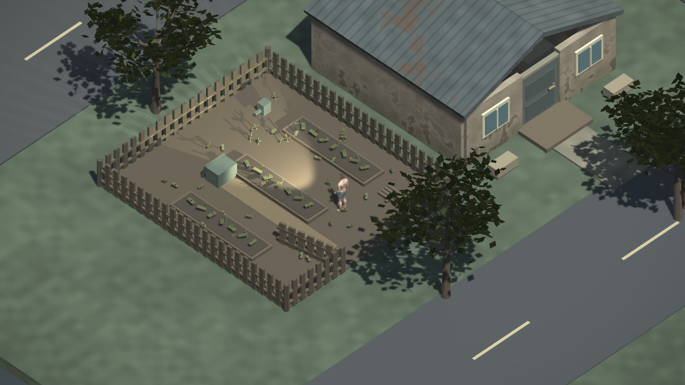

# Zonbee — места для исследования

Локальный этап: три интерактивных места в существующем районе, 8 ноября 2026.

## Огород на западной стороне

Огороженный двор за крайним западным домом: высохшие грядки, сорняки, забытая лейка, оставленные доски и ящик инструментальных материалов. Вход — южная калитка около **−46, −17**. E открывает и закрывает её с видимым поворотом; проход становится доступен после движения створки. Калитка не закрывается на герое или живом заражённом. Занятый проём сохраняется открытым, чтобы загрузка не зажимала персонажа.

Ящик около **−47, −10** обыскивается три секунды. Крышка открывается, герой использует существующую анимацию обыска, слышен звук перебираемых вещей; негромкий шум может привлечь близкого заражённого. E, движение, ранение, удар и начало другого занятия прерывают поиск. В ящике 2 доски, 1 проволока и 2 лоскута. Если все предметы не помещаются, вся находка остаётся в мире. После успешного обыска ящик пуст и остаётся открытым после загрузки. Земледелие не реализовано: грядки — следы прежней жизни.

## Машина с сигнализацией

Существующая жёлтая машина на восточной улице, точка действия **24,25, −9**, рядом с водительской стороной. E запускает пространственный сигнал и мигающие индикаторы на 18 секунд. Заражённые в пределах слуха получают место звука; игрок, которого они видят, остаётся приоритетом. Источник расположен на доступной земле рядом с машиной, поэтому враги действительно могут к нему подойти.

Один запуск расходует остаток заряда. E позволяет выключить сигнал раньше; повторно он уже не включится. Расход батареи сохраняется. После загрузки активный сигнал не проигрывается заново. Во время паузы длительность и звук заморожены. Это средство отвлечения, вождение и разбор этой машины пока не добавлены.

## Остановка

Небольшой навес у начальной улицы, объявление около **−6, −20,8**. Скамья, брошенный багаж и извещение связывают огород, машину и эвакуацию к башне. E читает объявление; обязательной последовательности действий нет. При приближении крыша и задняя панель скрываются, сохраняя видимость героя и столкновение с задней стеной.

Исследованные места получают небольшие цветные отметки на карте M. Постоянных новых текстовых панелей на HUD нет; короткая подсказка появляется рядом с доступным объектом. Это первые три места, а не переработка всей карты.

## Сохранения и происхождение

Добавлено необязательное поле состояния в текущий формат v9. Старые файлы без него загружаются с исходным состоянием новых мест; прежние предметы, дома и заражённые сохраняются. Неизвестные биты состояния отвергаются до изменения мира. Загрузка исправляет позиции внутри новых препятствий существующим способом. Частичный обыск не сохраняется.

Геометрия новых мест создана в проекте. Машина и материалы используются из прежних разрешённых источников, перечисленных в THIRD_PARTY.md. Новый сигнал синтезирован в проекте; сторонняя запись не использована.

Кадры сняты в настоящем Windows Player с подготовленными позициями, состояниями и скрытыми противниками; это локальный осмотр, не полная вылазка. Android не собирался и на устройстве не проверялся. GitHub не обновлялся.

[Машина с сигнализацией](images/exploration-alarm.png) · [Остановка](images/exploration-stop.png)

Проверено: **185 проверок пройдено** — 35 новых мест, 17 обыска, 18 выбора хранилища, 30 боя и 85 предыдущего этапа. Обычная Windows-сборка: 0 ошибок, 0 предупреждений. Отдельный запуск обычной версии завершён без исключений. Проверки используют временные сохранения; полной вылазки не было.
