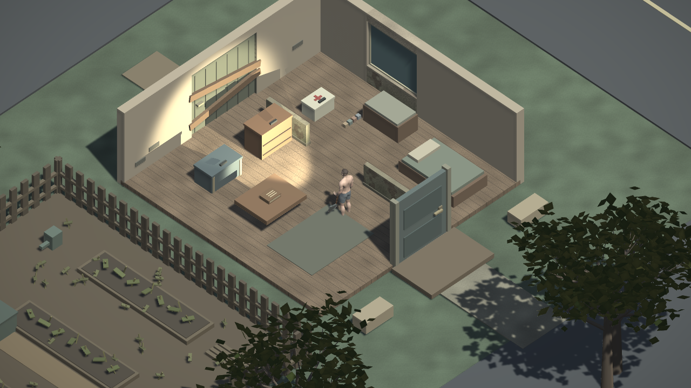

# Zonbee — окна и баррикады

Локальный этап в двух переработанных домах, 8 ноября 2026.

## Окна для разведки

Семейный дом №5 и дом столяра №9 имеют действующее окно на восточной стене. E поворачивает створку; обзор открывается по мере её движения. Подоконник продолжает препятствовать перемещению. Через открытое окно игрок и заражённые могут видеть друг друга. Закрытие возвращает преграду для обзора.

В семейном доме окно открывается тихо с любой стороны. У столяра оно заперто изнутри: из комнаты открывается обычно, снаружи нужен инструмент. E с топором или копьём начинает удар; стекло меняет состояние в момент попадания, а не при нажатии кнопки. Разбитое окно привлекает заражённых в радиусе слуха 26 м к доступной точке рядом с ним. Стекло больше не закрывается после загрузки. Звук разбивания синтезирован в проекте.

Перелезания через окно пока нет. Никакого мгновенного переноса через подоконник не добавлено.

## Укрепление задних дверей

У задней двери изнутри нажмите **V**. На установку уходят **2 доски и 1 проволока**, шесть секунд работы. Расход только после завершения. Движение, ранение, удар, открытие инвентаря или другого занятия прерывают работу; E отменяет. Работа негромко привлекает соседних заражённых.

Баррикада видна на двери, блокирует её открытие и выдерживает три обычных попадания. Заражённые находят доступную точку перед ней, замахиваются и бьют. Удар можно прервать оглушением. Тяжёлый заражённый снимает две единицы прочности, обычный — одну; ползущий пока не разрушает доски. Если к известному врагу месту существует открытый путь, он предпочитается началу нового взлома. Видимый игрок на той же стороне остаётся приоритетом.

Изнутри **V** снимает баррикаду за четыре секунды и возвращает одну доску. Проволока теряется. При полном инвентаре снятие не начинается, предмет не исчезает. Снаружи **E** с инструментом позволяет разбить укрепление, тратя силы на каждый удар. После разрушения последней доски дверь открывается; после аккуратного снятия её можно открыть обычным E. Подсказки появляются только рядом с объектом.

## Сохранения и границы этапа

Остаточная прочность и состояние окон записываются в необязательные поля текущего формата v9. Старые сохранения без них получают целые закрытые окна и двери без досок; прежние дома, инвентарь и добыча сохраняются. Неверные состояния отклоняются до изменения мира. Незаконченная работа и замахи не сохраняются, материалы до завершения не тратятся. Пауза останавливает створки, работу и момент попадания заражённого.

Используются прежние анимации работы руками и ударов; специальной анимации крепления проволоки пока нет. Баррикады пока доступны на двух задних дверях, на окна и остальные дома система не распространена. Геометрия создана в проекте, новых сторонних ассетов нет. Android не собирался и на телефоне не проверялся. GitHub не обновлялся.

Кадры из настоящего Windows Player с подготовленными позициями, состояниями окон и досок, скрытыми противниками. Это локальный осмотр, не полная вылазка.

[Выбитое окно в доме столяра](images/fort-window.png)

Проверено: **258 проверок пройдено** — 38 окон и баррикад, 35 планировок и задних дверей, 35 мест исследования, 17 обыска, 18 выбора хранилища, 30 боя и 85 предыдущего этапа. Обычная Windows-сборка: 0 ошибок, 0 предупреждений. Отдельный запуск обычной версии завершён без исключений. Проверки используют временные сохранения; полной вылазки не было.
