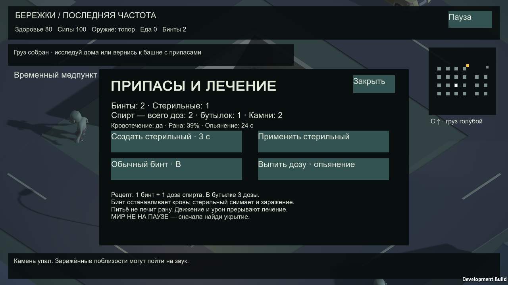
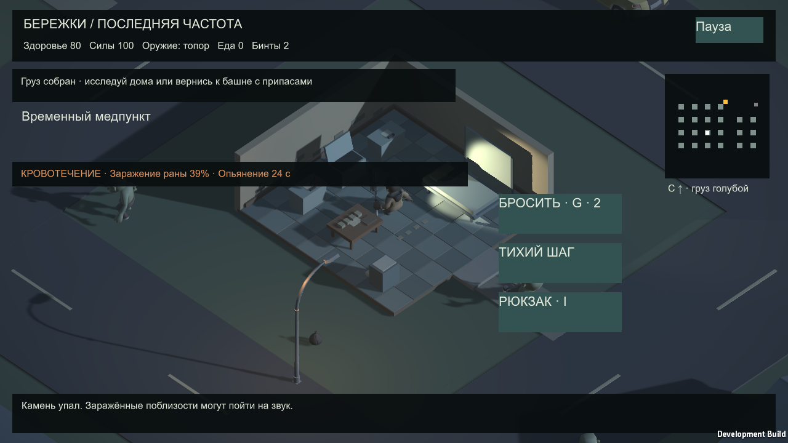
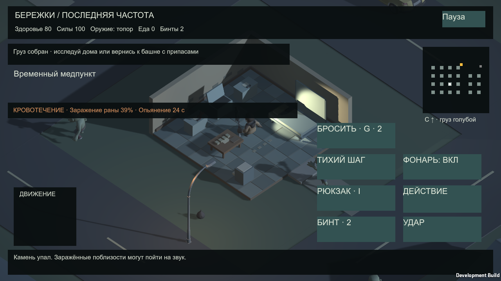

# Скрытность и последствия боя

4 ноября 2026. Этап после 2065d37. Офлайн, Windows x64. GitHub не обновлялся.

## Заражённые и скрытность

Обычный заражённый: 110 здоровья, скорость 2,25 м/с, 26 урона. Крупный: 160 / 1,65 / 34. Ползущий: 70 / 1,55 / 20. Обычному нужны три попадания топором, крупному четыре. Количество противников не сокращалось. В новой попытке один существующий обычный заражённый изначально находится перед медпунктом (12,−20), где лежат бинты и спирт. Новые враги при приближении не создаются. Это место позволяет попробовать обход, отвлечение и бой; баланс всех трёх вариантов ещё требует ручной игры.

Поведение разделено на блуждание, проверку звука, погоню и поиск. Видимость учитывает стены, направление взгляда и дистанцию: до 11 м в обычном режиме и до 4 м при тихом шаге; в непосредственной близости враг видит вокруг себя. Потеряв прямую видимость, он идёт к последней замеченной позиции, затем осматривается шесть секунд и успокаивается. Недоступная из-за закрытой двери точка тоже переводит его к поиску, а не к бесконечному знанию координат героя.

Камни подбираются по три у старта и на стыке восточной окраины. G или кнопка «Бросить» отправляет один камень до 8 м в направлении взгляда; стена сокращает дистанцию. По приземлении возникает шум радиусом 14 м. Враг, который прямо видит героя, не бросает погоню ради отвлечения. Камень расходуется при броске и повторно не подбирается. Начатый полёт не сохраняется; загрузка отменяет его без возврата камня.

## Ранения и предметы

Каждое попадание заражённого вызывает кровотечение и добавляет заражение раны. Кровотечение снимает 0,4 здоровья в секунду и само не проходит. Заражение начинается с 12%, растёт на 0,22 процентного пункта в секунду; повторный удар добавляет 12 пунктов. При 50% и выше максимум сил снижается до 65, здоровье теряется дополнительно по 0,15 в секунду. Оба состояния могут привести к смерти. Еда и отдых у башни не снимают их.

Обычный бинт: 2,5 секунды, остановка кровотечения и +8 здоровья, заражение остаётся. «Стерильный бинт»: 2,5 секунды, снимает оба состояния и возвращает 12 здоровья. Название и рецепт являются игровой условностью, а не медицинской инструкцией.

Крафт: один обычный бинт и одна доза этилового спирта, три секунды. Бутылка содержит три дозы. Дозы учитываются общим остатком; число бутылок выводится из остатка, индивидуальных слотов бутылок пока нет. Спирт есть в доме связиста, медпункте и во дворе дорожников; дополнительные бинты — в медпункте и на окраине. Все новые находки одноразовые, сохраняются независимо от старых шкафов, поэтому доступны и после переноса старого сохранения.

Спирт можно выпить: одна доза, 1,2 секунды действия, 45 секунд опьянения (повторное употребление — максимум 90). Рану это не лечит. Скорость движения уменьшается на 18%, восстановление сил — с 12 до 7 в секунду; направление движения и удара слегка колеблется. Опьянение проходит со временем и не снимается бинтом. Тряска камеры не добавлялась.

Движение, атака, получение урона или пауза прерывают начатое лечение/крафт. Материалы списываются только по завершении. Меню припасов не останавливает мир; его интерфейс предупреждает об этом.

## Управление

I или «Рюкзак» — предметы и крафт. B — обычный бинт. G или «Бросить» — камень. Ctrl или кнопка «Тихий шаг» — скрытность. На мыши направление броска задаётся прицелом; при сенсорном управлении — последним направлением движения. Новые кнопки отделены от удара и перевязки. Esc сначала закрывает рюкзак, затем открывает паузу.

## Сохранения

Версия 4 хранит кровотечение, заражение, оставшееся опьянение, дозы спирта, стерильные бинты, камни и новые находки. Версии 1–3 читаются. У старых заражённых сохраняется доля оставшегося здоровья при пересчёте нового максимума; погибшие остаются погибшими. Прежние позиции и добыча восстанавливаются. Старые герои не получают выдуманных ранений при переносе. Некорректные новые поля отклоняются до изменения мира. Старые исполняемые файлы не читают v4.

Как и раньше, незавершённые атаки и текущая тревога заражённых сбрасываются при загрузке. Незавершённое лечение также отменяется. Это не режим с безвозвратной смертью: загрузка последнего сохранения остаётся доступной.

## Проверка и ограничения

Диагностический Windows-player проверяет дозы, расход и прерывание действий, реальный таймер крафта через Update, сохранение новых состояний, миграцию v3, отбраковку повреждений, потерю видимости за закрытой дверью, поиск, отвлечение и приоритет видимой цели. Выполняются прежние проверки боя, интерьеров и сохранений.

Скриншоты сняты в настоящем player с подготовленными позициями, инвентарём и ранениями. Сенсорный кадр использует эмуляцию интерфейса в Windows. Это не полное ручное прохождение и не тест телефона. Android APK не собирался; производительность и удобство на устройстве не проверены.

Модели остаются стилизованными, лечение и крафт пока без отдельных скелетных анимаций. Нет распространения инфекции между персонажами, голода, жажды и множества видов ран. Отдельная атака ползуна, звуки поверхностей и полноценное ручное прохождение остаются следующими задачами. Новых внешних ассетов и платных сервисов нет.

Итог: 101 проверок пройдено в Windows Development Player. Обычная сборка: 0 ошибок, 0 предупреждений. Результаты: hardcore-checks.txt, hardcore-build-report.txt.

