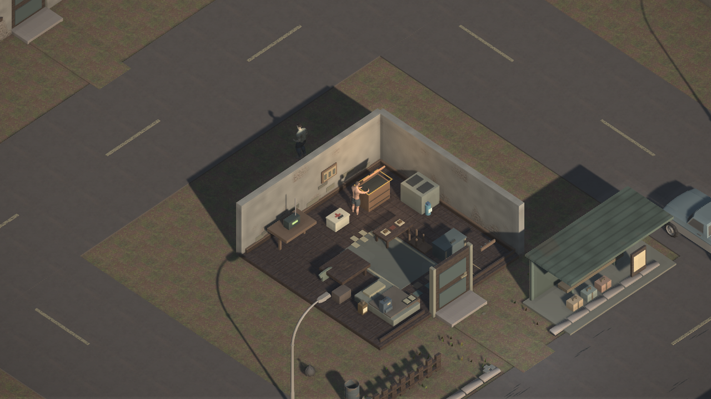

# Zonbee — шум и укрытия

17 ноября 2026. Слух заражённых теперь учитывает препятствия между ними и источником звука.

Стена сильнее глушит шум, закрытая дверь и целое стекло — слабее. Открытый проход или разбитое стекло не дают прежнего ослабления. Несколько отдельных стен складывают эффект; перекрывающиеся части одной стены не считаются несколькими препятствиями. Низкий подоконник и ограда не работают как глухая стена.

Это позволяет тише обыскивать дом за закрытой дверью. Однако громкие действия, разбивание стекла и радио всё ещё могут привлечь заражённых снаружи. Противник идёт к услышанному источнику, а видимый герой сохраняет приоритет перед отвлекающим шумом.

## Шаги

Раньше бег создавал сигнал для ИИ каждый кадр, а обычная ходьба такого сигнала не давала. Теперь шум возникает вместе с шагами: обычного заражённого на открытом месте ходьба может привлечь примерно с четырёх метров, бег — с четырнадцати; тихий шаг существенно слабее. Эти базовые дистанции меняются с чувствительностью типа заражённого и препятствиями. Звуки шагов для игрока сохраняются.

Повторный шум из того же места поддерживает интерес заражённого, но не заставляет каждый раз сбрасывать уже рассчитанный путь. Это особенно полезно при продолжительном обыске.

## Проверка

**247 успешных локальных проверок в Windows Player:** слух 25, поиск 17, обыск 17, дома 35, окна и баррикады 38, бой 30, интерфейс и сохранения 85. Специальная проверка охватывает стены, перекрывающиеся препятствия, двери, целое/открытое/разбитое окно, повторный шум, приоритет видимого героя и восстановление состояний после загрузки.

Ходьба и тихий шаг проверены настоящим вводом клавиатуры через Unity Input System: находящийся неподалёку спиной к герою заражённый слышит обычные шаги, но не реагирует на тихие в той же расстановке. В отдельной живой проверке обыск кухонного ящика не привлекает заражённого за наружной стеной, а громкий сигнал из той же точки привлекает его.

Настоящий кадр Windows Player. Положения героя, одного заражённого и камера заданы для проверки; движение заражённого в этой расстановке удерживается тестом, его восприятие работает. Остальные заражённые исключены. Это проверка слышимости, не ручная вылазка и не проверка большой толпы.

Development и обычная Windows-сборка завершены с 0 ошибками и 0 предупреждений. Обычная версия отдельно инициализирована и штатно закрыта. Формат сохранений не менялся, акустические свойства берутся из восстановленного состояния проёмов. Пользовательское сохранение для тестов не использовалось.

## Ограничения

Модель рассчитывает препятствия на прямой между источником и слушателем. Она не моделирует огибание углов, отражения или распространение звука через цепочку помещений. Ослабление настроено для игрового ИИ; новая симуляция акустики и приглушение всех слышимых игроком записей не добавлялись. Слабые ПК, большая толпа и Android на этом этапе не измерялись.

Следующая доработка — обратная связь при обыске: сделать риск громкого контейнера понятнее по виду, движению и звуку, сохранив лаконичный интерфейс.

## Повторение

Сборка: `Askich.Editor.BuildDistrict.Pair`. Специальная проверка: Development Player с `-zonbee-hearing-check`, папка из `ZONBEE_HEARING_CHECK`. Отчёты этого этапа — `hearing-*-checks.txt` и `hearing-build-report.txt`.
