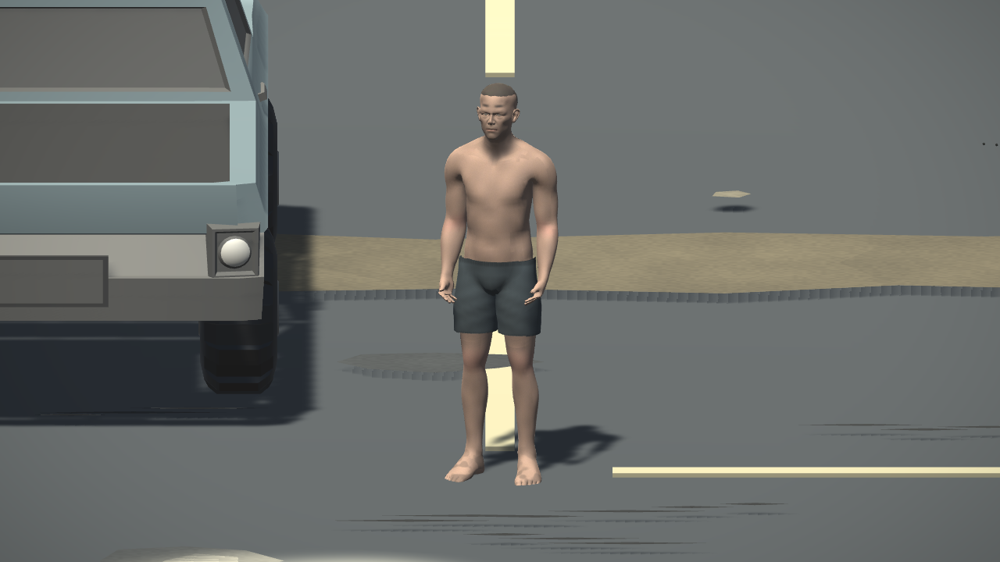

# Zonbee — модель героя и опора ног

13 ноября 2026. Небольшой этап переработки существующего героя после исправления окон. Это доработка прежней модели на основе CC0 Human Base Mesh, а не новый отсканированный персонаж.

## Изменения

Слегка уменьшены ширина торса и объём икр. Сохранены исходные сглаженные нормали кожи, скелет, веса и формы захвата оружия. Шорты свободнее на бёдрах, пояс и нижний край выровнены; отдельный матовый материал добавляет плетение ткани, подгибку и швы. Кожа получила более сдержанный блеск, лёгкую щетину, оттенки суставов и грязь у стоп. Это процедурные детали, не новые фототекстуры.

Переработаны движения таза и ног в ходьбе и беге. При ходьбе вертикальное движение таза ограничено 2,5 см; опорная стопа движется назад со скоростью, согласованной с обычной скоростью персонажа 1,8 м/с. В беге выше поднимается переносимая нога. Добавлен перекат стопы. Циклы — 0,80 секунды для ходьбы и 0,68 для бега. Прежний свободный мах рук и динамическое сгибание пальцев сохранены.

При надевании брюк шорты теперь скрываются, при снятии снова появляются. Это устраняет пересечение более свободных шорт с брюками. Формат сохранений не менялся.

## Проверка

Windows: сборка без ошибок и предупреждений, обычный запуск и закрытие с кодом 0. Пройдено 218 проверок: 16 модели/движений, 32 рук, 21 одежды, 34 перелезания, 30 боя и 85 прежних исправлений обзора, столкновений, интерфейса и сохранений. После последнего исправления видимости шорт повторены проверки модели и одежды; остальные проверки прошли непосредственно перед ним. Все диагностические режимы используют временные сохранения, полная вылазка не проводилась.

Проверены реальное движение с клавиатуры, переход ходьба → бег, хват оружия, восстановление одежды и импорт старого профиля. Поведение проверок не доказывает художественное качество — оно отдельно оценивалось по кадрам из Player.

Ниже кадр настоящего Windows Player с приближённой камерой и подготовленной позой. Это постановочный диагностический кадр.

[Ходьба и бег спереди и сбоку](images/hero-motion.mp4) — ролик из равномерно выбранных фаз настоящих игровых клипов, отрисованных Windows Player. Темп соответствует длительности клипов; это осмотр анимации на месте, не запись управления в реальном времени. Динамический полусгиб пальцев отдельно проверен при живом движении.

[Герой в найденной одежде](images/hero-clothed.png). Детальные результаты: `hero-*-checks.txt`, отчёт сборки — `hero-build-report.txt`.

## Ограничения

Это всё ещё процедурно подготовленные анимации, без захвата движений. У героя нет отдельного поворота на опорной ноге и адаптации стоп к лестницам/неровностям. Кисти, лицо и переходы при резкой смене направления требуют дальнейшей художественной работы. Модели заражённых и окружения этим этапом не переделаны. Android не проверялся, публикация на GitHub отложена.

## Воспроизведение

`Askich.Editor.HeroRefinementAuthor.Bake` создаёт производные сетки, материалы и движения героя. `BakeAndBuild` дополнительно собирает диагностический и обычный Windows Player в каталоги `ASKICH_BUILD_DIR` и `GOIDA_SURVIVAL_RELEASE`.

Исходная сетка тела — `HeroHands.asset`, шорт — `Adult.fbx`. Оригинальные источники не перезаписываются. Проверки запускаются флагами `-district-character-art-check`, `-zonbee-arm-check`, `-district-wardrobe-check`, `-zonbee-climb-check`, `-district-pc-combat-check`, `-zonbee-polish-check`.
