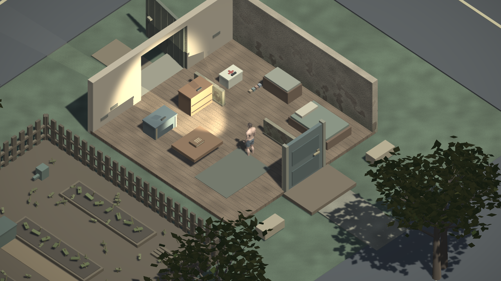
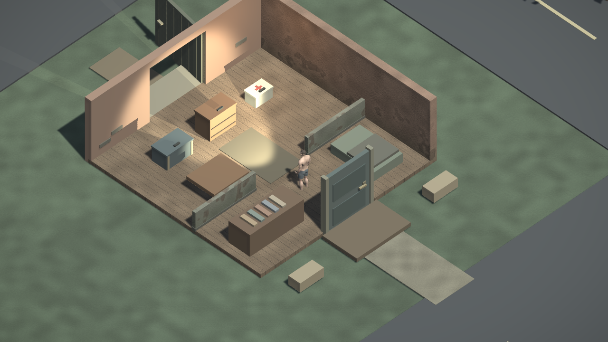

# Zonbee — два дома с выходами во двор

Локальный этап, 8 ноября 2026. Первые разные внутренние планировки на существующей карте.

Семейный дом №5 на западе (**−36, −12**) получил отдельную спальную часть с кроватью и детской койкой. Перегородка делит восточную спальню и западную жилую часть, оставляя проход и коридор у задней стены. Дом столяра №9 (**−36, 12**) разделён иначе: верстак и место для сна находятся за поперечной перегородкой, в которую оставлен центральный проход.

В обоих домах появилась задняя дверь на северной стене, E — открыть или закрыть. Теперь можно заходить со двора и уходить через другой выход. Дверь поворачивается, её столкновение меняется по мере движения. Закрытие невозможно, пока проём занят героем или живым заражённым. Заражённые используют тот же настоящий проход и находят путь через открытую заднюю дверь.

Перегородки физически препятствуют движению и закрывают обзор заражённым. Их верхняя часть скрывается внутри дома вместе с внешними стенами для чтения помещения; логика стен при этом сохраняется. Индексы и содержимое всех 66 старых контейнеров прежние. При близости к шкафу и двери E выбирает более близкий шкаф, чтобы подсказка обыска не приводила к открытию двери.

Состояние двух задних дверей сохраняется в новом необязательном поле формата v9. Старый файл без поля открывается с закрытыми новыми дверями. Позиции внутри новых перегородок исправляются в пределах прежнего дома. Занятые дверные проёмы записываются открытыми, что предотвращает зажим при загрузке. Неверные биты состояния отвергаются до изменения мира.

Попутно исправлен пропущенный запуск звука обыска огородного ящика: теперь перебирание материалов слышно во время поиска и останавливается при отмене или завершении.

Это две планировки в прежних наружных контурах 8×8 м. Остальные дома пока используют прежние схемы. Разбивание окон, перелезание и баррикады ещё не реализованы. Геометрия создана в проекте, новые сторонние материалы не добавлялись.

Кадры из настоящего Windows Player: подготовленные позиции, открытые задние двери и скрытые противники для осмотра интерьера. Это не полная вылазка. Проверки используют временные сохранения. Android не собирался и на телефоне не проверялся. GitHub не обновлялся.

Проверено: **220 проверок пройдено** — 35 планировок и задних дверей, 35 мест исследования, 17 обыска, 18 выбора хранилища, 30 боя и 85 предыдущего этапа. Обычная Windows-сборка: 0 ошибок, 0 предупреждений. Отдельный запуск обычной версии завершён без исключений. Проверки используют временные сохранения; полной вылазки не было.
