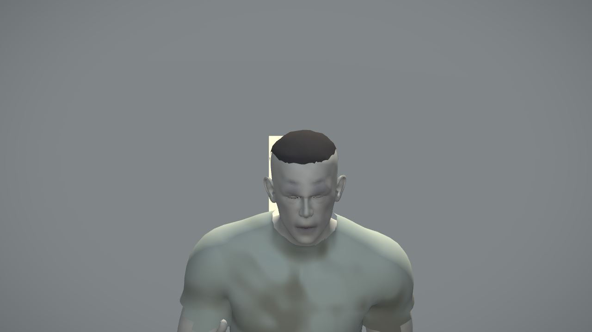

# Zonbee — лицо и одежда обычного заражённого

14 ноября 2026. Продолжение работы над Lean, на основе прежнего CC0 Human Base Mesh. Новых сторонних материалов нет.

Слегка углублены щёки и изменена нижняя часть лица. Отдельный материал кожи добавляет приглушённый оттенок, затемнение вокруг глаз, изменение цвета губ и несимметричный синяк. Разметка этих деталей привязана к телу и движется со скелетом. У волос неровнее край, меньше блеска. Брюки свободнее на ногах, со складками у коленей и отдельным матовым материалом.

Исправлено наложение шорт поверх брюк у стоящих заражённых. У ползущего, который не носит брюки, шорты сохранены. Хват, скелет, анимации и формат сохранения сохранены.

## Проверка

56 проверок в Windows Player: 10 внешнего вида и анимаций заражённого, 30 боя, 16 модели героя. После изменения диагностической камеры повторена проверка заражённого. Сборка без ошибок и предупреждений; отдельный обычный запуск и закрытие проверены. Проверки локальные, на временных сохранениях.

Это настоящий кадр Player, но с постановочной камерой и дополнительным проверочным светом. [Полный рост](images/appearance-idle.png) и [ролик игровых анимаций](images/appearance-motion.mp4) сняты в тех же условиях; ролик составлен из равномерно выбранных фаз, без звука. [Игровой ракурс без дополнительного света](images/appearance-gameplay-view.png) тоже подготовлен для сравнения: камера приближена, герой скрыт, заражённый поставлен на улицу.

## Ограничения

Это всё ещё производная существующей модели, а не новый реалистичный персонаж. Волосы остаются цельной геометрией без отдельных прядей, мимики нет, ткань не симулируется. Кожа и одежда используют процедурные детали. Тяжёлый и ползущий заражённые не получили новую внешность. Android не проверялся, GitHub не обновлялся.

Создание ресурсов: `Askich.Editor.InfectedAppearanceAuthor.BakeAndBuild`. Для сборки готовых ресурсов используется `Askich.Editor.BuildDistrict.Pair`. При полном пересоздании сначала вызывается прежний автор движений/рубашки, затем автор внешности. Источники сеток неизменяемые — `Adult.fbx`; изменённые материалы и сетки хранятся отдельно.
