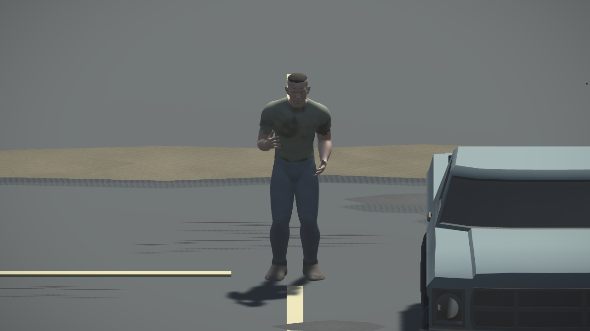

# Zonbee — обычный заражённый

14 ноября 2026. Доработан существующий тип Lean. Тяжёлый и ползущий заражённые остаются прежними.

У обычного заражённого теперь асимметричная поза: одна рука опущена ниже другой, плечи наклонены, голова слегка покачивается. При ходьбе одна стопа поднимается выше другой; сохранены опора и замкнутый цикл. Перед атакой руки отводятся назад, затем выбрасываются вперёд. Контакт остаётся на 47% клипа длительностью 1,2 секунды и соответствует прежнему моменту нанесения урона. Характеристики урона и здоровья не менялись.

Сетка рубашки заново выделена из существующей модели тела: закрыты плечи, добавлен неровный нижний край и отдельный матовый материал с нерегулярными загрязнениями. Используется прежний CC0 источник Human Base Mesh, указанный в THIRD_PARTY.md; платных или новых сторонних материалов нет. Это производная прежней модели, не новый отсканированный персонаж.

## Проверки и кадры

54 проверки в Windows Player: 8 нового оформления и движения, 30 боя, 16 модели героя. После последней правки материала повторена проверка заражённого. Сборка: 0 ошибок и предупреждений. Обычный запуск и закрытие проверены отдельно. Использованы временные сохранения; полная вылазка не проводилась.

[Походка и атака](images/infected-motion.mp4). Кадры получены в настоящем Player с приближённой камерой и равномерным выбором фаз клипов. Это постановочный осмотр анимаций на месте, без звука, а не запись управления. [Подготовка атаки](images/infected-windup.png) · [Контакт](images/infected-contact.png).

Крупный план всё ещё выявляет ограничения исходного лица, волос, кистей и брюк. Фотореалистичной графикой этот результат не является. Для остальных типов заражённых изменения не распространялись; Android не проверялся, GitHub не обновлялся.

Воспроизведение: `Askich.Editor.InfectedMotionAuthor.BakeAndBuild`. Диагностика: `-zonbee-infected-art-check`, каталог `ZONBEE_INFECTED_ART_CHECK`. Готовые ресурсы можно собрать обычным `Askich.Editor.BuildDistrict.Pair`.
