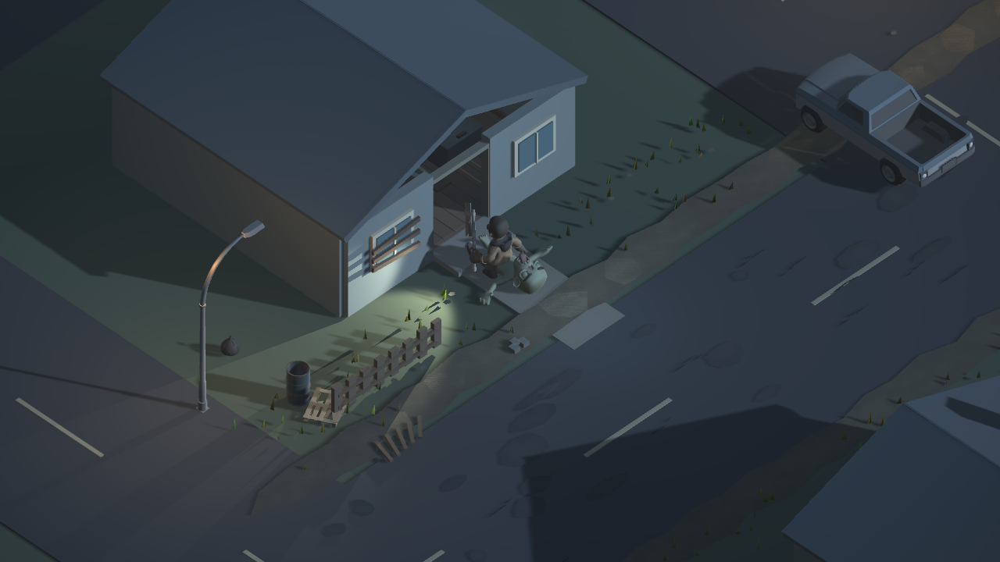
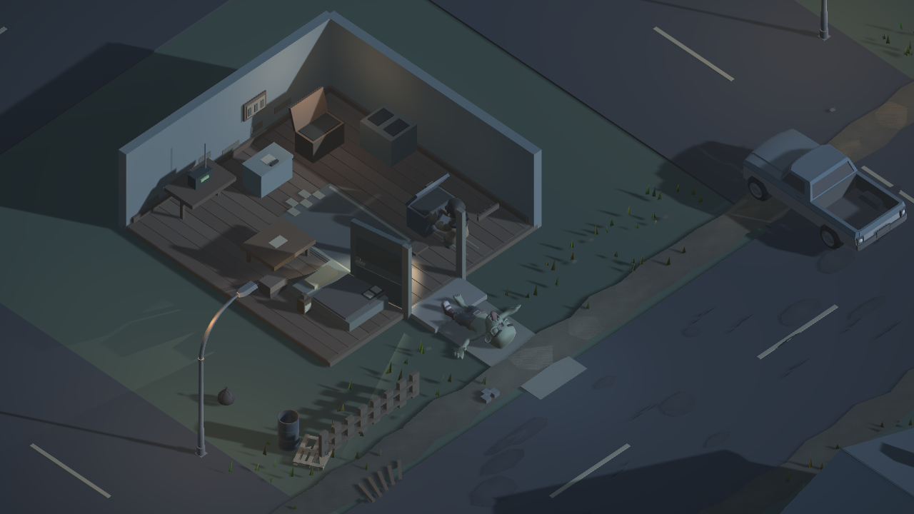

# Бережки — двери и обыск

## Двери

Входная дверь вращается вокруг петли; панель, ручка и рама остаются видимыми в открытом положении. Движение занимает около трети секунды. Проход становится доступен, когда створка достаточно отведена. При закрывании занятый героем или живым заражённым проём удерживает дверь в приоткрытом положении. После освобождения прохода она закрывается. Граница прохода моделируется прежним прямоугольным барьером.

Пауза останавливает движение. Повторное действие меняет направление створки. Загрузка сразу устанавливает сохранённое положение. Если сохранение выполнено в занятом проёме, дверь восстанавливается открытой, чтобы сохранить позицию героя и возможность двигаться.

## Контейнеры

Крышка постепенно приоткрывается во время поиска, а звук обыска повторяется до завершения. Герой поворачивается к контейнеру и использует запечённый для этого этапа клип Search; оружие временно скрывается. Руки движутся перед корпусом. Точное размещение ладоней на каждом предмете ещё предстоит настроить.

Движение, атака, ранение и переход к лечению прерывают поиск. Незавершённый контейнер закрывается, звук прекращается. После завершения добыча выдаётся один раз, а крышка остаётся открытой. При загрузке внешний вид восстанавливается из прежнего массива taken. Незавершённый поиск отменяется.

Подсказка и действие выбирают один ближайший контейнер с прямой видимостью. Стена препятствует обыску снаружи. Для переключения радио также требуется прямой доступ.

## Проверка

В Windows Development Player пройдено 155 проверок. Набор проверяет промежуточный угол и время открытия, паузу, занятую дверь, закрытие после освобождения, сохранение на пороге и восстановление поз. Для обыска проверяются частично открытая крышка, повторяющийся звук, отмена, получение топора и восстановление уже обысканного ящика. Прежние проверки боя, ранений, радио, сохранений и сенсорной схемы входят в общий прогон.

Автоматическая вылазка завершилась за 133,2 с. Герой начал без оружия, добыл топор, дослушал радио, после удара обошёл забор и закрыл медпункт. На обратном пути он применил запасной стерильный бинт и обустроил убежище. Попытка начать лечение при занятом проёме ранее закончилась смертью; повтор использует обход и отрыв от преследователя.

[Проверки](interactions-checks.txt) · [Сборка Windows](interactions-build-report.txt) · [Автоматическая вылазка](interactions-route.txt)

Кадры ниже — постановочная проверка в Windows Player. Герой заранее размещён у двери и затем у ящика; остальные заражённые выключены для этой проверки. Кадры сняты игровой камерой без интерфейса.

В сцене использованы прежние материалы и скелет персонажа. Новая геометрия двери создана средствами проекта. Звук обыска синтезируется кодом. Платные материалы и новые внешние ассеты не приобретались.

Слепой тест новым игроком и полноценный ручной сеанс на 10–15 минут остаются открытыми. Android APK на этом этапе не собирался; телефон и удобство взаимодействий на устройстве не проверялись.
