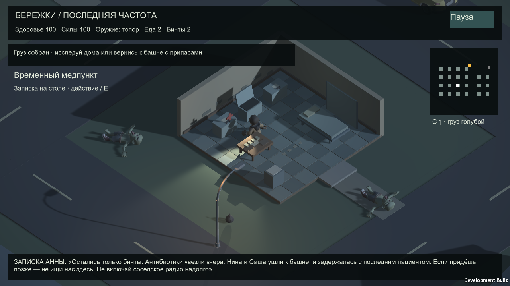
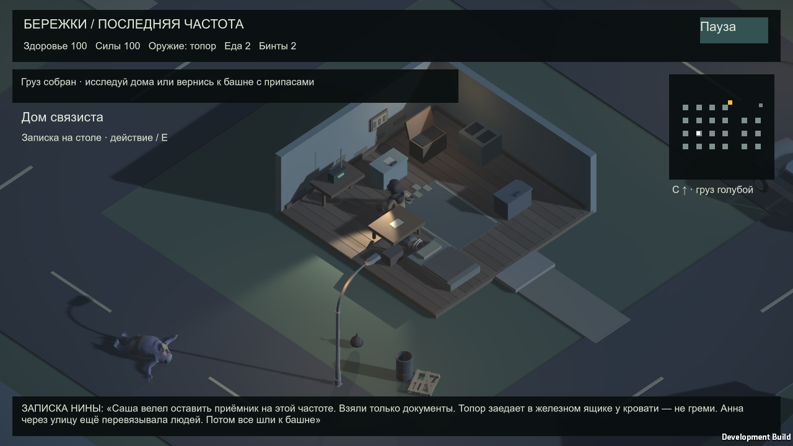

# Два дома и осмысленный обыск

4 ноября 2026. Локальный этап после c002089. Размер мира прежний: 180×120 м, 22 дома. GitHub не обновлялся.

## Реализовано

Дом связиста (первый дом к северу от старта) получил дощатый пол, выцветший ковёр, матрас с одеялом, кухонную плиту, стол под радио, письма и семейную фотографию из простой геометрии. Железный ящик с топором перенесён от радио: раньше действие у него включало приёмник вместо обыска. Содержимое прежних трёх слотов сохранено.

Соседний дом через улицу стал временным медпунктом: плитка, кушетка на ножках, ширма, умывальник, пустые упаковки и журнал пациентов. Записки Нины и Анны связывают две семьи и уход жителей к башне. На чтение отводится 12 секунд, запись можно открыть снова.

Контейнеры имеют названия и разные условия обыска. Перед действием рядом отображаются длительность и шум. Инструментальный ящик: 3,4 секунды и радиус тревоги 13 м; дорожная аптечка и медицинская сумка: 1,3 секунды и 3 м. Другие контейнеры находятся между ними. Кнопка действия одинакова для клавиатуры и сенсорной схемы. Движение, удар или урон прерывают обыск без выдачи добычи. Повторное нажатие на уже обыскиваемый контейнер не обнуляет таймер.

Обыск сопровождается новыми процедурными пространственными звуками ткани, металлического ящика и защёлки. Это синтезированные эффекты, а не полевые записи; субъективный микс звука ещё нужно оценить вручную. После обыска крышка открыта, при загрузке её положение восстанавливается по прежнему признаку taken. В остальных домах контейнеры также показывают состояние крышки.

## Совместимость и ограничения

Формат сохранений остаётся v3, число домов, порядок слотов и ID заражённых не изменены. Чтение v1/v2 сохраняется. Новое окружение создано кодом проекта; новых сторонних ресурсов, платных материалов или голосов не добавлено. Предыдущие лицензии остаются в THIRD_PARTY.md.

Геометрия и персонажи пока стилизованные. Мебель преимущественно декоративная, без отдельных столкновений; проходы проверяются существующей навигацией. Это не законченная реалистичная художественная переработка. Остальные 20 домов ещё требуют собственной обстановки. Старое синтетическое радио остаётся временным.

## Проверка

Диагностический Windows-player проверяет обычный цикл обыска через Update, тревогу от шумного ящика, отсутствие дальней тревоги от тихой сумки, пути ко всем шести контейнерам, отсутствие добычи при прерывании, загрузку видимого состояния крышек и предыдущие проверки мира. Полный ручной маршрут и прослушивание звуков не заявляются.

Снимки clinic.png и radio-home.png сделаны в настоящем Windows-player с подготовленными позициями героя, инвентарём и состоянием врагов. Это постановочные тестовые кадры, а не прохождение. Android APK не собран, на устройстве не проверено.

Результат: 57 проверок пройдено. Обычная Windows x64-сборка: 0 ошибок, 0 предупреждений. Подробности — interiors-checks.txt и interiors-build-report.txt.

