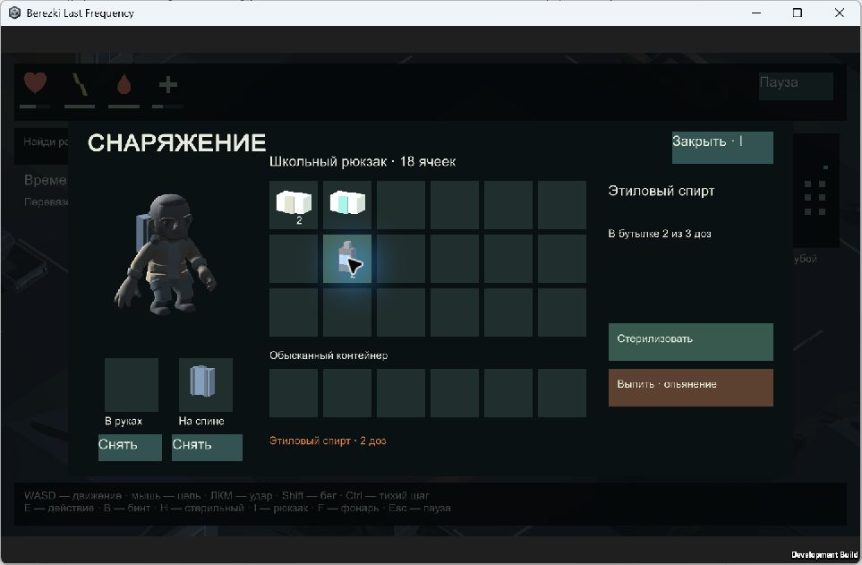
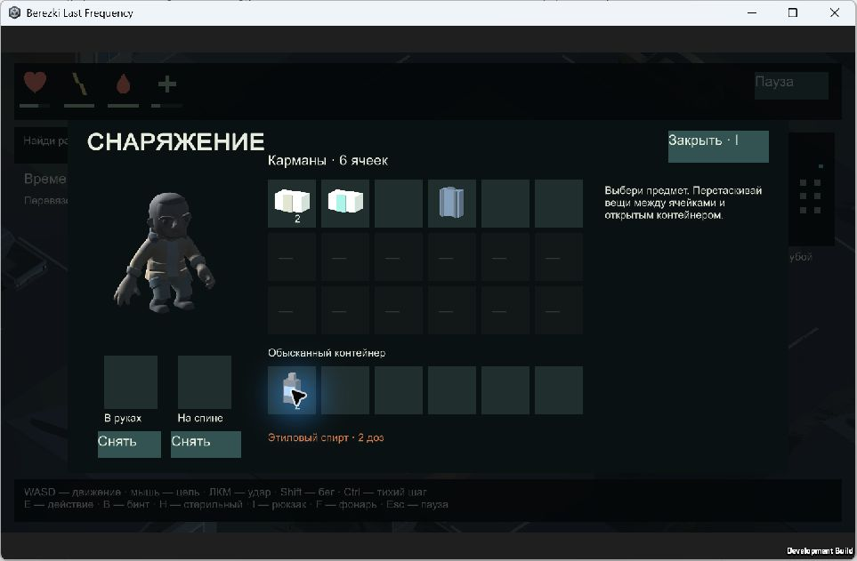

# Бережки — ячейки, школьный рюкзак и экипировка

## Что работает

Новая попытка начинается с шестью ячейками карманов. Школьный рюкзак лежит в доме связиста возле оставленных вещей. Его нужно подобрать действием / E, затем надеть через силуэт или кнопку предмета. Он открывает ещё двенадцать ячеек и появляется на спине. Снять рюкзак можно после освобождения дополнительных ячеек и места под сам предмет в карманах.

В сетке показаны изображения предметов, полученные рендером трёхмерной геометрии проекта. Фигура персонажа также рендерится с текущим оружием и рюкзаком. В этом этапе доступны места для оружия в руках и рюкзака на спине. Одежда и броня остаются дальнейшим развитием.

Мышью вещи перетаскиваются между ячейками, на экипировку и в доступный обысканный контейнер. Для сенсорного ввода используется удержание и перенос через MenuPointer. Ячейки меняются местами или объединяют одинаковые предметы до размера пачки. Бутылка занимает одну ячейку и хранит от одной до трёх доз; действие расходует дозу выбранной бутылки. Оружие, найденное безоружным героем, сразу берётся в руки. Следующее оружие требует места среди вещей.

Находка при заполненных карманах остаётся в мире. Содержимое ещё не обысканного ящика выдаётся после поиска; если оно не помещается, ящик сохраняет свою добычу. Предметы можно оставить в уже обысканных ящиках и вернуться за ними. В каждом таком хранилище шесть ячеек. Крафт проверяет место под результат и изменяет ингредиенты одной операцией.

Здоровье, выносливость, кровотечение, заражение и опьянение представлены иконками со шкалами. Пояснение появляется при наведении или удержании. Голод, жажда, вес и прочность вещей остаются следующими механиками.

## Сохранения

Новые записи используют версию 5. Читаются прежние версии 1–4. Вещи переносятся в карманы с сохранением количества и доз. Избыточные старые запасы отображаются отдельным разделом переноса с листанием. Из него можно переложить вещи в свободные ячейки. Рядом с доступным контейнером сначала показывается его содержимое; чтобы открыть перенос старого запаса, достаточно отойти от ящика.

Положение вещей, экипировка, находка рюкзака, частичные бутылки и хранилища записываются в сохранение. Повреждённые ячейки отклоняются до изменения мира; сохраняется прежнее восстановление резервной копии. Старые исполняемые файлы рассчитаны на прежний формат.

## Проверка

В Windows Development Player пройдено 194 проверки. Новые проверки охватывают вместимость, полный подбор, место для крафта, обмен с контейнером, надевание и снятие рюкзака, сохранение остатков доз и перенос больших запасов из v4 без потерь.

[Результаты](inventory-checks.txt) · [Сборка Windows](inventory-build-report.txt) · [Вылазка](inventory-route.txt)

Автоматическая вылазка с обычными правилами завершилась за 141,1 с. Герой нашёл школьный рюкзак в доме, надел его, дослушал радио, обработал рану и обустроил убежище. Предметы и здоровье не выдавались командами проверки в этой вылазке.

В отдельном оконном запуске через computer-use проверены перенос рюкзака на персонажа, расширение сетки, перенос бутылки во второй ряд, отказ снять заполненный рюкзак, размещение бутылки в контейнере и обратный перенос. Две оставшиеся дозы сохранились. На кадрах ниже используются заранее выданные тестовые вещи и отдельное сохранение; окружающие заражённые выключены для осмотра.

Иконки — первые рендеры геометрии проекта, совместимые со стилем текущих моделей. Отдельные авторские иллюстрации предметов и более детальная модель рюкзака могут заменить их дальше. Новые внешние ассеты и платные сервисы не использовались.

Перенос мышью проверен в оконном Windows Player. Полный сенсорный прогон сетки и физический Android-телефон остаются открытыми. Android APK в этот этап не собирался. Полноценный слепой ручной сеанс на 10–15 минут также остаётся открытым.
