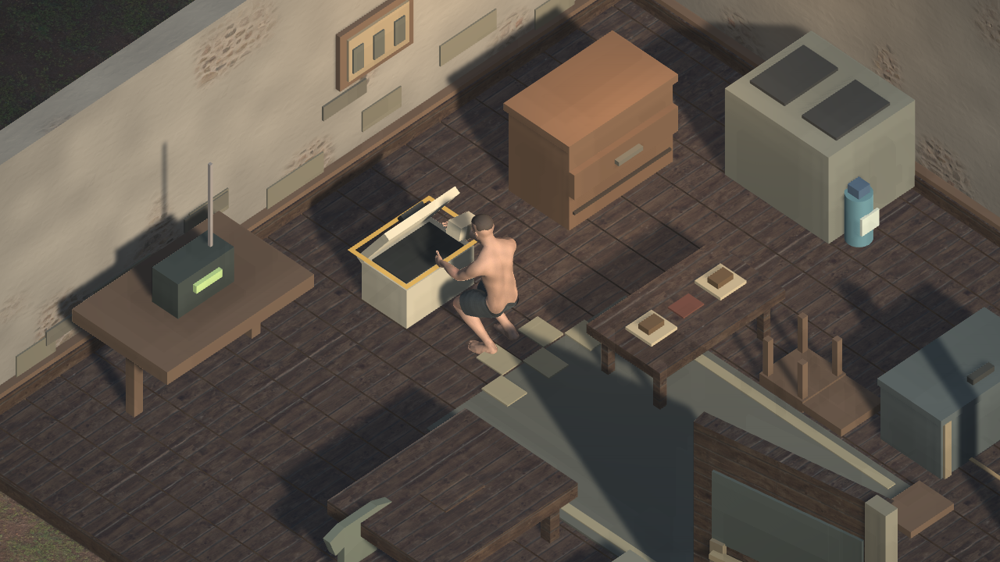

# Zonbee — находка в руке

19 ноября 2026.

В последней части обыска появляется объёмная находка, следующая за правой кистью. Рука приподнимает предмет. Используются те же модели, из которых игра рисует иконки инвентаря: бинт, банка еды, инструменты и материалы сохраняют общий вид. Новые внешние материалы или модели не скачивались.

Если места достаточно, находка переносится в инвентарь после полного окончания поиска. Если места нет, движение опускает предмет обратно, а настоящая вещь остаётся в контейнере. Проверка свободного места учитывает неполные стопки и существующую возможность взять первое оружие прямо в свободную руку. Сама картинка не меняет количество предметов: окончательное решение о переносе принимает существующая операция инвентаря.

Отмена, загрузка и смерть убирают временный предмет. Пустой контейнер ничего не показывает. Дополнительное время ожидания и новые сообщения не добавлялись; извлечение занимает последнюю часть прежнего времени обыска.

## Проверено

229 локальных проверок в Windows Player: находки 20, переходы 17, контакт 17, слух 25, управление контейнерами 18, обыск 17, бой 30, интерфейс и сохранения 85. Проверены бинт и банка еды, привязка к кисти, отсутствие преждевременной выдачи, отмена видимой находки, пустой контейнер, полный инвентарь, возврат и последующий перенос, повторное открытие, сохранение и загрузка, очистка при смерти.

Windows Development и обычная сборка — без ошибок и предупреждений. Обычная версия отдельно запущена и штатно закрыта. Пользовательское сохранение в проверках не использовалось. Формат сохранений не менялся.

Настоящий кадр Windows Player. Положение героя и камера заданы диагностикой, заражённые отключены. Предмет ещё не перенесён в инвентарь; это проверочная сцена, не полная ручная вылазка.

## Ограничения

Модели предметов пока простые. Пальцы слегка сгибаются, но индивидуального захвата каждой формы и контакта пальцев с поверхностью ещё нет. Находка показывается на последнем этапе поиска, а не физически лежит в ящике всё время. Перенос кнопками из уже обысканного контейнера остаётся прежним, без новой анимации. Работа на Android и длительная производительность на слабых ПК не проверялись.

Следующий небольшой шаг — сделать оставленную в контейнере вещь заметной после обыска и улучшить её последующий подбор, сохранив существующие правила инвентаря.

Повторение: `Askich.Editor.BuildDistrict.Pair`; Development Player с `-zonbee-loot-presentation-check`; результаты в `ZONBEE_LOOT_PRESENTATION_CHECK`. Отчёты: `loot-presentation-*-checks.txt`.
