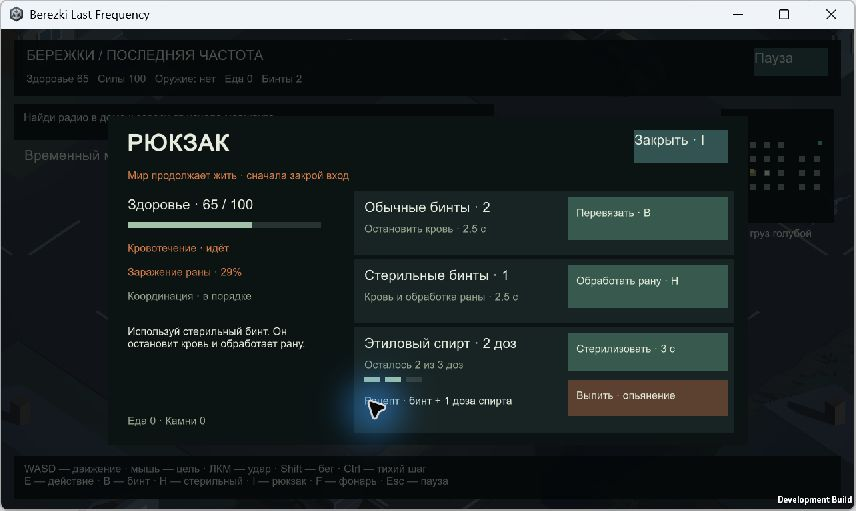
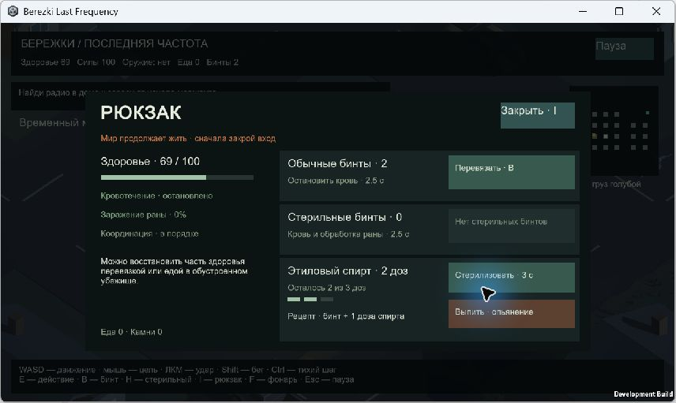

# Бережки — рюкзак и перевязка

В рюкзаке состояние героя находится слева, а бинты и спирт — справа. Кровотечение, заражение и опьянение получают отдельные строки. Подсказка под ними учитывает рану и имеющиеся материалы. Если предмета не хватает, кнопка показывает причину и не запускает действие.

Спирт показан общим числом доз, остатком в начатой бутылке и тремя отметками заполнения. Стерилизация и питьё расположены отдельно. Применение бинта закрывает рюкзак и запускает существующий игровой таймер. На экране видны ход действия и кнопка отмены. Отмена сохраняет материалы; движение, удар и пауза прерывают действие по прежним правилам.

B использует обычный бинт, H — стерильный. Сенсорная быстрая перевязка выбирает стерильный бинт при заражённой ране, если он имеется. При обычном кровотечении сначала используется простой бинт; когда он закончился, можно использовать имеющийся стерильный. Крафт остаётся отдельным действием.

В игровом оконном запуске через computer-use проверена перевязка. Снимки ниже показывают тестовую рану и припасы, заранее выданные в отдельном диагностическом сохранении. Все остальные заражённые выключены в этом просмотре. Кадры захвачены из настоящего окна вместе с интерфейсом.

В оконном Windows Development Player пройдено 167 проверок. Новые действия проверяются через события мыши Unity Input System. В пакетном запуске проверяются соответствующие игровые команды и состояния; проверка кликов требует оконного запуска. Пакетный повтор также прошёл все 167 проверок команд и состояний. [Отдельный журнал пакетного запуска](medical-command-checks.txt). Ранее пакетный клик не запускал действие, поэтому такой прогон не засчитывался как проверка кнопок.

Автоматическая вылазка до убежища прошла за 144,5 с. Обычный релиз отдельно запущен до начальной сцены. Сборка Windows x64 завершилась с нулём ошибок и предупреждений.

[Проверки](medical-checks.txt) · [Сборка Windows](medical-build-report.txt) · [Автоматическая вылазка](medical-route.txt)

Правила расхода и сохранения предметов используют существующую систему. Формат сохранений не менялся. Новые изображения и платные ассеты не добавлялись. Полноценное слепое прохождение, тест на телефоне и оценка удобства при реальном сенсорном управлении остаются открытыми.
