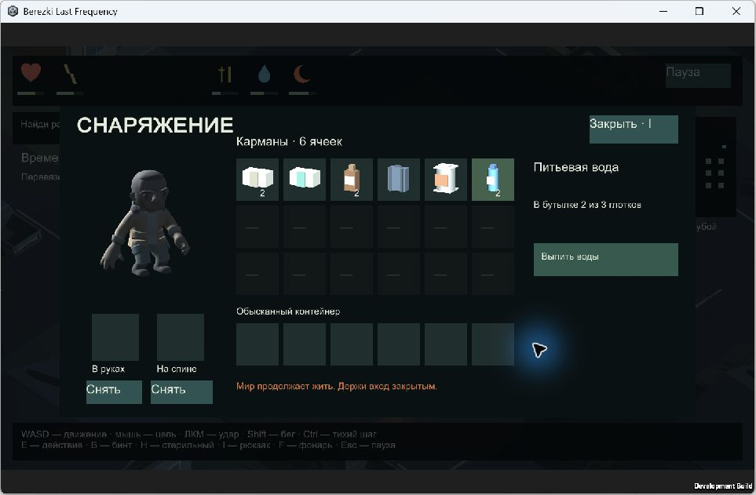
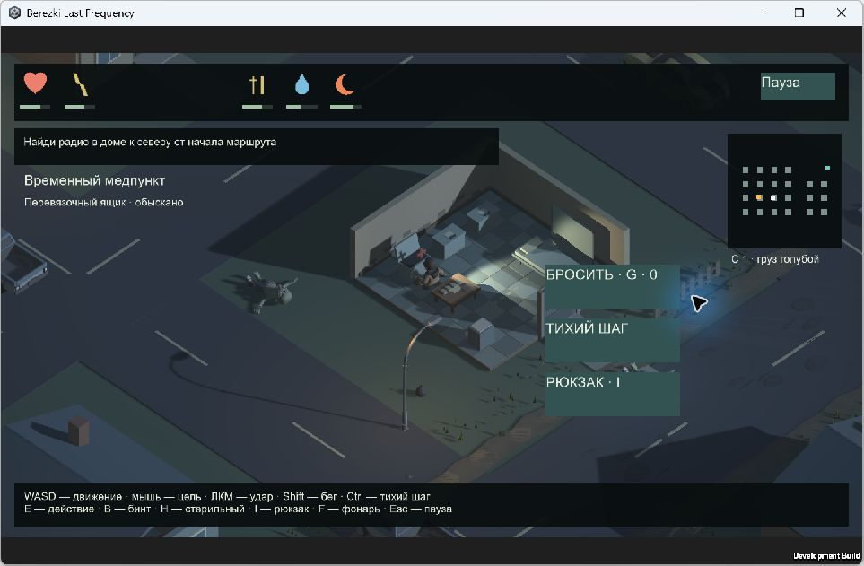

# Бережки — еда, питьевая вода и отдых

## Потребности и темп

Сытость, запас воды и усталость представлены отдельными иконками. Наведение мыши или удержание показывает значение и подсказку. На свежем старте сытость равна 70%, вода 60%, усталость 15%. Потребности меняются только во время активной игры, включая открытый рюкзак. Пауза останавливает симуляцию.

За секунду ходьбы сытость уменьшается на 0,022, вода на 0,035, а усталость растёт на 0,017. При беге значения равны 0,033, 0,052 и 0,032. Низкая сытость и вода ограничивают запас и восстановление выносливости. Сильная усталость также снижает восстановление и ограничивает максимум сил. Потребности сами по себе не отнимают здоровье.

В проверке модели за 900 секунд ходьбы получилось 50,2% сытости, 28,5% воды и 30,3% усталости. Это расчёт с вызовом симуляции, а не ручное прохождение на 15 минут.

## Предметы и действия

Консервы можно съесть из выбранной ячейки за 1,8 секунды. Одна порция прибавляет 35 сытости и немного выносливости. Питьевая вода находится в кухне дома связиста, медпункте и у дорожников. Бутылка занимает одну ячейку, содержит три глотка и сохраняет остаток. Один глоток за 1,5 секунды прибавляет 28 воды.

Для питьевой воды используется отдельный предмет и голубая модель бутылки. Для еды сделан цилиндрический корпус банки с ободками и язычком. Изображения предметов рендерятся из геометрии проекта.

У обустроенного убежища доступен отдых по R или контекстной кнопке. Действие занимает 6 секунд, снижает усталость на 45 и восстанавливает часть выносливости. Кровотечение, тяжёлое заражение и живой заражённый в видимости в пределах 10 м мешают отдыху. Если опасность появляется во время действия, отдых прерывается. Движение, удар и пауза используют прежнюю систему отмены действий.

## Сохранения и проверка

Новая запись использует v6; версии 1–5 читаются. При переносе старого сохранения потребности получают обычные стартовые значения. Сохраняются потребности, найденные бутылки и число глотков в инвентаре и хранилищах. Некорректные значения отклоняются до изменения мира.

В Windows Development Player пройдено 211 проверок. Проверены расчёт темпа, прерывание питья без расхода, использование воды и еды через Update, штрафы к выносливости, прерывание отдыха врагом, восстановление после отдыха, миграция v5 и отказ повреждённых потребностей.

[Проверки](needs-checks.txt) · [Модель 15 минут](needs-15-minute-model.txt) · [Сборка Windows](needs-build-report.txt) · [Автоматическая вылазка](needs-route.txt)

Автоматическая вылазка с обычными правилами завершилась за 138,2 с. Герой нашёл рюкзак и питьевую воду, выпил один глоток, сохранил два оставшихся и добрался до убежища. Отдых проверялся отдельно в подготовленной безопасной сцене.

В оконном запуске через computer-use проверены выбор бутылки, питьё, остаток двух глотков, выбор консервов и еда с ростом шкалы сытости. На кадрах заранее подготовлены потребности и припасы в отдельном сохранении; заражённые выключены для осмотра.

Обычный релиз Windows x64 отдельно запущен до начальной сцены. Сборка завершилась без ошибок и предупреждений. Новых внешних ассетов и платных сервисов нет.

Полноценный ручной сеанс на 15 минут, оценка баланса новым игроком и физический Android остаются открытыми. APK на этом этапе не собирался. Полные анимации открытия консервов, питья и отдыха, пустые бутылки и пополнение воды требуют дальнейшей работы.
