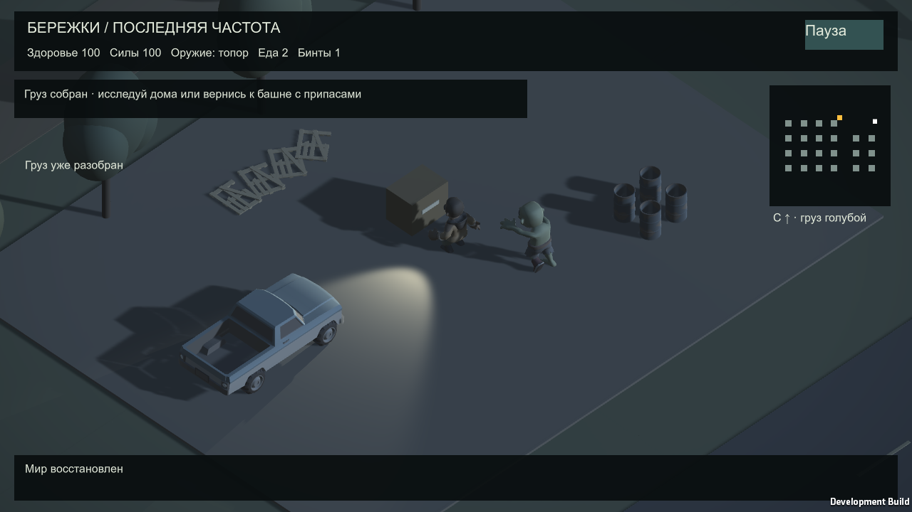

# Восточная окраина

4 ноября 2026. Первый физически связанный участок расширения: район теперь занимает 180×120 м вместо 120×120 м, площадь увеличилась на 50%. Проходимые границы: x от −58 до 118, z от −58 до 58. Это конечная карта, созданная при старте; потоковой подгрузки и бесконечного мира нет.

Три восточные дороги продолжают старые улицы через прежнюю границу x=58. Добавлены шесть домов (всего 22), записки о грузе дорожников, двор дорожной службы на северо-востоке (102,40), грунтовка вдоль северной окраины и видимая восточная ограда. Во дворе можно один раз забрать две еды и бинт; открытие груза привлекает ближайших заражённых. Ящик имеет столкновение: герой обыскивает его снаружи. После сбора цель меняется на дальнейшее исследование и возвращение с припасами. Есть девять новых заранее расставленных заражённых — они не появляются при приближении игрока. Северный путь позволяет обойти занятые перекрёстки, но не гарантирует безопасность после перемещения врагов.

Мини-карта охватывает увеличенный район. Голубая точка — груз, серая после сбора; жёлтая — радио или убежище. Дома на окраине используют прежнюю основу, поэтому дальнейшая работа над архитектурой и интерьерами остаётся необходимой.

## Сохранения

Версия 3 хранит новый район и состояние груза. Версии 1 и 2 с исходными 16 домами принимаются: прежние двери и добыча восстанавливаются, новые дома начинают необследованными. Версия 2 сохраняет прежних заражённых по их ID; добавленные жители окраины начинают в исходных точках. При загрузке старого сохранения в уже изменённом мире новые объекты также сбрасываются корректно. Старые исполняемые файлы не читают версию 3.

## Проверка

Windows x64: диагностический player проверяет пересечение старой границы, путь заражённого через стык, миграцию сохранения v2 с 16 домами, однократную добычу и восстановление героя на окраине. Полный список — outskirts-checks.txt. Снимок окраины получен в реальном player с подготовленной тестом позицией и инвентарём. Полное ручное прохождение и производительность Android не проверены. Android APK этого этапа не собран. GitHub не обновлялся.

## Запуск

Распакуйте весь архив, запустите Berezki.exe. WASD — движение, Shift — бег, Ctrl — тихий ход, E — действие, ЛКМ — удар, F — фонарь, B — бинт, колёсико — масштаб, Esc — пауза. От башни идите на восток по северной грунтовке или через улицы: голубая точка мини-карты указывает груз. Сохранение локальное и работает офлайн.

Художественная основа пока стилизованная; в этом этапе не добавлялись реалистичные модели или новая речь. Синтетическое радио остаётся временным; условия распространения голоса нужно подтвердить или заменить запись перед публикацией (THIRD_PARTY.md).

Результат: 44 проверки пройдены в Windows Development Player. Итоговая обычная сборка: 0 ошибок, 0 предупреждений.

