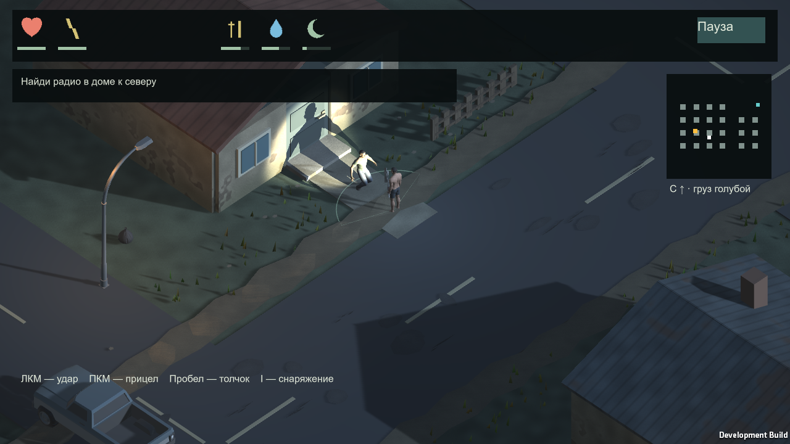
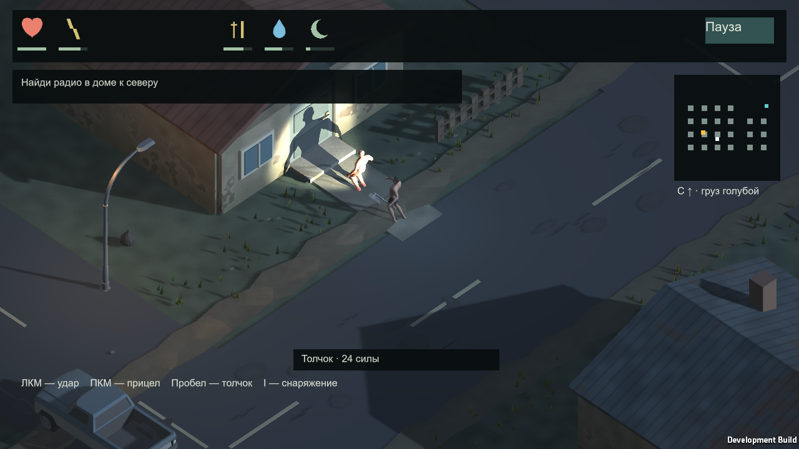

# Бережки — бой и управление на ПК

Локальный этап 6 ноября 2026 года. Основная платформа разработки — Windows. Android-код сохранён, новый APK на этом этапе не собирался. Публикация на GitHub отложена.

## Что изменилось

**Пробел — толчок.** Короткое действие на 0,55 с с контактом примерно через 0,26 с. Стоимость — 24 единицы сил, дальность 1,5 м, до двух целей перед героем. Урона здоровью нет. Обычного заражённого отодвигает до 0,9 м и прерывает его замах; крупного — до 0,54 м, с меньшим временем остановки. Стена ограничивает отталкивание. При нехватке сил или незавершённом действии новый толчок не начинается. Бесконечного автоматического повтора при удержании пробела нет. Используется имеющееся движение Punch, отдельная двуручная анимация ещё не создана. Звук контакта — новая процедурная запись шума ткани без металлического звона.

**ПКМ — направленное движение.** При удержании герой поворачивается к курсору и движется со скоростью до 1,9 м/с. Бег в этом положении отключён. На земле появляется тонкий сектор дальности выбранного оружия. Это геометрическая подсказка, не гарантия попадания через препятствие. При отступлении имеющаяся походка проигрывается назад. Для движения боком пока используется тот же набор клипов, отдельных шагов в сторону и IK стоп нет.

**ЛКМ — удар.** Нажатие в последние 0,16 с возврата оружия запоминается и выполняется один раз после завершения предыдущего действия. Ранние нажатия не создают длинную очередь. Буфер хранит направление нажатия и очищается при ранении, паузе, открытии инвентаря и загрузке. Удержание ЛКМ не включает автоматический бой. Момент урона теперь использует тот же шаг игрового времени, что и таймер атаки: прежнее ограничение 0,05 с задерживало контакт при просадках кадров.

**Плотность толпы.** Живые персонажи учитывают занятое другими телами место. Преследователи пробуют обойти соседей с двух сторон вместо движения в одну точку сетки. Герой не проходит сквозь живого заражённого; трупы путь не блокируют. Уже пересекающиеся позиции из старого сохранения разрешают движение на выход из пересечения. Это локальное избегание, не физическая симуляция тел и не полное решение всех заторов в тесных проходах.

**Обзор на ПК.** Большие сенсорные кнопки броска, тихого шага и рюкзака убраны из Windows-раскладки. Их место снова принимает игровые клики. Снизу находится одна строка основных клавиш; камни показываются возле карты. Сенсорная схема сохранена отдельно. Полоса текущего удара поднята над строкой клавиш.

## Сложность и сохранения

Здоровье, урон и скорость заражённых не уменьшались: обычный — 110 здоровья / 26 урона / 2,25 м/с; крупный — 160 / 34 / 1,65; ползущий — 70 / 20 / 1,55. Топор по-прежнему наносит 45 урона, копьё — 30, кулак — 10. Кровотечение и заражение раны сохранены. Толчок нужен для освобождения пространства и отступления, а не заменяет оружие.

Сохранения остаются v8, чтение версий 1–8 сохранено. Буфер ввода и прицеливание не записываются в мир. Пользовательское сохранение для проверок не использовалось; диагностические сценарии выбирают отдельные временные файлы.

## Проверка

Итог: **230 общих проверок и 30 проверок боя прошли** в настоящем оконном Windows Player. Release и диагностические Windows-сборки — 0 ошибок и 0 предупреждений. Отдельный живой бой подтверждает, что ИИ начинает замах, Space прерывает его без урона здоровью заражённого, после чего герой отбегает более чем на 4 м без ранения. Для этого боя подготовлены позиция и топор; противник действует самостоятельно, остальные противники исключены из данной расстановки.

Полная автоматическая вылазка **не прошла**: герой погиб примерно на 70,5 секунде при переходе между домами, до запланированного ранения у медпункта. Находки и радио до этого сработали. Успех отдельного боя не означает готовность всего маршрута. Следующий этап — выбрать и проверить проходимый подход к медпункту с учётом толпы, преследования и ограниченного запаса сил.

Обычное окно диагностической игры открыто через Computer Use, временная новая попытка запущена кнопкой меню. Полноценное ручное прохождение и надёжная проверка клавиш через управление окном не завершены; положительным результатом их не считаем. Клавиатура и мышь в перечисленных автоматических проверках подаются через Unity Input System. Release отдельно запущен для проверки инициализации; ручной бой в Release не проводился. FPS и субъективный звуковой микс не измерены.

Отчёты и результаты окончательного запуска приведены в соседних текстовых файлах. Первые прогоны обнаружили устаревшее ожидание сенсорной кнопки в ПК-раскладке и потерю искусственных кликов при смене фокуса окна. Сенсорный тест теперь явно включает сенсорную раскладку. Проверка лечения подаёт нажатие и отпускание на отдельных отрисованных кадрах и разрешает виртуальному устройству работать без фокуса. Это изменения диагностического сценария; обычное поведение игры при потере фокуса не менялось.

Специальная проверка боя охватывает цену и момент толчка, сопротивление крупного заражённого, предел двух целей, дверь, живые тела и трупы, выход из старого пересечения, буфер, сброс при ранении/паузе/инвентаре/загрузке, ввод Space и мыши через Unity Input System, прицеливание и шаг назад, 45 урона топором, отсутствие атак через HUD и живой бой с отходом. Расстановки подготовлены; это не естественная вылазка.

В прежней автоматической вылазке сценарий намеренно получал рану, а затем останавливал бег ради ударов. Теперь после ранения он пытается оттолкнуть нападающего и отступает к медпункту без ударов на бегу. Правила мира, припасы и характеристики противников в маршруте не подменяются. Результат полного маршрута фиксируется отдельно; его нельзя выводить из успеха отдельных проверок.

[Новые проверки](pc-combat-checks.txt) · [Общая регрессия](pc-combat-regression.txt) · [Вылазка](pc-combat-route.txt) · [Windows](pc-combat-build-report.txt) · [Проверка окна](pc-combat-window-check.txt)

## Кадры

Кадры ниже сняты в настоящем оконном Windows Development Player. Для проверки заданы положение, топор, состояние противника и камера, остальные противники скрыты. Это постановочные кадры диагностического боя.

## Повторение

Сборка: `Askich.Editor.BuildDistrict.Pair`, переменные `ASKICH_BUILD_DIR` и `GOIDA_SURVIVAL_RELEASE`. Версия Unity — 6000.3.4f1.

Новые проверки: видимый Windows Development Player с флагом `-district-pc-combat-check`, каталог из `BEREZKI_PC_COMBAT_CHECK`. Общие проверки: `-district-check` и `GOIDA_DISTRICT_CHECK`. Обычная автоматическая вылазка: `-district-route-check` и `GOIDA_ROUTE_CHECK`. Не запускать графические проверки со скрытым окном: необходимы кадры GUI Repaint.

Для осмотра вручную предусмотрен `-district-pc-combat-preview`: подготовленная позиция у медпункта, выданные топор и припасы, начало на паузе, отдельное временное сохранение. Это проверочная сцена с настоящими противниками, а не старт новой обычной попытки. Все эти флаги исключены из Release.

Новых сторонних моделей, текстур и аудиофайлов нет. Источники существующих ресурсов — [THIRD_PARTY.md](../THIRD_PARTY.md). Субъективное качество звука и длительный баланс требуют дальнейшей игры.
