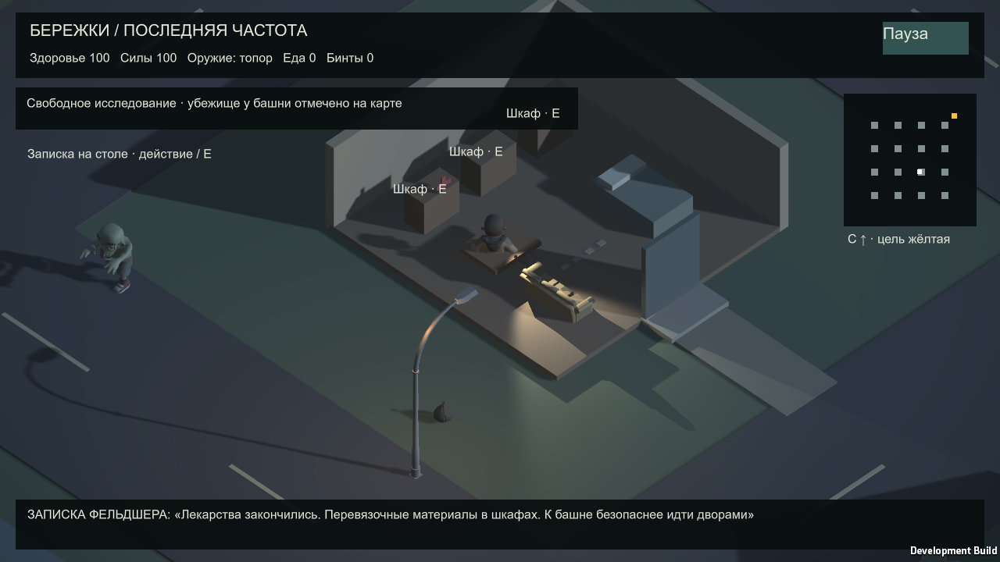
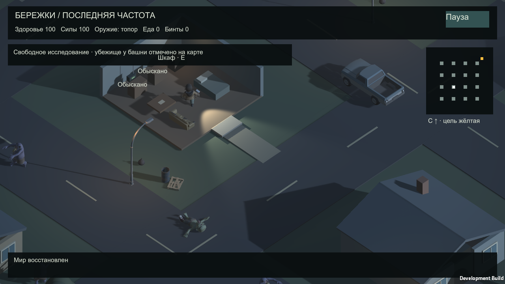

# Постоянный мир: первый шаг

4 ноября 2026. Направление проекта — цельный офлайн-мир, который будет постепенно расширяться. Этот этап меняет продолжение игры и сохранения; карта пока прежняя, 120×120 м и 16 домов, без потоковой загрузки.

## Реализовано

У башни можно обустроить убежище за одну еду и один бинт. Радио необязательно. Это восстанавливает 25 здоровья и позволяет продолжить исследование. В дальнейшем одна еда восстанавливает 25 здоровья в убежище, если герой ранен; повторная оплата строительства не нужна. Убежище не даёт неуязвимости, заражённые продолжают действовать.

Сохранение версии 2 записывает положение, здоровье и направление каждого заражённого, состояние убежища, добычу, двери и героя. Погибшие заражённые после загрузки остаются погибшими. Тревога и текущая атака сбрасываются, радио выключается. Старые файлы версии 1 читаются; в них нет данных о заражённых, поэтому они возвращаются в начальное состояние. Имя файла district-v1.json намеренно сохранено для совместимости.

Запись использует временный файл и замену основного. Предыдущее валидное сохранение становится резервным; повреждённый основной файл не перезаписывает хорошую резервную копию. Загрузка полностью проверяет данные перед применением. При ошибке используется .bak; при повреждении обеих копий состояние игры и экран смерти не изменяются. Новое сохранение версии 2 не предназначено для старого исполняемого файла.

Дом с радио получил записку и заколоченное окно. Соседний восточный дом — бывший пункт фельдшера: бинты, пустой шкаф, медицинская отметка, использованные повязки и другая записка. Читать записки можно действием у стола. Это первый небольшой шаг к разным интерьерам, а не законченная художественная переработка.

## Проверки и ограничения

Результаты Windows-player: world-checks.txt. Сценарий проверяет убежище без финала, сохранение погибших, восстановление резервной копии, отказ без изменения мира, миграцию v1 и прежние проверки. Изображения сняты в диагностическом player с подготовленными позициями и инвентарём. Полное ручное прохождение не заявляется.

Android этого этапа не собран и на устройстве не проверен. Расширение карты, более реалистичные модели, отдельная атака ползуна, звуки поверхностей и новая лицензированная речь остаются следующими этапами. Публикация на GitHub отложена.

