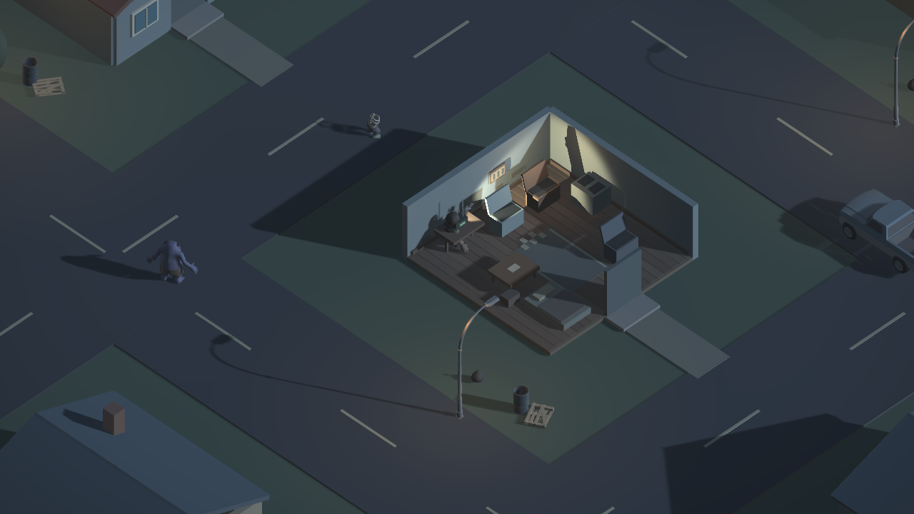
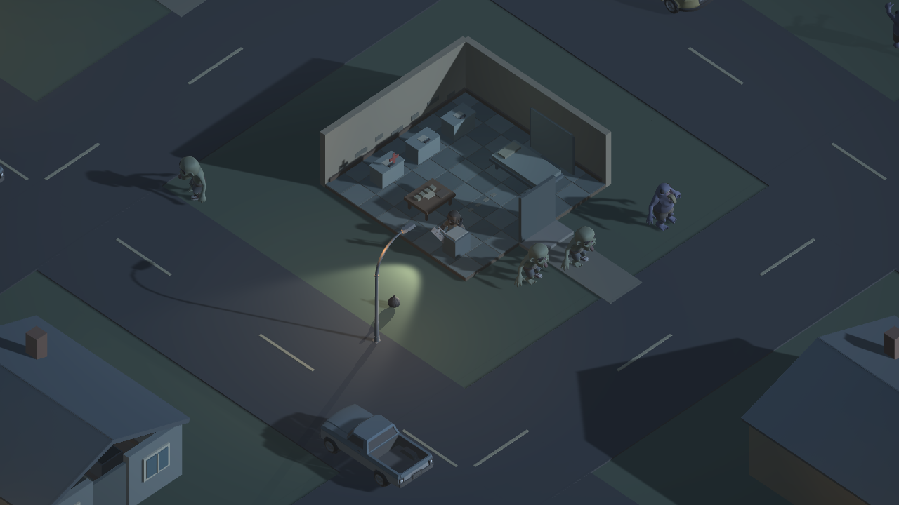

# Бережки — дом связиста и первая вылазка

## Первый обыск

В исходном прогоне ползун начинал внутри дома связиста. Герой запер вход, но получил удар во время поиска топора. К десятой секунде у него осталось 79,3 здоровья, началось кровотечение, а ящик остался закрыт. Для новой попытки стартовая точка этого ползуна перенесена за дом. Враг слышит дверь, ящик и радио по обычным правилам. Его идентификатор сохранён. Если позиция врага записана в сохранении, загрузка восстанавливает эту позицию.

При смертельном ударе значение здоровья теперь останавливается на нуле.

## Что слышно

Трава, асфальт, деревянный пол и плитка медпункта дают разные звуки шагов. Шаг привязан к пройденному расстоянию. При упоре в стену новые шаги прекращаются, крадущийся герой ступает тише. Источник скрипа остаётся у двери, пока герой отходит. При истощении и тяжёлых ранениях слышно дыхание. Для перевязки звучит ткань, при крафте слышна бутылка, у питья есть отдельный звук. Прерывание действия гасит его звуковую петлю.

Новые звуки синтезируются в проекте. В образце последовательно звучат три шага по каждому из четырёх покрытий, затем дверь, бинт и дыхание. WAV смонтирован из тех же клипов. Громкость финального микса в наушниках и на динамике телефона предстоит оценить на слух.

## Как проверялся маршрут

Диагностический Windows Player создаёт отдельное сохранение. WASD, Shift и E проходят через Unity Input System. Удар, бросок и лечение вызывают те же команды, что и игровой ввод. Прогон использует обычную скорость времени, поиск пути, ИИ и содержимое контейнеров. Для проверки лечения герой намеренно подошёл под удар у медпункта. Подробные координаты, здоровье и расход припасов записаны в [журнале](feedback-route.txt).

На 10,2 секунде герой нашёл топор. На 22,5 секунде изготовил стерильный бинт, оставив в бутылке две дозы. На 25,1 секунде услышал радио. Удар на улице оставил 74 здоровья и 12% заражения. На 50,3 секунде перевязка в медпункте сняла оба состояния и подняла здоровье до 82. По дороге к башне герой снова был ранен. Он обустроил убежище на 98,5 секунде, сохранив один обычный бинт и две дозы спирта. Само обустройство лагеря рану не перевязывает.

Кадры ниже сняты игровой камерой в соответствующие моменты автоматического прогона. Интерфейс в эти кадры не входит.

Полный ручной сеанс на 10–15 минут и баланс для человека, который впервые ищет дорогу, ещё предстоит проверить. Android-сборка и проверка на телефоне в этот этап не входили. Отдельная атака ползуна остаётся следующей задачей.

## Сборка и повторяемость

Windows x64, Unity 6000.3.4f1. [Отчёт сборки](feedback-build-report.txt). В Windows Development Player пройдено 108 [проверок](feedback-checks.txt), включая старые сохранения и прерывание лечения. При диагностике в скрытом окне жест клавиатуры воспроизводится по игровым кадрам, а движение кисти проверяется относительно самого героя во время замаха. Анимация выжившего вычисляется и при отсечении его модели камерой.

Для воспроизведения подходят диагностические сборки Windows. Перед запуском задайте GOIDA_ROUTE_CHECK или GOIDA_DISTRICT_CHECK равным полному пути к отдельной папке для результатов. Для маршрута используйте `-batchmode -force-d3d11 -district-route-check`, для набора проверок — `-batchmode -force-d3d11 -district-check`. При скрытии обычного окна Windows проверка ввода однажды остановилась на первом шаге. Пакетный запуск прошёл эту точку. Обычный релиз отдельно проверен запуском до инициализации начальной сцены.
