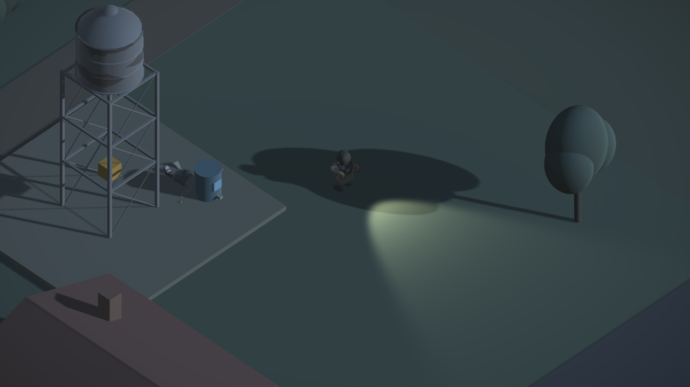
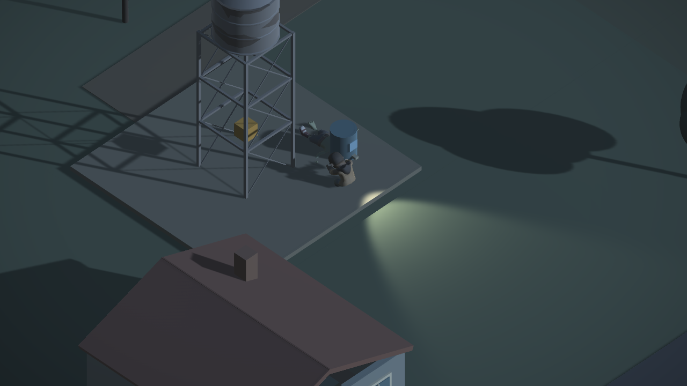
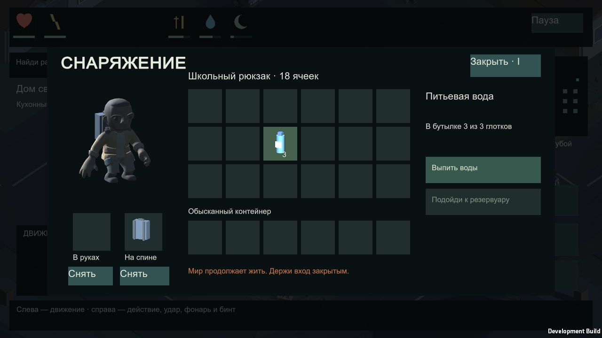

# Бережки — бутылки и действия выживания

## Что изменилось

После последнего глотка питьевой воды остаётся пустая бутылка в той же ячейке. Пустую или неполную бутылку можно наполнить у голубого резервуара рядом с убежищем у водонапорной башни (48, 43). Подойди и нажми E / кнопку действия; наполнение занимает 3 секунды и возвращает три глотка. Это постоянный запас питьевой воды без ограничения объёма, а не система очистки или дождевой воды.

В инвентаре есть отдельная иконка пустой бутылки и действие наполнения с подсказкой о расстоянии. Две неполные бутылки при переносе меняются местами, сохраняя число физических бутылок. Подбор новой воды требует отдельную ячейку. Наполнение и питьё меняют содержимое только по завершении; отмена не расходует предмет.

Добавлены три скелетных клипа: поднятие бутылки к лицу, приём пищи и отдых в приседе. Бутылка или банка следуют за анимированной рукой, оружие на время действия скрывается. Движение, удар и пауза прерывают действие по прежним правилам. Наполнение использует существующий жест работы руками. Клип еды пока условный: нет отдельного открывания крышки, ложки и работы пальцев. Отдых не включает сон или установку спального места.

Анимации запечены редакторским ProvisionClipAuthor на существующем лицензированном скелете Matt из Idle/Duck с дополнительным движением рук. Новых внешних материалов и платных сервисов нет. Сохраняется нынешний стилизованный вид персонажа.

## Сохранения

Новые сохранения имеют версию 7. Версии 1–6 читаются по существующим правилам переноса. Пустые бутылки, остатки воды, ячейки и хранилища сохраняются. Перезапись старого сохранения создаёт v7; обратная совместимость с прежним исполняемым файлом не заявляется.

## Проверка

Windows x64 Release и Development собраны в Unity 6000.3.4f1: 0 ошибок, 0 предупреждений. Release отдельно запущен до начальной сцены. В Development Player прошли 225 проверок, включая прежние механики, миграцию старых данных, пустую бутылку после последнего глотка, перенос частичных бутылок, отмену и завершение наполнения, клипы еды/питья/отдыха и сохранение v7.

Автоматическая вылазка по обычным правилам завершилась за 151,8 секунды: находка рюкзака, оружия и воды, питьё, радио, ранение, лечение в медпункте, возвращение и пополнение бутылки у убежища. Враги действовали, припасы не выдавались тестом. Это заранее известный автоматический путь, не ручной сеанс на 15 минут. На возвращении герой получил новое кровотечение; этот прогон не подтверждает безопасный отдых, который проверен отдельно.

Четыре сенсорных жеста прошли в оконном Windows Player с виртуальным Touchscreen / Unity Enhanced Touch: надевание рюкзака, перенос бутылки в рюкзак, помещение в обысканный контейнер и возврат без дублирования. Подключённых ADB-устройств нет. Это проверка сенсорной схемы на Windows, не проверка Android-устройства. APK на этом этапе не собирался.

[Проверки Player](provisions-checks.txt) · [Маршрут](provisions-route.txt) · [Сенсорные жесты](provisions-touch-checks.txt) · [Отчёт Release](provisions-build-report.txt)

## Кадры

Ниже реальные кадры Development Player. Питьё и отдых сняты в подготовленной тестовой сцене: припасы и потребности заданы для проверки, заражённые выключены. Снимки камеры без интерфейса. Кадр инвентаря получен после виртуальных сенсорных жестов в оконном Player с тестовыми предметами.

## Что дальше

Проверить APK на физическом телефоне: размер кнопок, перенос вещей пальцем, вырезы экрана, нагрев и частоту кадров. Затем провести ручную вылазку на 15 минут и уточнить доступность воды, запас перевязок и темп усталости. Для анимаций нужны более детальные жесты еды, крышки и пальцев; нынешние модели и окружение остаются стилизованными. Публикация на GitHub отложена.
