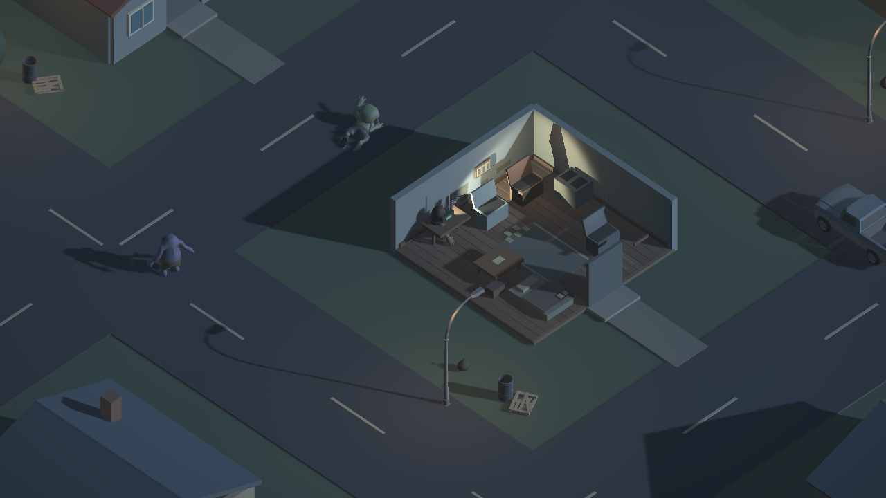

# Бережки — голоса в доме связиста

## Осмотр перед работой

В прежней версии включение приёмника сразу открывало точку убежища. Одинаковая фраза в интерфейсе сопровождала длинную зацикленную запись. В доме уже были письмо, семейное фото и мебель, но у входа было мало следов того, как хозяева уходили.

## Изменения

Открытая сумка с оставленной одеждой стоит рядом с порогом. Над ней пустые крючки для ключей. Два следа на полу тянутся к инструментальному ящику; небольшой тёплый свет помогает заметить его с прохода. Записка Нины связывает эти предметы с уходом семьи. Геометрия декора не меняет проходы, контейнеры и добычу.

Передача разбита на три отдельные записи. Сначала звучит просьба найти Анну в медпункте, затем предупреждение Нине о заражённых, в конце — ориентир у водонапорной башни. Между фрагментами слышны помехи. Субтитры следуют текущему фрагменту и исчезают за пределами слышимости. Точка убежища открывается после завершения последней записи.

Приёмник можно выключить действием / E. Голос и помехи прекращаются, повторное включение начинает передачу заново. Дослушанный ориентир сохраняется вместе с прежним полем heard. Старые сохранения с уже известным убежищем загружаются с этим знанием.

Шум приёмника направляет существующих заражённых к источнику. Если живой заражённый подходит к закрытому входу, с крыльца доносится процедурный скрежет. Его источник находится у порога. Появление новых врагов для этой сцены не добавлялось.

## Проверка

В Windows Development Player пройдено 132 проверки, включая семь новых проверок передачи. Они проверяют загрузку трёх звуковых файлов, субтитр Анны, защиту субтитров от случайного удара мышью, паузу, раннее выключение, дослушивание ориентира и его сохранение после загрузки. Проверки используют отдельные сохранения.

[Проверки](radio-checks.txt) · [Сборка Windows](radio-build-report.txt) · [Автоматический путь до убежища](radio-route.txt)

Первый автоматический прогон с долгим прослушиванием закончился смертью от повторных ран на обратном пути. В нём оставались бинты, но команды прохождения не применяли их повторно. При повторе герой выключает радио перед выходом, заранее готовит запасную перевязку и может применить её после отрыва от преследователей. Повтор завершился за 135,0 с. После выключения приёмника герой добрался до медпункта, вылечил полученную рану и дошёл до лагеря без новых ран, сохранив запасной стерильный бинт.

Кадр ниже снят игровой камерой после дослушивания передачи в автоматическом прохождении с обычными правилами. Интерфейс в кадр камеры не входит.

Голос Microsoft Irina Desktop синтезирован локально и остаётся временной записью. Условия его распространения требуют проверки перед публикацией. Новые детали дома и скрежет созданы средствами проекта. Перечень исходных материалов находится в THIRD_PARTY.md.

Слепой тест с новым игроком, полноценный ручной сеанс на 10–15 минут, оценка звукового микса на слух и проверка на физическом Android-устройстве остаются открытыми. Для этого этапа собран Windows x64. Android APK в этот этап не собирался.
