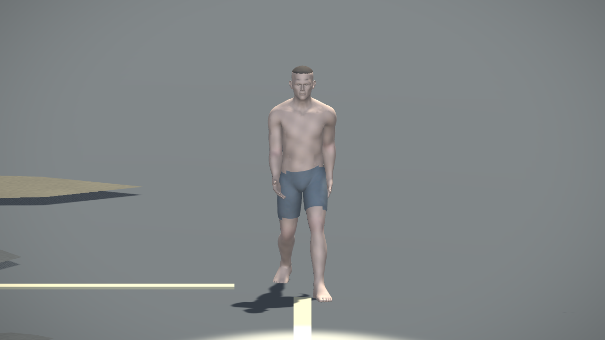
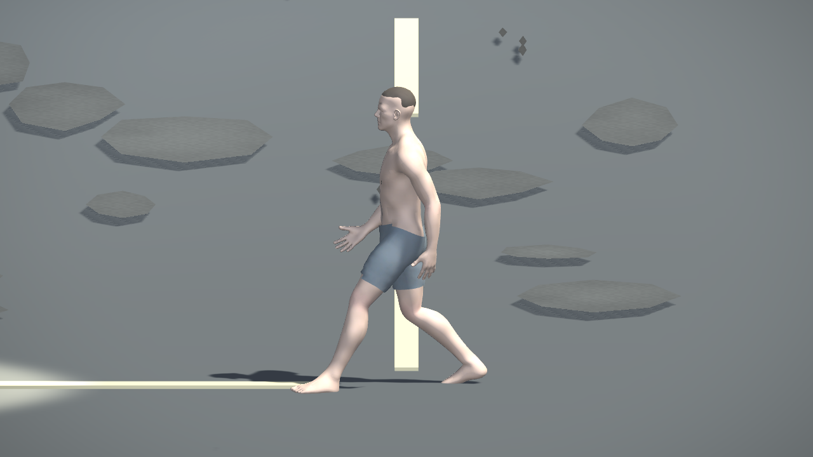

# Zonbee — спокойная работа рук при движении

8 ноября 2026. Исправление после замечания о «крыльях» при ходьбе.

## Изменение

Прежний расчёт тянул кисть к точке возле таза и выбирал направление сгиба локтя позади корпуса. Получалась согнутая и отведённая рука, особенно заметная крупным планом.

Для героя заменены руки в клипах **Idle, Walk и Run**. Плечевые кости восстанавливаются из исходной позы скелета, локоть рассчитывается последовательным поворотом плеча и предплечья. При ходьбе плечи опущены, руки качаются в основном вперёд и назад с небольшим сгибом локтя. При беге предплечья согнуты сильнее, верх руки остаётся возле корпуса. Ладонь ориентируется по костям пальцев и большого пальца: большой палец смотрит вперёд при опущенной руке, ладони — к бёдрам. Сохранены противоположная работа рук и ног и существующий ритм шага.

Это локальная доработка рук. Кривые ног, движение персонажа, игровые тайминги ударов, модели заражённых и сохранения не менялись. Положение предметов в ладони обновлено для новых поз. Метод создания анимаций вызывает этот проход повторно, чтобы старый расчёт не возвращался после пересборки персонажа.

## Проверка

**171 проверка пройдена:** 25 новых для рук, 11 персонажа, 30 боя, 20 одежды и 85 предыдущего этапа Zonbee. После уточнения осмотровой сцены повторно пройдены 25 проверок рук. Обычная Windows-сборка: **0 ошибок, 0 предупреждений**; отдельно проверен запуск окна Zonbee.

Новые проверки измеряют руки по всему циклу, проверяют бесшовность повторения, противоположный мах, положение оружия, реальное переключение ходьбы/бега/ожидания через клавиатуру и загрузку сохранения. Численные проверки ограничивают ошибки, но не заменяют зрительную оценку движения.

[Видео спереди и сбоку](images/relaxed-arms.mp4). Кадры сняты настоящей игровой камерой в Windows Player. Для осмотра камера приближена, передний план отсечён, добавлен осмотровой свет, заражённые отключены, фазы Walk/Run задаются сценарием. Циклы воспроизводятся с длительностью игровых клипов; это проверка поз, а не запись обычной вылазки. Реальное движение с клавиатуры проверено отдельно.

## Оставшиеся ограничения

Это авторская скелетная анимация без захвата движений. Ещё нужны отдельные варианты переноски оружия, повороты и боковое движение. Старые атаки в этом исправлении не переанимированы. Ноги и их работа на неровном рельефе относятся к отдельной доработке. Android не собирался и не проверялся.
