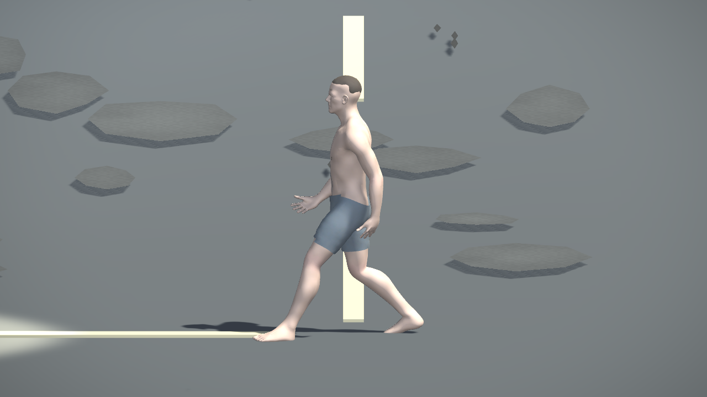

# Zonbee — расслабленные кисти

Продолжение исправления походки, 8 ноября 2026.

Для второй руки создано зеркальное сгибание пальцев на существующей модели. Для героя используется отдельная копия меша; модели заражённых используют прежнюю геометрию. Исходник анатомической модели и лицензия остаются прежними.

Обе свободные кисти слегка согнуты в ожидании, чуть сильнее при ходьбе и собраннее при беге. Переход плавный. Левая рука с оружием сохраняет полный хват. При обыске и действиях с припасами свободное сгибание уступает существующей позе действия. Пауза останавливает изменение пальцев.

[Видео ходьбы и бега спереди и сбоку](images/relaxed-hands.mp4)

Кадры из настоящего Windows Player: приближённая камера, осмотровой свет, отсечённый передний план и заданные фазы анимации. Видео показывает позы, не обычную вылазку. Реальные переходы с клавиатуры проверяются отдельно. Форма пальцев остаётся упрощённой; отдельная анимация каждого пальца пока отсутствует. Сохранения и характеристики персонажа не менялись. Android не проверялся. GitHub не обновлялся.

Проверка: **175 проверок пройдено** — 29 поз и переходов рук, 11 персонажа, 30 боя, 20 одежды, 85 предыдущего этапа. Windows: **0 ошибок, 0 предупреждений**, обычный запуск проверен отдельно. Проверки используют отдельные временные сохранения.
