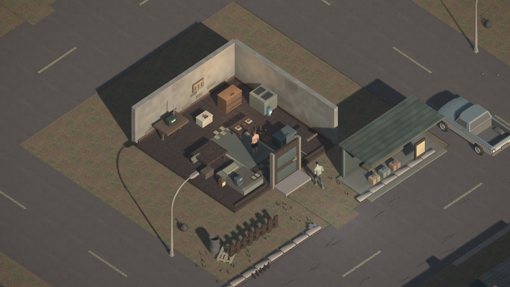

# Zonbee — поиск потерянного следа

17 ноября 2026. Первый небольшой этап геймплея после публичного выпуска.

Раньше заражённый доходил до последней известной позиции героя или источника шума и шесть секунд вращался на месте. Теперь он останавливается на короткое время, затем проверяет соседние доступные точки. Это делает укрытие за углом менее надёжным: противник может сам подойти ближе, пока ищет потерянный след.

Поиск по-прежнему длится до шести секунд. Противник выбирает до трёх мест примерно в пределах трёх метров от запомненной точки и движется медленнее, чем при преследовании. Между переходами есть короткие остановки. Недоступные места пропускаются; при заторе заражённый прекращает попытку пройти по этому пути. Маршруты ограничены по длине и числу проверяемых клеток, чтобы локальный поиск не запускал несколько дорогих расчётов по всему району.

Скрытое перемещение героя не меняет цель поиска. Новый слышимый шум направляет заражённого к источнику звука; увидев героя, противник возвращается к преследованию. Поиск не двигает и не поворачивает заражённого во время уже начатого удара. Характеристики здоровья и урона не изменены.

## Проверка

**205 успешных проверок в Windows Player:** поиск 17, дома 35, окна и баррикады 38, бой 30, интерфейс/столкновения/сохранения 85. В живой локальной расстановке заражённый искал снаружи закрытого дома, перемещался по доступной земле и не видел и не ранил скрытого внутри героя. Дополнительно проверены новая звуковая цель, возвращение к преследованию, замкнутое препятствие, завершение поиска и загрузка сохранения. Полная вылазка не проводилась.

Сборки Development и обычная Windows — без ошибок и предупреждений. Обычная версия отдельно инициализирована и штатно закрыта (код выхода 0). Формат сохранений остаётся прежним; как и раньше, после загрузки кратковременное состояние тревоги сбрасывается. Для проверок использованы отдельные временные сохранения.

[Начало той же проверки](images/search-start.png). Это настоящие кадры Windows Player с заданной расстановкой героя и одного заражённого и инспекционной камерой. Во время показанного поиска действует обычный игровой ИИ; остальные заражённые исключены из проверки. Это не ручная вылазка и не демонстрация поведения большой толпы.

## Ограничения

Это короткий локальный поиск. Противники ещё не обыскивают помещения систематически, не координируют прочёсывание района и не предугадывают маршрут игрока. За недоступной закрытой дверью поиск может закончиться без перехода к новой точке. Большие толпы и слабые компьютеры на этом этапе не измерялись. Android не проверен.

Следующая полезная доработка — восприятие шума через стены и двери: проверить, насколько надёжно игрок различает тихий обыск, бег и громкие действия, а затем настроить риск привлечь соседних заражённых.

## Повторение

Сборка: `Askich.Editor.BuildDistrict.Pair`, каталоги `ASKICH_BUILD_DIR` и `GOIDA_SURVIVAL_RELEASE`. Специальная проверка: Development Player с `-zonbee-search-check`, каталог отчёта задаётся `ZONBEE_SEARCH_CHECK`.

Отчёты: `search-focused-checks.txt`, `search-houses-checks.txt`, `search-fort-checks.txt`, `search-combat-checks.txt`, `search-zonbee-checks.txt`, `search-build-report.txt`.
