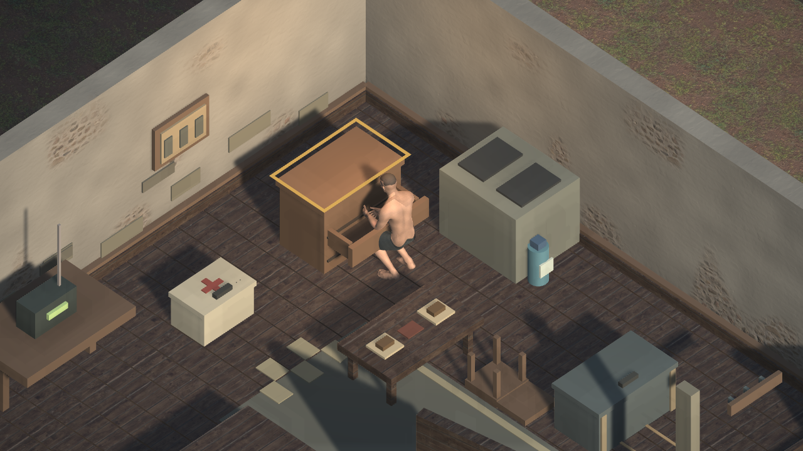

# Zonbee — подход к контейнерам

19 ноября 2026.

Герой перед обыском делает короткий подход к передней стороне контейнера. Если прямой путь закрыт соседней мебелью, проверяется обход через точку перед фасадом. Каждый отрезок проверяется на препятствия; движение использует существующие столкновения с миром и заражёнными. Это локальный подход, не автоматический маршрут через весь дом. Обыск и его шум начинаются только после подхода. Собственные шаги героя по-прежнему слышимы.

Руки подстраиваются по высоте переднего края открытого ящика или аптечки. Для низкого контейнера добавлено приседание и сохранение опоры стоп на приподнятый пол. Коррекция работает поверх существующей скелетной анимации. Движение игрока, E, пауза и боевые действия позволяют прервать подход. При загрузке сохранения незавершённый подход сбрасывается.

## Проверка

192 локальные проверки в Windows Player: контакт и подход 17, слух 25, выбор контейнеров мышью и клавиатурой 18, обыск 17, бой 30, интерфейс и сохранения 85. Проверены две высоты контейнера, постепенное движение, занятая точка подхода, отмена, сохранение и загрузка. Проверка выбора мышью включает обыск после подхода, удержание кнопки, отмену и выбор содержимого конкретного контейнера. Обычная и диагностическая Windows-сборки завершены без ошибок и предупреждений.

Настоящий кадр из Windows Player. Позиции и камера заданы диагностикой, заражённые отключены. Это локальная проверка, не полная вылазка.

## Ограничения

Коррекция размещает кисти возле содержимого, но пальцы пока не обхватывают ручки и отдельные находки. Смена направления в конце подхода и переход обратно в стойку требуют дальнейшего сглаживания. Опора настроена на существующий пол домов; произвольные лестницы и наклонные поверхности не поддерживаются этой коррекцией. Общие модели и материалы не заменялись. Android и длительная игра на слабых ПК не проверялись.

Следующий шаг — сгладить окончание подхода и выход из приседания, затем добавить короткое движение извлечения найденного предмета.

Повторение: `Askich.Editor.BuildDistrict.Pair`, Development Player с `-zonbee-storage-contact-check`, результаты в `ZONBEE_STORAGE_CONTACT_CHECK`. Отчёты этапа: `storage-contact-*-checks.txt`.
