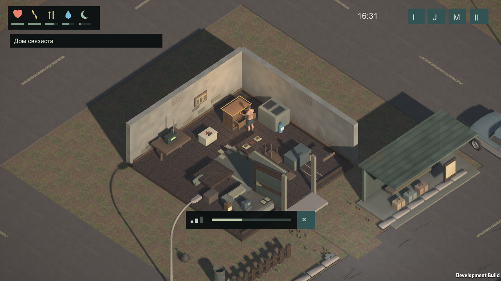

# Zonbee — движения и звук обыска

17 ноября 2026. Небольшой законченный этап для Windows.

## Реализовано

- Кухонный ящик выдвигается по горизонтали, закрывается при отмене и остаётся открытым после завершения. Добавлены дно, боковины, ручка и забытая упаковка. Металлические ящики и аптечки сохранили откидные крышки.
- Для ткани, дерева и металла созданы по три коротких варианта процедурного звука. Между ними есть паузы. Медицинский обыск звучит тише, металлический — громче. Это синтезированные эффекты, не натурные записи.
- Один такт обыска одновременно запускает звук и сигнал для слуха заражённых. Цикл рук привязан ко времени поиска; покачивание крышки следует тактам. Используется существующая скелетная анимация Search, а не новый набор анимаций. Оружие во время обыска, как и раньше, убрано из рук.
- Вместо строки с процентами и инструкциями показаны полоска прогресса, индикатор относительного шума и кнопка отмены. До начала поиска остаются название контейнера и три деления риска; пояснение появляется при наведении. Индикатор отражает шум действия, а не обещает, что враг его услышит: расстояние и преграды учитываются отдельно.
- Отмена кнопкой, клавишей E, движением, паузой или открытием инвентаря прекращает обыск без выдачи содержимого. Звук останавливается сразу. Содержимое, перенос вещей и редкость оружия не менялись.

## Проверено

**191 успешная локальная проверка в Windows Player:** новые сценарии 16, слух 25, выбор контейнера мышью 18, обыск и перенос 17, бой 30, интерфейс и сохранения 85. Проверены настоящий щелчок по кнопке отмены, клавиатурные пауза и движение, возобновление поиска, разные материалы, фазы рук, завершение и восстановление открытого ящика из сохранения. Формат сохранений не менялся.

Development и обычная сборка завершены с **0 ошибками и 0 предупреждений**. Обычная версия отдельно инициализирована и штатно закрыта. Пользовательское сохранение диагностические сценарии не используют.

Настоящий кадр Windows Player с игровым интерфейсом. Позиция героя и камера заданы диагностикой, заражённые отключены. Это локальная проверка, не полная ручная вылазка.

## Ограничения

Мебель пока собрана из простых форм. Положение рук не подстраивается индивидуально к каждой ручке, высоте и стороне подхода; для этого потребуется отдельная работа с контактными позами. Звуки различаются материалом и громкостью, но ещё не имеют качества полевых записей. Существующий садовый тайник сохраняет свой отдельный механизм поиска. Пространственная реверберация не добавлялась.

Проверки подтверждают маршрутизацию и остановку звуков в Player, но не заменяют оценку звучания на разных колонках и наушниках. Android, слабые ПК и длительная игра на этом этапе не проверялись.

Следующий шаг — положение героя и контакт рук при обыске с разных сторон: подход к доступной стороне мебели и подходящая поза для низких и высоких контейнеров.

## Повторение

Сборка: `Askich.Editor.BuildDistrict.Pair`. Development Player: `-zonbee-storage-feedback-check`, папка результатов из `ZONBEE_STORAGE_FEEDBACK_CHECK`. Отчёты: `storage-feedback-*-checks.txt`, `storage-feedback-build-report.txt`.
