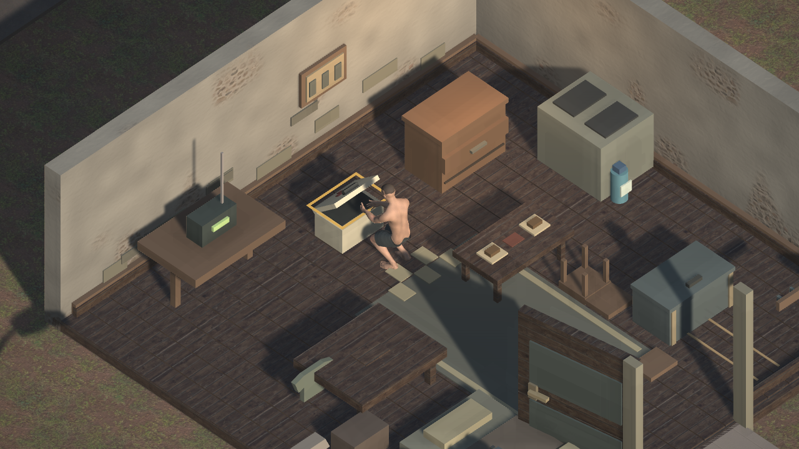
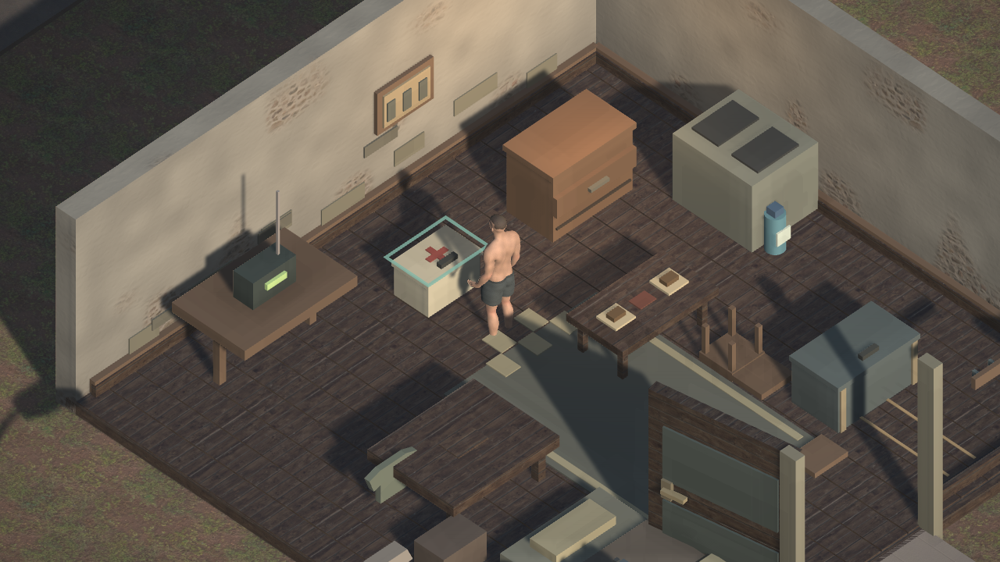

# Zonbee — переходы обыска

19 ноября 2026.

После подхода герой постепенно разворачивается к контейнеру. Пока поворот не закончен, обыск и его звук не начинаются. Используется существующий механизм поворота с переступанием; завершающий принудительный разворот убран из обычного взаимодействия.

После отмены или завершения обыска поправка положения рук, корпуса и ног плавно снимается примерно за 0,22 секунды. Звук прекращается сразу. Переход накладывается на входящую анимацию стойки или ходьбы и не заставляет персонажа тянуться назад к ящику при движении. Атака, получение урона и другие приоритетные действия сразу отключают поправку, чтобы она не искажала бой. Загрузка сохранения сбрасывает незавершённую визуальную позу.

## Проверка

209 успешных локальных проверок в Windows Player: переходы 17, контакт 17, слух 25, управление контейнерами 18, обыск 17, бой 30, интерфейс и сохранения 85. Проверка переходов измеряет изменение угла при развороте на 180°, отсутствие преждевременного звука, постепенное снижение веса коррекции, возврат в Idle, прерывание настоящим клавиатурным вводом, атаку и загрузку во время обыска.

Диагностическая и обычная Windows-сборки завершены с 0 ошибками и 0 предупреждений. Обычная сборка отдельно запущена и штатно закрыта. Пользовательское сохранение для диагностики не использовалось, формат сохранений не менялся.

До отмены:

После возвращения в стойку:

Оба кадра получены из настоящего Windows Player. Камера и позиции заданы диагностикой, заражённые отключены; это локальный сценарий, не ручная полная вылазка. Непрерывность перехода проверена покадровыми измерениями, сами изображения показывают только крайние состояния.

## Ограничения

Это доработка переходов поверх существующих анимаций. Захват ручек пальцами и отдельная анимация извлечения предмета ещё не реализованы. Боевая анимация имеет немедленный приоритет над мягким переходом. Общая графика и качество моделей этим этапом не менялись. Android и длительная игра на слабых ПК не проверялись.

Следующий шаг — короткое движение извлечения находки с визуальным отображением типа предмета, без дополнительных длинных сообщений.

Повторение: `Askich.Editor.BuildDistrict.Pair`, Development Player с `-zonbee-storage-transition-check`, папка результатов `ZONBEE_STORAGE_TRANSITION_CHECK`. Отчёты: `storage-transition-*-checks.txt`.
