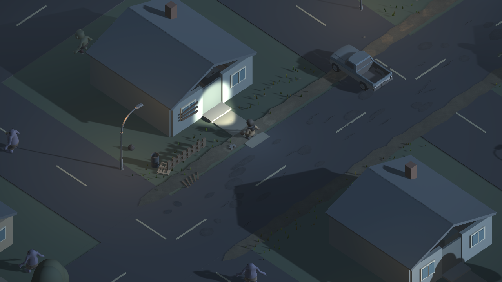
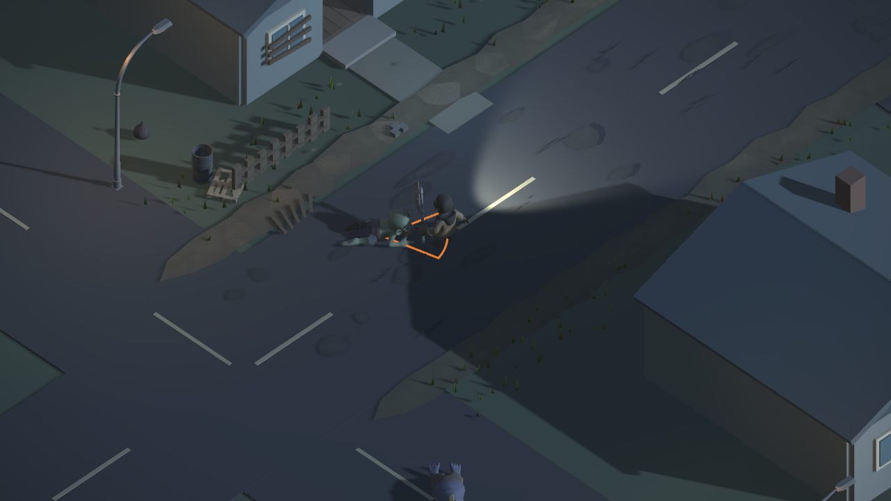

# Бережки — улица от дома связиста до медпункта

## Окружение

Участок вдоль южной улицы получил пятна ремонта, неровные трещины, гравийные обочины и низкую траву, которая колышется на ветру. Покрытия используют освещаемый материал с процедурным зерном в мировых координатах. Дорожные и растительные детали объединены в два компактных меша. У входов оставлены свободные полосы для движения и боя.

Два деревянных пролёта забора ограждают дворы. Они имеют игровую коллизию и перекрывают обзор заражённым. Существующие автомобили и уличные предметы использованы повторно. Новые доски и заборы созданы геометрией проекта. Платные и внешние ассеты для этого этапа не приобретались.

Мягкий холодный свет около дома связиста и медпункта освещает подходы и силуэты в тени. Дистанция и угол камеры сохранены. Скрытие стен при входе использует прежнюю логику. Отдельные травинки остаются ниже ползуна и сектора атаки.

## Звук

Близкие видимые заражённые звучат громче удалённых. За препятствиями их громкость ниже, а фильтр сильнее приглушает высокие частоты. Радио при прослушивании через стену также звучит тише и глуше. Настройки применяются в игровых источниках пространственного звука.

Оценка итогового микса на слух в наушниках и на динамике телефона остаётся открытой.

## Сохранения и проверки

Формат сохранений поддерживает прежние версии. Если герой или живой заражённый были сохранены прямо на месте нового забора, загрузка ищет свободную точку в пределах 0,85 м с одной из сторон. Состояния предметов, ранений и убитых заражённых восстанавливаются прежней системой.

В Windows Development Player пройдены 140 проверок. Проверены наличие шейдеров, размеры мешей, закрытый обзор через забор, доступ к начальным камням, входам и дороге между домами. Отдельная проверка сохраняет героя и живого врага на месте забора, загружает их и проверяет свободные позиции. Общий набор включает прежние проверки боя, радио, сенсорного ввода и сохранений.

На финальной версии автоматический путь от безоружного старта до обустройства лагеря завершился за 124,3 с. Герой дослушал и выключил радио, получил рану у медпункта и обработал её за закрытой дверью. Релиз отдельно запущен до начальной сцены. Сборка Windows завершилась с нулём ошибок и предупреждений.

[Журнал проверок](street-checks.txt) · [Сборка Windows](street-build-report.txt) · [Автоматическая вылазка](street-route.txt)

Кадр ниже снят игровой камерой в начале автоматического прохождения с обычными правилами. Интерфейс в этот кадр не входит.

Стилизация моделей сохраняется. Слепое прохождение новым игроком и полный ручной сеанс на 10–15 минут остаются открытыми. Android APK в этот этап не собирался; физическое устройство и частота кадров на телефоне не проверялись. Экономный режим продолжает использовать настройки камеры и света проекта.

Постановочная встреча на дороге с заранее выданным топором показывает силуэт ползуна и сектор броска в тени дома.

