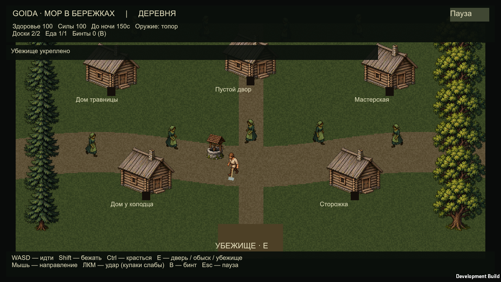
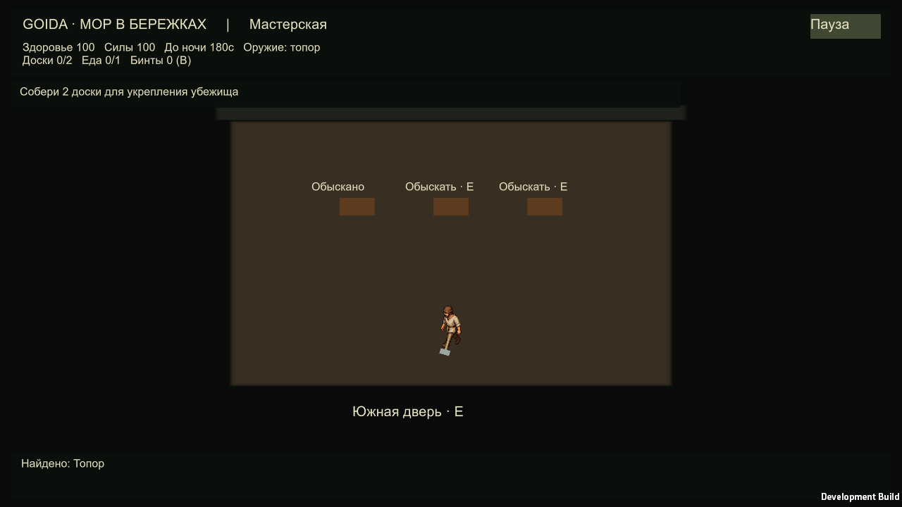

# Мор в Бережках · первый прототип выживания

Отдельная сцена Assets/Scenes/Survival.unity и ветка survival-first-village. Прежняя кампания остаётся в Arena.unity. Прототип не обращается к старым сохранениям; текущая попытка пока не сохраняется.

## Первый эпизод

Герой начинает без оружия. За три минуты нужно найти оружие, еду и две доски, затем укрепить южный двор кнопкой E. В пяти домах есть отдельные интерьеры с тремя шкафами. Некоторые шкафы пусты. Добыча фиксирована для обучения: топор в мастерской, копьё в сторожке. Обыск длится 1,6 секунды и прерывается движением, атакой или паузой.

Заражённые бродят, замечают игрока поблизости, реагируют на бег, двери, обыск и удары. Ctrl сокращает дистанцию обнаружения, Shift позволяет бежать за выносливость. Перед ударом заражённый меняет цвет и делает паузу; можно отойти. Кулаки слабы, топор бьёт сильнее, копьё дальше и быстрее. Бинты восстанавливают здоровье.

WASD / стрелки — движение; мышь — направление; ЛКМ — удар; E — взаимодействие; B — бинт; Esc — пауза. На вступительном экране выберите «Начать выживание». Обыск: подойдите к шкафу внутри дома и нажмите E. Выход из интерьера — у южного края.

## Границы

Это ранний самостоятельный эпизод, не готовая игра масштаба Project Zomboid. Вход в дома пока безопасен: заражённые снаружи приостанавливаются и внутрь не заходят. Нет взлома дверей, голода, инфекции, случайной генерации добычи, полноценной ночи, переноса предметов и сохранения попытки. Завершение наступает при укреплении двора, смерти или истечении времени.

Использованы прежние дома, окружение и четыре кадра движения жителей. Заражённые пока отличаются окраской и поведением; отдельные спрайты атак, ранений и смерти нужны. Оружие отображается простой геометрией. Не использованы ресурсы Project Zomboid.

Сенсорный ввод подготовлен на общей системе проекта, но этот новый эпизод не собирался и не проверялся на Android. Предыдущий экспорт Android относится к GOIDA 2.4.

## Проверка и сборка

BuildSurvival.Windows создаёт отдельную сцену и Windows-player, путь результата задаётся ASKICH_BUILD_DIR. ASKICH_DEVELOPMENT=1 включает диагностическую версию. В ней флаг -survival-check проверяет девять условий: начало без оружия, наличие пустых шкафов, стены, шум, вход, получение топора, однократность добычи, выход и расход припасов при укреплении. Проверки вызывают игровые операции напрямую и не доказывают прохождение мышью или полный баланс боя. Кадры получают из настоящего Windows-player.

Первый диагностический запуск прошёл девять условий. Финальный отчёт и кадры находятся рядом с этим документом после проверки итоговой сборки.

Финальный Windows-player: 0 ошибок, 0 предупреждений, Development=False. Девять диагностических проверок повторены. [Отчёт](survival-checks.txt). Это проверка операций игрового состояния, без имитации полного пользовательского прохождения.

