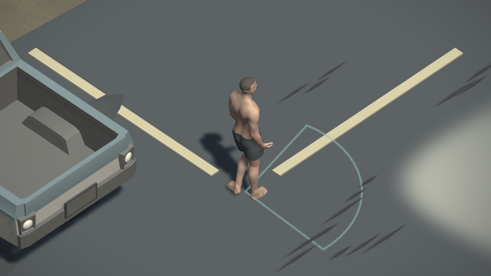

# Zonbee — переступание и кисти

14 ноября 2026.

При неподвижном прицеливании мышью герой теперь поочерёдно переставляет ноги. Опорная стопа удерживается в мировых координатах, другая немного поднимается и переносится в новое положение. Плечи слегка опережают поворот; в движении добавлен небольшой наклон. Оружие следует за рукой при повороте плеч.

Промежуточные формы пальцев теперь следуют дуге сгиба. Полный хват оружия сохранён. Уменьшен поворот ладоней вокруг предплечья, сглажен переход между расслабленной кистью и хватом. Переход к ожиданию стал мягче; небольшие колебания скорости около границы бега больше не переключают клипы туда-сюда.

## Проверка

Windows-сборка: 0 ошибок, 0 предупреждений. 218 успешных проверок в настоящем Windows Player: 21 нового поведения, 32 рук, 16 модели, 30 боя, 34 перелезания и 85 предыдущих исправлений. Для проверки использованы временные сохранения и программно поданные команды мыши/клавиатуры. Полная вылазка не проводилась. Обычный запуск и закрытие готовой версии также проверены отдельно.

При двух неподвижных разворотах измеренный сдвиг опорной стопы между кадрами во время переноса другой ноги составил не более 1,7 мм. Проверены прерывание переступания атакой и движением, пауза, хват топора, переключение ходьбы/бега и загрузка сохранения.

[Ролик поворотов в Player](images/turning.mp4). Это локальная проверка прицеливания с приближённой камерой; кадры получены из работающей игры, длительности взяты из времени их записи. Звуковая дорожка не записывалась.

## Ограничения

Переступание рассчитано на ровную поверхность. Адаптации к лестницам и рельефу, отдельных записанных анимаций разворота и синхронизированного звука переступания пока нет. Кисти и лицо всё ещё используют прежнюю базовую модель и требуют художественной доработки; это не финальное качество персонажа. Модели заражённых этим этапом не изменены. Android не проверялся, GitHub не обновлялся.

Проверка: `-zonbee-turn-check`, каталог результата — `ZONBEE_TURN_CHECK`. Рабочая логика — `DistrictActorVisual.Turning.cs`; создание промежуточных форм кистей — `HeroRefinementAuthor.cs`. Сборка существующих ресурсов — `Askich.Editor.BuildDistrict.Pair`, повторное создание ресурсов и сборка — `Askich.Editor.HeroRefinementAuthor.BakeAndBuild`.
