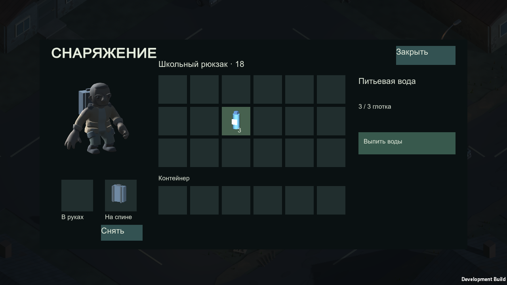
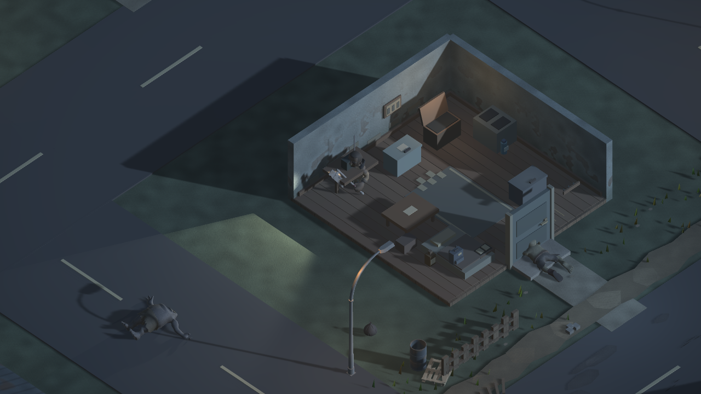
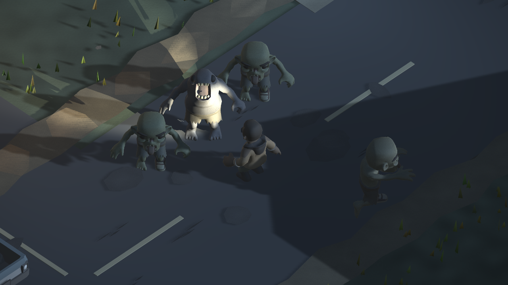
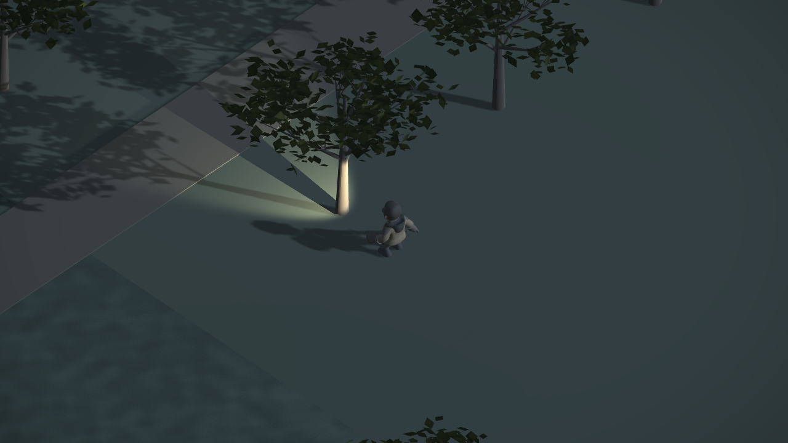

# Бережки — внешний вид, радио и чистый инвентарь

Локальный этап 5 ноября 2026 года. Существующий проект и механики выживания сохранены. GitHub не обновлялся.

## Внешний вид

Дома получили процедурные материалы вместо однотонных поверхностей: сырость и местами осыпавшаяся штукатурка, доски пола, швы и следы ржавчины на кровле. Материалы также применены к грунту, дорожкам и деревянным ограждениям. Это поверхностный износ, а не разрушаемость. Освещение и читаемость сцены сохранены; дополнительного затемнения экрана нет.

Крупные шары крон заменены ветвящимися стволами и небольшими листьями с движением от ветра и силуэтом в тенях. На дерево приходится два меша; на Android количество листьев уменьшено. Созданные меши и новые материалы освобождаются при завершении сцены. Замеры частоты кадров и нагрева на телефоне ещё не проводились.

Для существующих моделей заражённых добавлены различающиеся оттенки, пятна и загрязнение. Уменьшен размер головы, у крупного заражённого скрыта отдельная модель длинного языка. Скелеты, распознавание героя, здоровье, скорость, подготовка ударов и ранение не упрощались. Это доработка стилизованных моделей Quaternius, а не новые реалистичные персонажи. Для серьёзного перехода к реализму всё ещё нужны согласованные новые модели, материалы лица и одежды, более подробные анимации.

## Радио

Временная речь Microsoft Irina удалена из Resources: старый radio.wav и три фрагмента message0–2. Новых голосов не скачивали и синтетическую запись не выдавали за актёрскую. Приёмник оставляет тихие пространственные помехи и три текстовых фрагмента по 6, 6 и 8 секунд с паузами. Назначение убежища открывается после последнего фрагмента. Пауза останавливает передачу, раннее выключение сохраняет неизвестную цель, включённый приёмник по-прежнему привлекает заражённых. Между фрагментами нет постоянной надписи о помехах.

## Инвентарь и HUD

Инвентарь закрывает игровой HUD: за ним не просвечивают задачи, управление, индикаторы и подписи домов. Убраны постоянные инструкции, предупреждение про открытые двери, приглашение подойти к контейнеру, кнопка снятия отсутствующего оружия и рюкзака, прочерки в заблокированных ячейках. Полная бутылка не предлагает наполнение.

Оставлены название и краткое состояние выбранного предмета, подходящие действия, подписи экипировки и доступный рядом контейнер. Причины недоступного лечения остаются. Ошибка снятия заполненного рюкзака показывается на четыре секунды. В основном HUD длинная памятка управления больше не занимает нижнюю полосу постоянно; сообщения о событиях появляются временно. Мир при открытом инвентаре продолжает работать.

## Проверка

Unity 6000.3.4f1. Windows x64 Release и Development: 0 ошибок, 0 предупреждений. Проверены также сообщения компилятора шейдеров — успешный отчёт сборки сам по себе не гарантирует исправный шейдер. Обычный Release отдельно запущен до начальной сцены.

В Development Player прошли 230 проверок существующих механик, сохранений, радио без речи и новых материалов. Дополнительный короткий запуск финальной сборки проверяет пять условий внешнего вида. Четыре виртуальных сенсорных жеста прошли в видимом оконном Player: надеть рюкзак, переместить бутылку, положить в контейнер и забрать без дублирования. Это проверка через Unity Enhanced Touch на Windows, не физический Android.

Автоматический маршрут по обычным правилам завершён за 160,7 секунды. Герой нашёл оружие и припасы, получил и лечил ранения, дослушал новую передачу, обустроил убежище, отбился у резервуара и наполнил бутылку. В первом прогоне удар прервал набор воды; для завершённого прогона сценарий сначала устраняет угрозу обычными атаками. Враги не отключались, ресурсы не выдавались, сложность не снижалась. На финише осталось 14,2 здоровья и было новое кровотечение: баланс возвращения всё ещё требует ручной оценки. Это известный автоматический путь, не ручной сеанс на 15 минут.

Android ARM64 APK собирается отдельным BuildDistrictAndroid из сцены District, а не прежней Arena. OpenGLES3, минимальный API 26, целевой 35. Сборка: 0 ошибок, 0 предупреждений; проверены подпись, выравнивание и манифест. APK подписан локальным тестовым ключом. Подключённых ADB-устройств нет; установка, управление, звук, вырезы экрана и производительность на телефоне не проверены. При сборке Android использована отдельная копия проекта с путём без кириллицы и существующие локальные SDK/NDK/JDK и Gradle-кэш. Она не заменяет исходный проект.

Формат сохранений остаётся v7 с прежней загрузкой версий 1–6. Экипировка, потребности и состояние мира продолжают сохраняться.

[Проверки](polish-checks.txt) · [Короткая визуальная проверка](polish-visual-checks.txt) · [Сенсорный перенос](polish-touch-checks.txt) · [Маршрут](polish-route.txt) · [Windows](polish-build-report.txt) · [Android](polish-android-build-report.txt) · [Подпись APK](polish-android-signature.txt)

## Реальные кадры

Кадр инвентаря — из оконного Development Player после виртуальных сенсорных жестов с тестовыми предметами. Интерьер — из проверки радио. Заражённые и деревья сняты игровой камерой в подготовленной тестовой сцене; позиции и состояние персонажей заданы для осмотра, камера приближена. Это не кадры ручного прохождения и не рекламные рендеры.

Все новые материалы и геометрия созданы кодом проекта. Источники прежних моделей — в [THIRD_PARTY.md](../THIRD_PARTY.md). Более реалистичные модели, полноценная актёрская озвучка и проверка APK на телефоне остаются следующими этапами.
