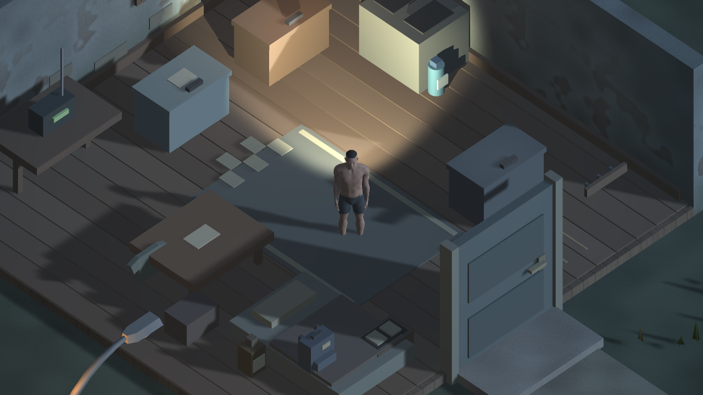
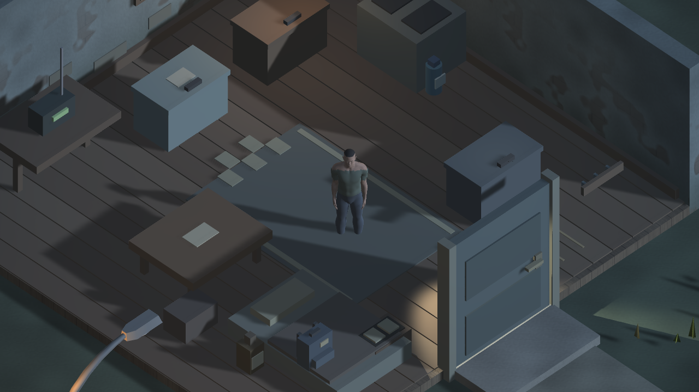
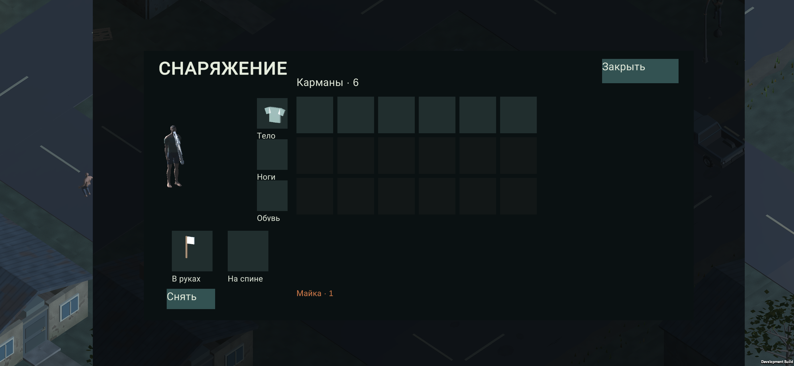

# Бережки — персонаж, находимая одежда и телефон

Локальный этап 5 ноября 2026 года. Публикация на GitHub отложена.

## Реализовано

Герой получил другую модель с естественными пропорциями. Новая попытка начинается босиком, в одних шортах. Майку, брюки и кроссовки можно найти в разных домах, подобрать в свободную ячейку и перетащить на соответствующий слот тела. Одежда видна на движущемся персонаже и в портрете. Снятие возвращает предмет в карманы; заполненные карманы не позволяют потерять надетую вещь. Повторно забрать уже найденную одежду нельзя. Это пока внешний вид: защиты от укусов, температуры и прочности одежды нет.

Основа — CC0-модель Blender Human Base Meshes. Скелет, привязка, волосы, части одежды и варианты телосложения подготовлены для проекта. Источник и лицензия указаны в [THIRD_PARTY.md](../THIRD_PARTY.md) и `Assets/CharacterSources/source.json`. Лицензия проверена в метаданных исходной коллекции.

Три типа заражённых получили ту же основу с разным телосложением, одеждой и обработкой кожи. Существующие атаки перенесены на новый скелет. Ползун движется и атакует низко над землёй, при ранении и смерти не встаёт в человеческую стойку. Для героя отдельно поставлены ожидание, обыск, еда и питьё. Оружие следует за рукой; размер топора уменьшен, обоим видам оружия назначен материал исходного атласа.

На телефоне появился видимый джойстик. Внешняя зона включает бег, внутренняя — ходьбу. Убраны клавиатурные подсказки из основной мобильной цели и строки ранения. Часть прежних подсказок взаимодействия ещё содержит E/I.

## Сохранения

Новый формат — v8, файл по-прежнему `district-v1.json`. Читаются версии 1–8. Старые персонажи остаются одетыми. Для начала в шортах нужна **новая попытка**, заменяющая текущий мир. Состояние найденной и надетой одежды сохраняется. Повреждённые сочетания флагов отклоняются до изменения мира; резервная копия продолжает работать.

## Исправления после проверки на устройстве

Android-сборка удаляла нативные типы Collider, необходимые для процедурной геометрии. В сцену добавлен неактивный объект со ссылками на BoxCollider, SphereCollider и CapsuleCollider. Обе команды сборки создают его перед сохранением сцены. Ошибки устранены, сообщения не скрывались. Причина описана в [документации Unity CreatePrimitive](https://docs.unity3d.com/ja/6000.0/ScriptReference/GameObject.CreatePrimitive.html).

Ограничение шага времени 0,05 с замедляло обыск и лечение при низкой частоте кадров. Теперь таймеры и вычисление скорости используют один шаг до 0,25 с. Перемещение делится на отрезки до 0,12 м, чтобы увеличенный шаг не позволял пройти сквозь закрытую дверь. Дальние заражённые больше не требуют постоянного обновления всех скелетов и свойств материалов.

## Проверка

Unity 6000.3.4f1. Итоговые Windows x64 и Android ARM64: **0 ошибок и 0 предупреждений** сборки. APK: min API 26, target API 35, OpenGLES3, versionCode 243. Подпись v2 и выравнивание APK на 16 КБ проверены. Локальный отладочный ключ предназначен для тестовой установки; публикация в Google Play не подготовлена.

В видимом Windows Development Player прошли **230 общих проверок**, **20 проверок одежды/модели** и **7 сенсорных сценариев**. Последние проверяют рюкзак, перенос бутылки, хранение и извлечение без дублирования, затем перетаскивание майки, брюк и обуви на тело. Графические проверки следует запускать в видимом окне: скрытое окно может не исполнять GUI Repaint. Скрытый контрольный запуск не прошёл клик крафта; в итоговом видимом запуске этот сценарий прошёл.

На **физическом телефоне 25053PC47G** проверены установка диагностического APK, новая попытка в изолированном тестовом сохранении, джойстик, двери, вход в дом, обыск с получением топора, радио и появление цели убежища, инвентарь, подбор майки, перенос в слот, снятие и повторное надевание. Управление подавалось Android-событиями касания через ADB, без телепортации и выдачи предметов. Поиск, здоровье и враги работали по обычным правилам. Это проверка первого дома с паузами на осмотр кадров, а не полное ручное прохождение до убежища.

Итоговый Release APK 243 установлен обновлением и запущен до меню. Журнал своего процесса не содержит ошибок Unity или исключений. Обычное пользовательское сохранение в диагностической вылазке не использовалось. В Release новая попытка поверх пользовательского мира не запускалась.

Автоматическая вылазка по обычным правилам нашла оружие, припасы, рюкзак, воду, изготовила стерильный бинт и прошла радио. У медпункта герой погиб; успешным прохождением маршрут не считается. Баланс подхода, тактика отрыва от преследования и полное 15-минутное прохождение остаются незавершённой проверкой. Заражённые для положительного отчёта не ослаблялись.

Устойчивый FPS не измерен: SurfaceFlinger не отдал пригодные выборки времени кадров. Субъективный микс звука по скриншотам и журналам не проверяется. Один телефон не означает проверку всех Android-устройств.

[Общие проверки](wardrobe-checks.txt) · [Одежда](wardrobe-equipment-checks.txt) · [Сенсорные жесты](wardrobe-touch-checks.txt) · [Windows](wardrobe-build-report.txt) · [Android](wardrobe-android-build-report.txt) · [Подпись](wardrobe-android-signature.txt) · [Неуспешная вылазка](wardrobe-route.txt) · [Телефон](wardrobe-device-checks.txt)

## Кадры из игры

Два кадра ниже — настоящая Windows-игра с подготовленной позицией, отключёнными для осмотра врагами и приближённой камерой. Это постановочные проверочные кадры, показывающие фактическую геометрию и материалы билда.

Следующий кадр — настоящий телефон после нахождения майки и её перетаскивания касанием. Диагностический APK на этом кадре ещё содержит слишком крупный белый топор. В итоговом APK масштаб и материал исправлены; новый APK проверен до меню.

## Повторная подготовка моделей

Готовые FBX, Unity-префабы и клипы включены: Blender для открытия проекта и обычной сборки не нужен. Для повторного создания FBX скачать зафиксированный архив из `source.json`, проверить SHA256 и открыть `human_base_meshes_bundle.blend` в Blender 4.5.9. Запустить Blender в фоновом режиме с этим файлом и `--python` с абсолютным путём к `tools/author_adult.py`. Скрипт пишет в `Assets/CharacterSources` относительно собственного расположения. Затем выполнить в Unity `Askich.Editor.AdultCharacterAuthor.Bake`. Используются включённые анимации Quaternius. Для пары Windows-сборок — `BakeAndBuild`, переменные `ASKICH_BUILD_DIR` и `GOIDA_SURVIVAL_RELEASE`. Побитовое совпадение экспорта между версиями Blender не гарантируется.

Следующий приоритет: проверить живой бой и уход от преследования у медпункта, затем доработать лица, материалы кожи и одежды. Новая модель — промежуточная художественная основа.
