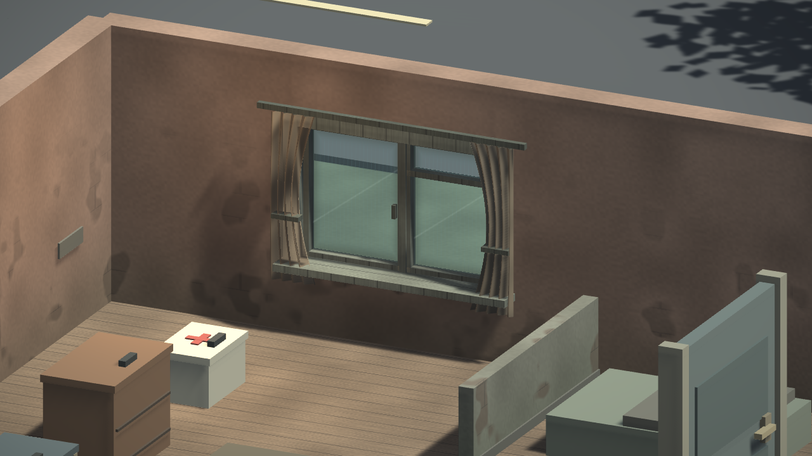
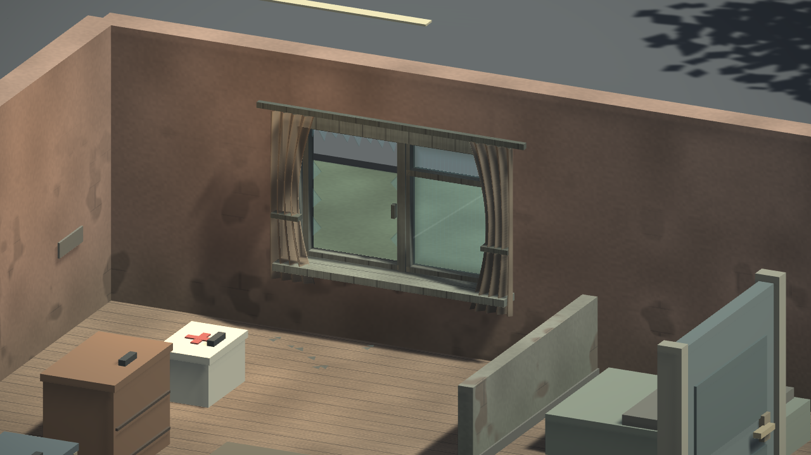

# Zonbee — исправление вида окон

11 ноября 2026. Первый небольшой этап художественной переработки после замечаний о графике. Это исправление конкретного элемента, а не заявление о готовности общего визуального качества игры.

## Что изменено

В двух переработанных домах широкая непрозрачная створка заменена двухсекционным деревянным окном. У него есть наличники, выступающий подоконник, узкая открывающаяся створка, защёлка и тонкое полупрозрачное стекло с бликом, грязью у краёв и потёками. Размер оконного проёма по высоте уменьшен; проход для перелезания оставлен в правой секции.

Удар теперь разбивает только стекло открывающейся секции. Деревянная рама не исчезает. По краям остаются осколки, мелкие фрагменты разлетаются и оседают на полу и снаружи. Соседнее стекло остаётся целым. Загрузка восстанавливает повреждение и осевшие осколки без повторного звука/разлёта. Это декоративные фрагменты, порезы и уборка стекла ещё не реализованы.

Добавлены объёмные присборенные шторы, карниз и перевязи. Ткань имеет матовый материал, складки и небольшое движение у открытого/разбитого окна. Это авторская процедурная геометрия, без симуляции ткани и без сторонних ассетов. Стекло использует лёгкий прозрачный шейдер с условным бликом, без настоящих отражений комнаты и преломления.

Исправлен выбор материала стен: названия вроде «East window wall north» раньше обходили материал штукатурки, оставляя поверхность однотонной. Теперь на них применяется уже существующая изношенная штукатурка.

## Проверка и ограничения

Windows-сборка: 0 ошибок, 0 предупреждений, отдельный обычный запуск и закрытие с кодом 0. Пройдено 301 проверка: 9 нового оформления, 34 перелезания и 258 предыдущих механик. Проверка попадания, состояния стекла, сохранения и перелезания выполнена в настоящем Windows Player на временных профилях; полная вылазка не проводилась.

Ниже настоящие кадры Windows Player. Для осмотра подготовлены состояния окна, скрыт герой и приближена камера. Это постановочные диагностические кадры, не изображение от генератора.

[Открытая створка](images/window-open.png) · [Перелезание через новую раму](images/window-climb.png)

Модели героя, заражённых и мебели этим этапом не переделаны; прежние движения сохранены. Остальные декоративные окна пока старые. Качество всей игры ещё не соответствует желаемому реалистичному хоррору. Следующий приоритет — пропорции и материалы одного героя, затем его ходьба/бег и переходы движений; новые игровые механики и расширение АЗС отложены. Android не собирался, GitHub не обновлялся.

Для сборки используется прежний `Askich.Editor.BuildDistrict.Pair`. Новая диагностика: `-zonbee-window-art-check`, каталог отчёта в `ZONBEE_WINDOW_ART_CHECK`. Исходники геометрии — `DistrictWindowArt.cs`, материалы — `WindowGlass.shader` и `WindowFabric.shader`.
