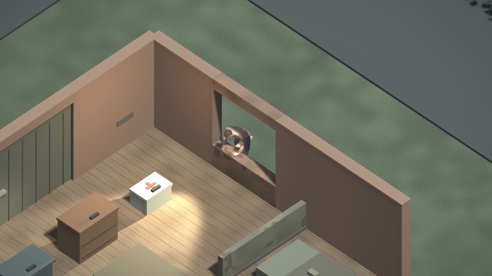

# Zonbee — перелезание через окна

Локальный этап для Windows, 9 ноября 2026.

Вид окна впоследствии исправлен: [стекло, шторы и сохраняющаяся рама](WINDOW_ART.md). Кадры ниже относятся к старому оформлению.

## Как пользоваться

В семейном доме №5 и доме столяра №9 можно перелезать через действующее окно восточной стены. **E** открывает или закрывает створку; **C** начинает перелезание через полностью открытое либо разбитое окно. Подходите к свободному краю проёма: детская кроватка в семейном доме остаётся препятствием. Подсказка появляется только рядом с окном.

Персонаж подходит и плавно поворачивается к окну, опирается руками, последовательно переносит ноги и опускается на землю. Для существующего скелета создана отдельная анимация `Hero_WindowClimb`; её движение согласовано с перемещением игрока. Перелезание занимает 2,8 секунды плюс короткая подготовка и расходует 12 сил. Восстановление сил на это время приостанавливается, оружие убирается из рук. После приземления оно снова доступно.

Препятствие или живой заражённый на месте приземления не позволяют начать действие. Подоконник всё время остаётся преградой для обычной ходьбы и навигации заражённых. На время движения место выхода резервируется от наложения другого персонажа; это не запрещает заражённому ударить героя в пределах обычной досягаемости.

До выхода на подоконник E или ранение прерывают подготовку. После начала переноса ног движение заканчивается на противоположной стороне: бой, лечение, бросок камня и открытие инвентаря недоступны до приземления. Ранения и кровотечение продолжают действовать; после получения урона герой на короткое время теряет устойчивость при приземлении. Потраченные силы при отмене не возвращаются. Esc приостанавливает и движение, и анимацию.

## Сохранения

Формат остаётся v9. Промежуточное положение внутри подоконника не записывается: в первой половине движения сохраняется безопасная точка перед окном, во второй — за ним. Загрузка сбрасывает незавершённое действие; прочие изменения мира и состояния окон сохраняются. При смерти во время перелезания тело размещается на ближайшей стороне, без зависания в стене.

## Границы этапа

Перелезание реализовано только в этих двух окнах и пока только для игрока. Заражённые продолжают использовать двери и ломать существующие баррикады. Новых моделей и записей голоса не добавлено. Анимация создана средствами проекта; это не захват движений. Отдельной анимации убирания оружия и порезов об осколки пока нет. Android и сенсорная кнопка перелезания отложены вместе с мобильной версией. GitHub не обновлялся.

## Проверка

Проверки запускаются в настоящем Windows Player, используют отдельные временные сохранения и искусственный ввод клавиатуры. Проверяются обе стороны семейного окна, разбитое окно столяра, занятый выход, кроватка, расход сил, блокировка конфликтующих действий, пауза, сохранение в процессе и настоящее разрешение удара заражённого. Дополнительно проверяется высота обеих стоп и носков во всех 113 кадрах анимации.

Ниже — настоящие кадры Windows Player с подготовленной позицией и остановленной фазой анимации. Камера приближена для осмотра, интерфейс и противники скрыты; это постановочные диагностические кадры, не полная вылазка.

[Перенос второй ноги](images/climb-crossing.png)

## Повторение сборки

Обычная сборка находится в `../Zonbee-Window-Climb`, архив — `../Zonbee-Windows.zip`. Для повторного создания анимации и пары Windows-сборок задайте разные каталоги в `ASKICH_BUILD_DIR` и `GOIDA_SURVIVAL_RELEASE`, затем вызовите `Askich.Editor.WindowClimbAuthor.BakeAndBuild`. Обычный `Askich.Editor.BuildDistrict.Pair` использует уже сохранённый клип. Диагностика: `-zonbee-climb-check` и переменная `ZONBEE_CLIMB_CHECK` с папкой для отчёта.

Итог проверки: **292 проверки пройдено** — 34 перелезания, 38 окон и баррикад, 35 планировок, 35 мест исследования, 17 обыска, 18 выбора хранилища, 30 боя и 85 сохранений/столкновений/интерфейса прежнего этапа. Обычная Windows-сборка: 0 ошибок, 0 предупреждений; отдельный запуск и нормальное закрытие без исключений. Полная вылазка не проводилась.
