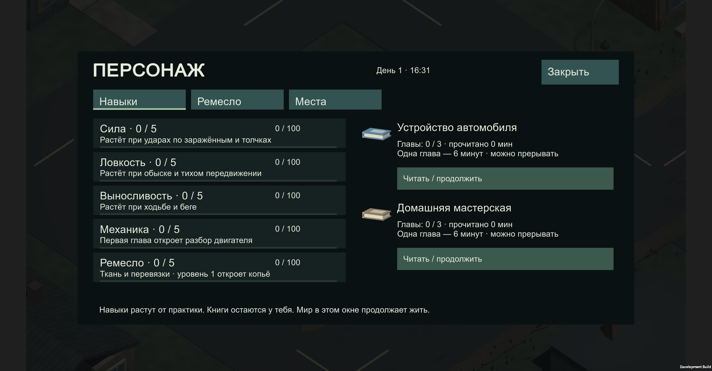
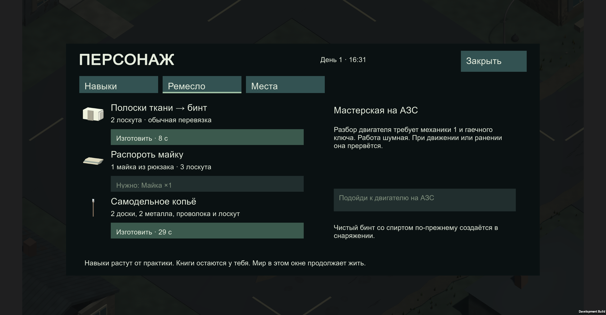
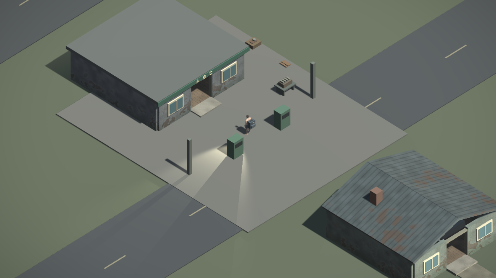
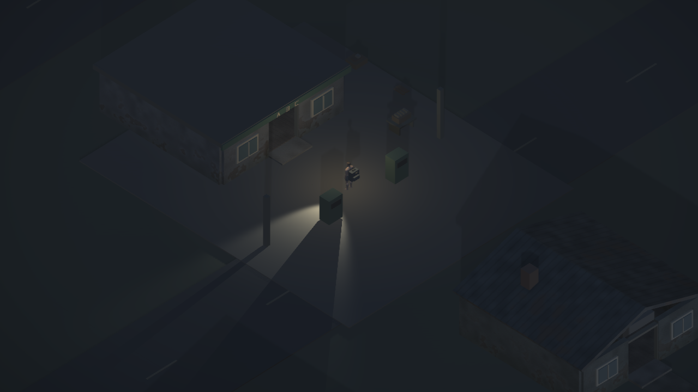

# Живой квартал: время, навыки и АЗС

Локальный этап 8 ноября 2026. Windows, Unity 6000.3.4f1. Работа продолжается в существующем проекте и прежнем мире.

## Что работает

В мире появились часы. Новая попытка начинается в 16:30 первого дня. Полные игровые сутки занимают около 30 минут активной игры. Солнце, общий свет, туман и уличные лампы меняются постепенно. Ночью на АЗС включается аварийное освещение. Пауза останавливает время, инвентарь и окно персонажа его не останавливают.

АЗС «Восточная» занимает последнее здание на восточной дороге, у поворота к двору дорожников. Здесь магазин, насосы, инструмент, материалы и двигатель на верстаке. Топливная система и вождение пока не реализованы. Номер существующего здания и индексы его контейнеров сохранены, поэтому старое обысканное содержимое не появляется заново. Новые отдельные находки на столах и во дворе имеют своё сохраняемое состояние.

Для обычных домов добавлены три формы крыш, палитры фасадов, ставни, заколоченные окна, крыльца и шесть вариантов обстановки: садовод, железнодорожник, столяр, оставленный ужин, семья и учительница. У зданий разные названия и сочетания деталей. Внешний контур помещений пока общий — 8 × 8 метров; это не 22 полностью уникальные архитектурные модели. Дом связиста и медпункт сохраняют прежние интерьеры и расположение находок.

В инвентаре появились собственные объёмные иконки для новых предметов:

- Сухари: +22 сытости, −4 воды.
- Фасоль в банке: +32 сытости, +6 воды.
- Шоколад: +18 сытости, +16 сил.
- Лоскуты, доски, металлолом, проволока и гаечный ключ.
- Книги «Устройство автомобиля» и «Домашняя мастерская».

Это игровые значения потребностей. Старая еда и прежняя медицинская система сохранены. Обустройство убежища и восстановление в нём принимают также новые виды еды.

## Персонаж и обучение

**J** открывает окно персонажа с вкладками «Навыки», «Ремесло» и «Места». **I** открывает прежнее снаряжение с новыми предметами. В мире показываются день, часы и название текущего места; обязательный маршрут к радио больше не занимает верхнюю строку.

Навыки имеют пять уровней с порогами опыта 100, 300, 650, 1100 и 1800. Текущий этап содержит первые источники развития, а не полноценную долгую кампанию для достижения всех предельных уровней.

- Сила растёт при попаданиях и толчках живых заражённых. За уровень: +3% урона оружием, +6% кулаком, +4% силы толчка.
- Ловкость растёт при первом обыске и тихом перемещении. За уровень: −4% времени обыска, +4% скорости тихого шага.
- Выносливость растёт от пройденного расстояния, быстрее при беге. За уровень: −4% расхода сил при беге и +5% восстановления. Упор в стену опыта не даёт.
- Механика открывает разбор двигателя. На АЗС нужен гаечный ключ, механика 1 и место в инвентаре. Разбор шумный, занимает около 41 секунды на первом уровне; выдаёт 4 металлолома и проволоку. Ключ остаётся у игрока. Двигатель разбирается один раз, результат сохраняется.
- Ремесло растёт от изготовления, книг и учебной радиопередачи. Первый уровень открывает копьё; скорость изготовления растёт на 7% за уровень.

Книга по механике лежит на столе АЗС. Книга по ремеслу — в семейном доме №5, западнее дома связиста. В книге три главы по шесть минут активного чтения. Глава даёт 100 опыта соответствующего навыка. Движение, ранение и отмена прерывают чтение; прочитанное сохраняется. Книга остаётся в инвентаре, повторное чтение завершённых глав опыта не приносит. Для чтения нужен свет; кровотечение и сильное заражение мешают заниматься.

Возле приёмника связиста можно выбрать учебную частоту во вкладке «Места». 90 секунд рядом с работающим приёмником дают 35 опыта ремесла, один раз за игровой день. На расстоянии больше шести метров или за стеной обучение не продвигается. Передача использует помехи и короткие субтитры; озвучки в ней нет. Приёмник продолжает привлекать заражённых. Телевизионные программы пока не добавлены.

## Изготовление

- 2 лоскута → обычный бинт, 8 секунд, ремесло 0.
- Ненадетая майка → 3 лоскута, 10 секунд, ремесло 0.
- 2 доски + 2 металлолома + проволока + лоскут → копьё, 30 секунд до бонусов скорости, ремесло 1.

Материалы тратятся только после успешного завершения. Полный инвентарь не уничтожает материалы; частично помещающаяся находка остаётся целиком в мире. Стерилизация бинта спиртом по-прежнему доступна в снаряжении.

## Противники

Ночью заражённые хуже видят. Направленный на них фонарь выдаёт игрока. У вариантов различается слух: ползущий лучше слышит, тяжёлый хуже. Увидевший героя заражённый может хрипом привлечь соседних к своему месту. Они получают положение звука, а не координаты скрывшегося игрока; стены продолжают прерывать зрение. Новые модели заражённых на этом этапе не добавлялись.

## Сохранения и ограничения

Формат сохранения обновлён до v9. Версии 1–8 читаются: старые предметы, ранения, одежда, открытые двери, убитые заражённые и обысканные контейнеры сохраняются. Новые часы и навыки начинаются с исходного состояния. Повреждённые опыт, время и прогресс книг отвергаются до изменения мира; резервная копия продолжает работать.

Для чтения используется существующее движение рук с видимой книгой. Отдельной анимации перелистывания и специальной анимации разборки двигателя ещё нет. Новые предметы и детали мест созданы геометрией проекта; фотосканированные материалы не добавлялись. Полностью разные планировки, больше занятий механика, машины, телевидение и дальнейшее художественное оформление остаются следующими этапами.

Проверки используют локальные подготовленные сценарии и временные сохранения. Полная вылазка не запускалась. Скриншоты сняты из настоящего Windows Player, но состояние мира, вещи и время для них подготовлены проверкой. Это не запись обычного прохождения. Android не собирался и на телефоне не проверялся. Публикация на GitHub отложена.

## Повторить локальную проверку

В Unity 6000.3.4f1 метод `Askich.Editor.BuildDistrict.Pair` собирает диагностическую и обычную версии; папки задаются через `ASKICH_BUILD_DIR` и `GOIDA_SURVIVAL_RELEASE`.

Новый сценарий запускается в диагностической версии с `-district-world-life-check`. Папка отчётов задаётся переменной `BEREZKI_WORLD_LIFE_CHECK`. Сценарий создаёт отдельное временное сохранение, включает подготовленные состояния и закрывает Player после завершения. Старые сценарии боя, одежды, обыска и выбора хранилища сохранены.

## Проверено

**457 проверок пройдено:** 142 новых сценария, 230 общих, 30 боя на ПК, 20 одежды, 17 обыска и 18 выбора хранилища. Обычная Windows-сборка — **0 ошибок и 0 предупреждений**. Отдельно проверен запуск обычной версии. Пользовательское сохранение не использовалось.

[Новые предметы](images/world-life-inventory.png) · [Чтение с видимой книгой](images/world-life-reading.png) · [Дом садовода](images/world-life-home-gardener.png) · [Дом учительницы](images/world-life-home-teacher.png)
