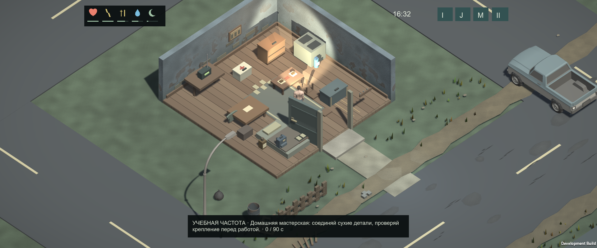

# Zonbee — обзор, движение и препятствия

> Руки в ходьбе и беге после этого этапа заменены: [исправление «крыльев», новые кадры и видео](RELAXED_ARMS.md).

8 ноября 2026. Unity 6000.3.4f1. Локальный этап для Windows, без публикации текущей версии на GitHub.

## Что изменилось

* Игровое окно, меню и исполняемый файл называются **Zonbee**. Внутренние имена Askich и каталог проекта сохранены, чтобы не ломать ссылки и сборочные инструменты.
* На ПК камера заполняет всё окно. Убрана привязка изображения мира к 16:9, оставлявшая по краям полосы с предыдущим кадром. Логические координаты интерфейса сохраняются. F11 переключает окно и полноэкранный режим без рамки. Размер самого района этим этапом не увеличен.
* Вместо широкой верхней панели — компактные показатели. Числа и названия появляются при наведении. I — инвентарь, J — персонаж и ремесло, M — карта; карта по умолчанию закрыта. Постоянная строка управления убрана, F1 открывает справку. Название дома появляется кратко при входе, субтитры радио находятся внизу.
* Крупная мебель, ящики, автомобили, стволы и уличные предметы получили препятствия для движения с учётом радиуса тела. Низкая мебель не мешает видеть и обыскивать вещи. Высокие стены и двери по-прежнему перекрывают видимость. Перепрыгивания и перелезания пока нет.
* Заражённые прокладывают путь по сетке 0,5 м с поиском A*, чтобы учитывать проходы между мебелью. Проверяется доступ ко всем 66 контейнерам. Мелкие предметы и тонкий декор намеренно не перекрывают движение.
* Обычная ходьба — 1,8 м/с, бег — 4,6 м/с. Пересмотрены длительность цикла, противоположная работа рук и ног, положение локтей, перенос веса, подъём таза над опорной ногой и перекат стопы. Движение клипа согласовано со скоростью тела. Лезвие топора развёрнуто наружу от бедра. Это доработка авторской анимации, без новых моделей и записей захвата движений.

## Сохранения

Формат остаётся v9, загрузчик поддерживает версии 1–9. При выборе загрузки в новом профиле ищется старое сохранение `Berezki Last Frequency/district-v1.json` и его резервная копия. Оно копируется через проверенный загрузчик в профиль Zonbee; исходник не удаляется и не перезаписывается. Если у Zonbee уже есть собственный файл или резервная копия, старый мир не подставляется вместо повреждённого нового.

Идентификаторы и количество заражённых сохранены. Живой персонаж, оказавшийся внутри добавленного препятствия, перемещается в свободную точку той же комнаты. Состояние погибших сохраняется.

## Проверка

**553 проверки пройдены. Обычная Windows-сборка: 0 ошибок, 0 предупреждений.** Отдельно проверен обычный запуск окна Zonbee. Результаты текущего запуска приложены отдельными файлами `zonbee-*.txt`. Проверки выполняются в настоящем диагностическом Windows Player с отдельными временными сохранениями. Импорт дополнительно проверяется на отдельной копии существующего сохранения v9. Исходный пользовательский файл не используется для записи.

Кадр подготовлен диагностическим сценарием: герой перемещён в дом связиста, заражённые отключены, включена учебная частота. Это реальная графика Windows Player, а не изображение будущего интерфейса. Проверены окна 1600×1000 и 1920×800; отдельная заливка подтверждает обновление обоих краёв кадра. Полная вылазка не требуется и не выполнялась.

[Ходьба и бег в реальном движении](images/zonbee-locomotion.mp4). Это последовательность снятых в Player кадров с фиксированной скоростью воспроизведения 12 кадров/с, без звука. Скорость ролика не является замером производительности или точного игрового времени.

## Ограничения

Модели и анимации ещё не имеют финального художественного качества. Нет постановки стоп по неровному рельефу и отдельных поз для каждого направления движения. Геометрия препятствий приближена прямоугольниками, а не точной поверхностью мешей. Стены в интерьере скрываются для обзора, но сохраняют препятствия. Производительность массовой погони отдельно не измерена. Android не собирался и на устройстве не проверялся.

## Старые сборки GOIDA

По уточнению автора удаляются только готовые сборки. Локально в корзину перемещены каталоги GOIDA-Windows, GOIDA-Windows-2.3, GOIDA-Windows-2.4, GOIDA-Android-2.4, GOIDA-Survival-Prototype, архив GOIDA-Windows.zip, такие же архивы в release-2.3 и release-2.4, а также папка и архив GOIDA-Windows из «Загрузок». Исходные архивы GOIDA-Source.zip, рабочий проект и история git сохранены.

На GitHub удаление не выполнено: подключение не предоставляет операции удаления файлов релизов, а управление текущим Windows-браузером заблокировано средой. Остаются бинарные архивы в релизах [survival-prototype-0.1](https://github.com/Asker323/askich/releases/tag/survival-prototype-0.1), [v2.3.0](https://github.com/Asker323/askich/releases/tag/v2.3.0) и [v2.2.0](https://github.com/Asker323/askich/releases/tag/v2.2.0). Исходные ZIP в этих релизах должны оставаться. Репозиторий удалять не нужно.
